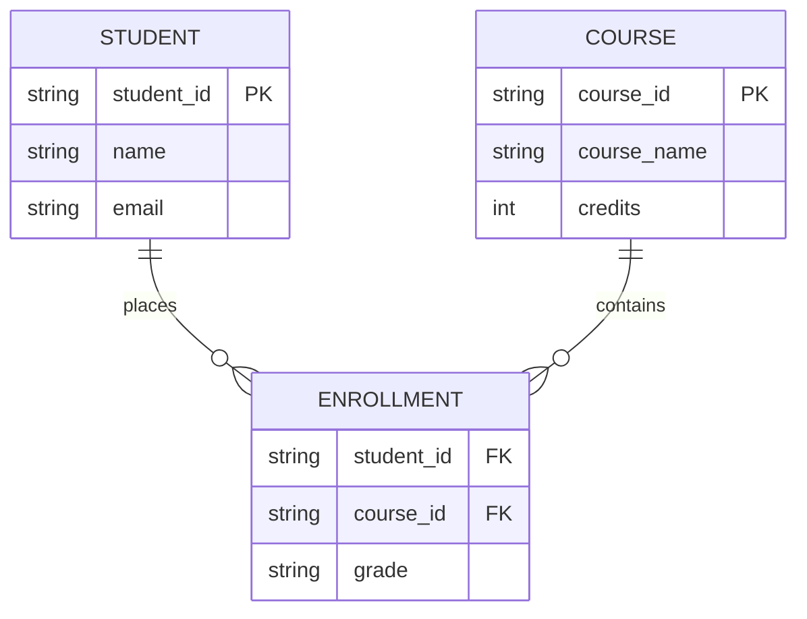

# {{title}}

arrow_back กลับไปที่ [[Week<N>-MOC|MOC สัปดาห์ <N>]] | ก่อนหน้า: [[<ชื่อโน้ตก่อนหน้า>]]

## key Keyword

- **<คำศัพท์/แนวคิดหลัก (English Term)>** — <คำอธิบายสั้น ๆ บรรทัดเดียว>
- **<คำศัพท์/แนวคิดหลัก (English Term)>** — <คำอธิบายสั้น ๆ บรรทัดเดียว>

## menu_book Theory (เข้าใจง่าย)

<อธิบายเนื้อหาหลักด้วยภาษาที่เข้าใจง่าย ใช้ตาราง/สูตร ($...$)/ตัวอย่างคำสั่ง SQL/Relational Algebra ประกอบได้ตามความเหมาะสม แบ่งเป็นหัวข้อย่อยด้วย ### ได้ถ้าเนื้อหายาว>

> [!tip] เคล็ดลับ
> <เทคนิคช่วยจำ ข้อควรระวัง หรือวิธีเช็คคำตอบ>

## schema Diagram

<!--
เกณฑ์มาตรฐาน Diagram สำหรับระบบฐานข้อมูล (เลือกประเภทให้ตรงกับบริบทของเนื้อหา):
1. ER Diagram / Relational Schema -> ใช้ erDiagram หรือ classDiagram
2. Flowchart / Activity Diagram (การทำงานของ Query, Transaction, ETL Pipeline) -> ใช้ flowchart TD/LR พร้อมโหนด Start ((●)), Action ([...]), Decision {...}, End (((●)))
3. Sequence Diagram (การติดต่อระหว่าง Client, Application Server, DBMS, Buffer Pool) -> ใช้ sequenceDiagram
4. State Machine Diagram (สถานะของ Transaction เช่น Active, Partially Committed, Committed, Failed, Aborted) -> ใช้ stateDiagram-v2

*หากเนื้อหาเป็นคำอธิบาย/นิยาม/ตารางเปรียบเทียบล้วน ๆ ไม่มีแผนผังความสัมพันธ์ ขั้นตอน หรือสถานะ ให้ลบ section นี้ทิ้งทั้งหมด*
-->

**ตัวอย่าง:** <ตัวอย่างประกอบสั้น ๆ พร้อมอ้างอิงเลขหน้าสไลด์ถ้ามี>

---
arrow_forward ต่อไป: [[<ชื่อโน้ตถัดไป>]]
