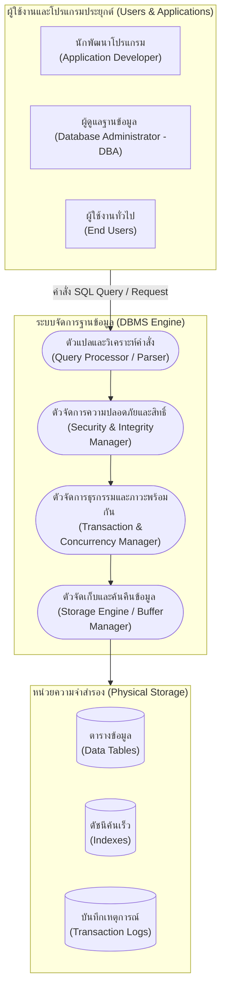

# บทนำสู่ระบบฐานข้อมูลและการจัดการข้อมูล (Course Introduction & Database Concepts)

arrow_back กลับไปที่ [[Week01-MOC|MOC สัปดาห์ 1]]

## key Keyword

- **Data (ข้อมูลดิบ)** — ข้อเท็จจริงหรือตัวเลขดิบที่ยังไม่ผ่านการประมวลผล ขาดบริบทความหมายในตัวเอง
- **Information (สารสนเทศ)** — ข้อมูลที่ผ่านการประมวลผล จัดหมวดหมู่ หรือวิเคราะห์จนเกิดความหมายที่นำไปใช้ตัดสินใจได้
- **Database (ฐานข้อมูล)** — แหล่งรวบรวมข้อมูลที่มีความสัมพันธ์กัน จัดเก็บไว้อย่างเป็นระบบในอุปกรณ์บันทึกข้อมูล
- **DBMS (Database Management System)** — ชุดซอฟต์แวร์ที่ทำหน้าที่เป็นตัวกลางระหว่างผู้ใช้/แอปพลิเคชันกับฐานข้อมูลจริง
- **ANSI-SPARC Architecture** — สถาปัตยกรรมฐานข้อมูล 3 ระดับ (External, Conceptual, Internal Level) เพื่อให้เกิด Data Independence

## menu_book Theory (เข้าใจง่าย)

### 1. ความแตกต่างระหว่าง Data และ Information
- **Data (ข้อมูล):** ตัวเลข เช่น `6752300313`, `25`, `A` ซึ่งเมื่อมองเดี่ยว ๆ จะไม่ทราบความหมาย
- **Process (การประมวลผล):** นำข้อมูลมาคำนวณ จัดเรียง หรือเชื่อมโยงความสัมพันธ์
- **Information (สารสนเทศ):** ตัวอย่างเช่น "นักศึกษารหัส `6752300313` สอบได้เกรดเฉลี่ย `4.00` มีสิทธิ์ได้รับทุนการศึกษา"

### 2. วิวัฒนาการจาก File-Based System สู่ DBMS
ในอดีต แต่ละโปรแกรมจะสร้างไฟล์ข้อมูลของตนเอง (เช่น ไฟล์ Text, CSV) ซึ่งก่อให้เกิดปัญหาสำคัญ:
1. **Data Redundancy & Inconsistency:** ข้อมูลเดียวกันถูกเก็บซ้ำหลายแห่ง เมื่อแก้ไขจุดหนึ่ง ข้อมูลอีกจุดไม่อัปเดต
2. **Data Dependence:** รูปแบบการจัดเก็บผูกติดกับโค้ดโปรแกรม หากโครงสร้างไฟล์เปลี่ยน โค้ดทั้งหมดต้องเขียนใหม่
3. **Lack of Concurrency & Security:** ไม่สามารถรองรับการเขียนข้อมูลพร้อมกันหลายผู้ใช้ และไม่มีระบบรักษาความปลอดภัยระดับแถวหรือคอลัมน์

### 3. บทบาทหน้าที่ของระบบจัดการฐานข้อมูล (DBMS)
DBMS เข้ามาทำหน้าที่เป็นตัวกลางจัดการ:
- **Data Definition (DDL):** นิยามโครงสร้างข้อมูล ตาราง ชนิดข้อมูล และข้อจำกัด
- **Data Manipulation (DML):** การเพิ่ม ลบ แก้ไข และค้นคืนข้อมูล (CRUD)
- **Data Security & Integrity:** ควบคุมสิทธิ์การเข้าถึง และตรวจสอบความถูกต้องของข้อมูลตามกฎ
- **Concurrency Control & Recovery:** ดูแลการเข้าถึงพร้อมกันของธุรกรรม (Transaction) และการกู้คืนเมื่อระบบล่ม

### 4. สัดส่วนคะแนนและแผนการเรียนของวิชา (1322203)
- **หน่วยกิต:** 3 (2-2-5)
- **การเช็คชื่อเข้าชั้นเรียน (Room Tracking):** 10%
- **แบบทดสอบกลางภาค / Quiz:** 15%
- **โครงงานกลุ่ม (Group Project):** 15%
- **แบบฝึกหัด / การบ้าน / การทดลอง (Labs & Assignments):** 30%
- **การสอบปลายภาค (Final Examination):** 30%

> [!tip] เคล็ดลับ
> หัวใจหลักที่ทำให้ DBMS ชนะระบบไฟล์ดั้งเดิมคือ **Data Independence** หมายความว่าโปรแกรมเมอร์สามารถเขียนแอปพลิเคชันเรียกใช้ข้อมูลผ่านภาษามาตรฐาน (SQL) โดยไม่ต้องสนใจว่าข้อมูลถูกจัดเก็บบนดิสก์ด้วย Data Block หรือ Index ชนิดใด

## schema Diagram

**ตัวอย่าง:** แผนผังแสดงการทำงานของ DBMS เมื่อผู้ใช้ส่งคำสั่งค้นหาข้อมูล ระบบจะผ่านกระบวนการตรวจสอบสิทธิ์ ประมวลผลคำสั่ง ควบคุมธุรกรรม และดึงข้อมูลจากดิสก์ (อ้างอิง Course Intro สไลด์หน้า 14–22)

---
arrow_forward ต่อไป: [[02_Relational-Data-Model-and-Constraints]]
