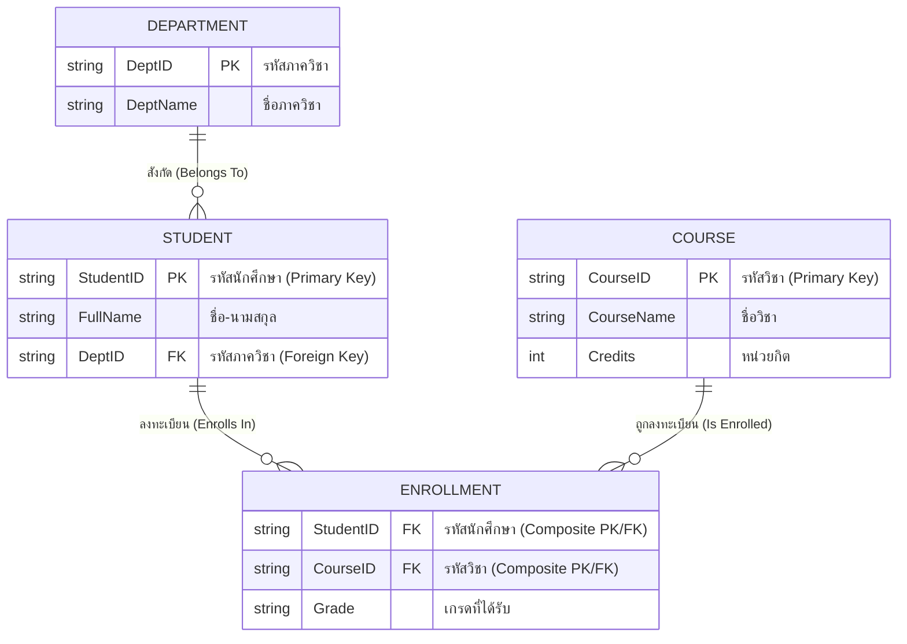

# แบบจำลองข้อมูลเชิงสัมพันธ์และกฎความคงสภาพ (Relational Data Model & Integrity Constraints)

arrow_back กลับไปที่ [[Week01-MOC|MOC สัปดาห์ 1]] | ก่อนหน้า: [[01_Course-Introduction-and-Database-Concepts]]

## key Keyword

- **Relation (รีเลชัน/ตาราง)** — โครงสร้างข้อมูลแบบตาราง 2 มิติ ประกอบด้วยแถวและคอลัมน์
- **Tuple (ทูเพิล/แถว)** — ข้อมูล 1 แถวในตาราง แทนระเบียน (Record) หรือข้อมูล 1 รายการของ Entity
- **Attribute (แอตทริบิวต์/คอลัมน์)** — คุณลักษณะหรือฟิลด์ของข้อมูลในตาราง
- **Domain (โดเมน)** — ขอบเขตหรือเซตของค่าข้อมูลที่เป็นไปได้ทั้งหมดของ Attribute นั้น ๆ
- **Degree (ระดับ)** — จำนวน Attribute (คอลัมน์) ทั้งหมดในตาราง
- **Cardinality (ภาวะเชิงการนับ)** — จำนวน Tuple (แถว) ทั้งหมดในตาราง
- **Primary Key (คีย์หลัก)** — Candidate Key ที่ถูกเลือกใช้เป็นตัวระบุแต่ละ Tuple ในตารางอย่างเฉพาะเจาะจง (ห้ามซ้ำและห้ามเป็น NULL)
- **Foreign Key (คีย์นอก)** — Attribute ในตารางหนึ่งที่อ้างอิงไปยัง Primary Key ของอีกตารางหนึ่ง เพื่อสร้างความสัมพันธ์

## menu_book Theory (เข้าใจง่าย)

### 1. โครงสร้างของตารางเชิงสัมพันธ์ (Relational Terminology)

| ศัพท์ทางทฤษฎี (Formal) | ศัพท์ที่ใช้ในฐานข้อมูล (DBMS) | ศัพท์ในระบบไฟล์ (File System) | ความหมาย |
| :--- | :--- | :--- | :--- |
| **Relation** | Table (ตาราง) | File | โครงสร้างจัดเก็บข้อมูล 2 มิติ |
| **Tuple** | Row / Record (แถว) | Record | ข้อมูล 1 รายการของสิ่งนั้น |
| **Attribute** | Column / Field (คอลัมน์) | Field | คุณลักษณะเฉพาะ |
| **Domain** | Data Type + Constraints | Type / Definition | ชนิดและขอบเขตค่าที่ยอมรับได้ |

### 2. ลำดับชั้นของคีย์ (Hierarchy of Keys)
1. **Super Key (ซูเปอร์คีย์):** กลุ่มของ Attribute หนึ่งตัวขึ้นไปที่สามารถระบุแต่ละ Tuple ได้อย่างไม่ซ้ำกัน (อาจมี Attribute ที่เกินความจำเป็นปนอยู่ได้ เช่น `{StudentID, Name}`)
2. **Candidate Key (คีย์คู่แข่ง):** Super Key ที่มีขนาดเล็กที่สุด (Minimal Super Key) โดยไม่มี Attribute ส่วนเกิน หากตัด Attribute ใดออกจะไม่สามารถระบุ Tuple ได้อย่างเฉพาะเจาะจงอีกต่อไป
3. **Primary Key (คีย์หลัก):** Candidate Key ตัวที่ผู้ออกแบบเลือกขึ้นมาทำหน้าที่ระบุแถว มีคุณสมบัติสำคัญคือ:
   - ต้องไม่ซ้ำ (Unique)
   - ห้ามเป็นค่าว่างเด็ดขาด (NOT NULL)
   - ไม่ควรเปลี่ยนแปลงค่าบ่อย ๆ
4. **Alternate Key (คีย์ตัวแทน):** Candidate Key ตัวที่ไม่ได้รับเลือกให้เป็น Primary Key
5. **Foreign Key (คีย์นอก):** ฟิลด์ที่ใช้เชื่อมโยง โดยค่าของ Foreign Key จะต้องตรงกับค่า Primary Key ของตารางที่อ้างอิง หรือเป็นค่า NULL (ถ้าความสัมพันธ์อนุญาต)

### 3. กฎความคงสภาพของข้อมูล (Integrity Constraints)
- **Domain Integrity (ความถูกต้องระดับโดเมน):** ค่าในแต่ละคอลัมน์ต้องตรงตามชนิดข้อมูลและเงื่อนไข (เช่น อายุต้องเป็นจำนวนเต็มบวก)
- **Entity Integrity (ความถูกต้องระดับเอนทิตี):** ค่า Primary Key ของแต่ละแถวในตารางต้องไม่ซ้ำกัน และห้ามเป็น `NULL`
- **Referential Integrity (ความถูกต้องระดับการอ้างอิง):** ค่าของ Foreign Key ต้องมีอยู่จริงในตารางแม่ (Primary Key) เสมอ หรือมิฉะนั้นต้องเป็นค่า `NULL` ป้องกันไม่ให้เกิดข้อมูลกำพร้า (Orphan Records)

> [!important] ข้อควรระวัง
> หากลบหรือแก้ไขข้อมูลในตารางแม่ (Parent Table) ที่มีตารางลูก (Child Table) ชี้ Foreign Key มา RDBMS จะมีตัวเลือกในการจัดการ:
> - `ON DELETE RESTRICT / NO ACTION` (ปฏิเสธการลบ)
> - `ON DELETE CASCADE` (ลบข้อมูลตารางลูกตามไปด้วยโดยอัตโนมัติ)
> - `ON DELETE SET NULL` (เปลี่ยน Foreign Key ในตารางลูกให้เป็นค่าว่าง)

## schema Diagram

**ตัวอย่าง:** ผังความสัมพันธ์ (Entity-Relationship) ของระบบลงทะเบียนนักศึกษา แสดงการเชื่อมโยง Foreign Key ระหว่าง `STUDENT.DeptID` กับ `DEPARTMENT.DeptID` และตารางรวมหลายต่อหลาย `ENROLLMENT` (อ้างอิง Chapter 2.1 สไลด์หน้า 3–15)

---
arrow_forward ต่อไป: [[03_Relational-Algebra-Operations]]
