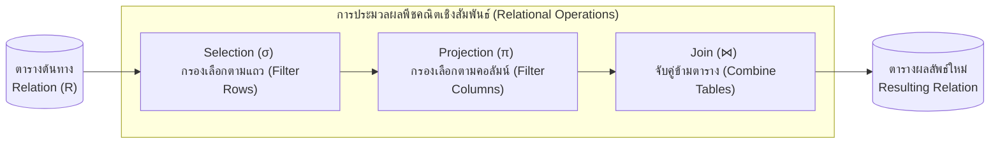

# พีชคณิตเชิงสัมพันธ์และการประมวลผลคำสั่ง (Relational Algebra Operations)

arrow_back กลับไปที่ [[Week01-MOC|MOC สัปดาห์ 1]] | ก่อนหน้า: [[02_Relational-Data-Model-and-Constraints]]

## key Keyword

- **Relational Algebra (พีชคณิตเชิงสัมพันธ์)** — ภาษาเชิงกระบวนการ (Procedural Language) ที่ใช้ตัวดำเนินการทางคณิตศาสตร์ในการแปลงหรือประมวลผล Relation เพื่อให้ได้ Relation ผลลัพธ์ใหม่
- **Selection ($\sigma$)** — ตัวดำเนินการกรองเลือก "แถว (Tuples)" ตามเงื่อนไข (เทียบเท่าคำสั่ง `WHERE` ใน SQL)
- **Projection ($\pi$)** — ตัวดำเนินการคัดเลือก "คอลัมน์ (Attributes)" ที่ต้องการ และตัดคอลัมน์อื่นทิ้ง (เทียบเท่าคำสั่ง `SELECT columns` ใน SQL)
- **Cartesian Product ($\times$)** — การจับคู่ทุกแถวของตารางแรกกับทุกแถวของตารางที่สอง (ผลลัพธ์มีจำนวนแถวเท่ากับ $M \times N$)
- **Natural Join ($\bowtie$)** — การจับคู่แถวระหว่างสองตารางโดยเทียบค่าในคอลัมน์ที่มีชื่อและโดเมนตรงกันโดยอัตโนมัติ

## menu_book Theory (เข้าใจง่าย)

### 1. ตัวดำเนินการแบบเอกภาพ (Unary Operations)

#### 1.1 การคัดเลือกแถว: Selection ($\sigma$)
- **สัญลักษณ์:** $\sigma_{\text{condition}}(R)$
- **หน้าที่:** กรองเฉพาะ Tuple ที่สอดคล้องกับเงื่อนไข
- **ตัวอย่าง:** $\sigma_{\text{DeptID} = \text{'CAI'}}(Student)$ หมายถึง หานักศึกษาทั้งหมดที่สังกัดสาขา CAI
- **SQL เทียบเท่า:** `SELECT * FROM Student WHERE DeptID = 'CAI';`

#### 1.2 การคัดเลือกคอลัมน์: Projection ($\pi$)
- **สัญลักษณ์:** $\pi_{A_1, A_2, \dots, A_n}(R)$
- **หน้าที่:** ตัดคอลัมน์ที่ไม่ต้องการทิ้ง โดยผลลัพธ์จะตัดแถวที่ซ้ำซ้อน (Duplicate Elimination) ออกตามหลักทฤษฎีเซต
- **ตัวอย่าง:** $\pi_{\text{StudentID, FullName}}(Student)$
- **SQL เทียบเท่า:** `SELECT DISTINCT StudentID, FullName FROM Student;`

### 2. ตัวดำเนินการทางเซต (Set-Theoretic Operations)
ทั้งสองตารางที่จะนำมาดำเนินการทางเซตได้ จะต้องมีคุณสมบัติ **Union-Compatible** คือมีจำนวนคอลัมน์เท่ากันและมี Domain ข้อมูลตรงกันทีละคู่
- **Union ($\cup$):** รวมข้อมูลทั้งสองตารางเข้าด้วยกัน ($R \cup S$)
- **Intersection ($\cap$):** เอาเฉพาะข้อมูลที่มีอยู่ร่วมกันทั้งสองตาราง ($R \cap S$)
- **Set Difference ($-$):** เอาข้อมูลที่มีใน $R$ แต่ไม่มีใน $S$ ($R - S$)

### 3. ตัวดำเนินการจับคู่และความสัมพันธ์ (Binary Operations)

#### 3.1 Cartesian Product ($R \times S$)
จับคู่ทุกแถวของ $R$ กับทุกแถวของ $S$
- ถ้า $R$ มี 10 แถว และ $S$ มี 5 แถว ผลลัพธ์จะมี $10 \times 5 = 50$ แถว
- ผลลัพธ์ของ Degree (จำนวนคอลัมน์) จะเท่ากับ $\text{Degree}(R) + \text{Degree}(S)$

#### 3.2 Theta Join ($R \bowtie_{\theta} S$) และ Equi-Join
เป็นการทำ Cartesian Product แล้วตามด้วยการกรองแถวด้วย Selection:
$$R \bowtie_{\theta} S = \sigma_{\theta}(R \times S)$$
หากเงื่อนไข $\theta$ เป็นเครื่องหมายเท่ากับ ($=$) จะเรียกว่า **Equi-Join**

#### 3.3 Natural Join ($R \bowtie S$)
จับคู่ตารางโดยพิจารณาคอลัมน์ที่มีชื่อเหมือนกันโดยอัตโนมัติ และผลลัพธ์จะรวมคอลัมน์ที่ซ้ำกันให้เหลือเพียงคอลัมน์เดียว

> [!tip] เคล็ดลับ
> การเขียนคิวรีซับซ้อนใน SQL สามารถมองย้อนกลับเป็นขั้นตอน Relational Algebra ได้เสมอ เช่น:
> $\pi_{\text{FullName, CourseName}}(\sigma_{\text{Grade} = \text{'A'}}(Student \bowtie Enrollment \bowtie Course))$
> หมายถึง: "เชื่อม 3 ตารางเข้าด้วยกัน $\rightarrow$ กรองเอาเฉพาะเกรด A $\rightarrow$ แสดงเฉพาะชื่อนักศึกษากับชื่อวิชา"

## schema Diagram

**ตัวอย่าง:** แผนผังลำดับขั้นการแปลงข้อมูลในเชิง Relational Algebra จากตารางดิบ ผ่านตัวดำเนินการกรองแถว กรองคอลัมน์ และจับคู่ข้ามตาราง จนได้ Relation สุดท้าย (อ้างอิง Chapter 2.1 สไลด์หน้า 26–44)

---
arrow_forward กลับไปที่: [[Week01-MOC|MOC สัปดาห์ 1]]
