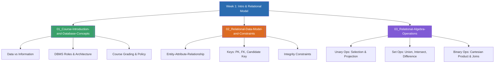

# Week 1 — Introduction to Database & Relational Model (MOC)

## check_circle เช็คลิสต์ก่อนเข้าเรียน

- [ ] ทำความเข้าใจความแตกต่างระหว่าง Data (ข้อมูลดิบ) และ Information (สารสนเทศ) — ดู [[01_Course-Introduction-and-Database-Concepts]]
- [ ] ศึกษาโครงสร้างพื้นฐานของ Entity, Attribute และ Relationship ในแบบจำลองข้อมูล — ดู [[02_Relational-Data-Model-and-Constraints]]
- [ ] ทบทวนแนวคิดทางคณิตศาสตร์เรื่อง Set และ Relational Algebra ขั้นพื้นฐาน — ดู [[03_Relational-Algebra-Operations]]

## assignment ภาพรวมสัปดาห์ 1 (สรุปย่อ)

สัปดาห์แรกเป็นการปูพื้นฐานสำคัญของระบบฐานข้อมูล ครอบคลุมภาพรวมรายวิชา ข้อตกลง และเกณฑ์การประเมินผล จากนั้นเข้าสู่ทฤษฎีรากฐานของแบบจำลองเชิงสัมพันธ์ (Relational Model) ที่คิดค้นโดย E.F. Codd โดยมุ่งเน้นการแปลงสิ่งต่าง ๆ ในโลกความเป็นจริงให้อยู่ในรูปของตาราง 2 มิติ (Relations, Tuples, Attributes) การกำหนดคีย์ประเภทต่าง ๆ (Primary Key, Foreign Key, Candidate Key) กฎความคงสภาพของข้อมูล (Integrity Constraints) และพีชคณิตเชิงสัมพันธ์ (Relational Algebra) ซึ่งเป็นทฤษฎีเบื้องหลังการทำงานของคำสั่ง SQL ทั้งหมด

## map แผนที่หัวข้อสัปดาห์ 1

## collections_bookmark โน้ตรายหัวข้อ

| หัวข้อ | เนื้อหาหลัก | หน้าสไลด์ |
| --- | --- | --- |
| [[01_Course-Introduction-and-Database-Concepts]] | แนะนำรายวิชา, เกณฑ์การให้คะแนน, ความหมายของข้อมูล/สารสนเทศ, วิวัฒนาการจาก File System สู่ DBMS | Course Intro น. 1–46 |
| [[02_Relational-Data-Model-and-Constraints]] | องค์ประกอบ Relational Model, ตาราง (Relation/Tuples/Attributes), ชนิดของ Keys, Entity & Referential Integrity | Chapter 2.1 น. 1–25 |
| [[03_Relational-Algebra-Operations]] | พีชคณิตเชิงสัมพันธ์: การคัดเลือกแถว ($\sigma$), คัดเลือกคอลัมน์ ($\pi$), การรวมตาราง, Cartesian Product, และ Joins | Chapter 2.1 น. 26–44 |

> [!tip] เคล็ดลับการจำ
> ฐานข้อมูลเชิงสัมพันธ์ทุกระบบ (RDBMS เช่น MySQL, PostgreSQL) ทำงานอยู่บนทฤษฎี Set และ Relational Algebra การเข้าใจสัญลักษณ์ $\sigma$ (Selection = WHERE) และ $\pi$ (Projection = SELECT columns) จะช่วยให้เขียนและจูนคำสั่ง SQL ในสัปดาห์ถัดไปได้อย่างรวดเร็ว

arrow_forward สัปดาห์ถัดไป: [[Week02-MOC|MOC สัปดาห์ 2]]
