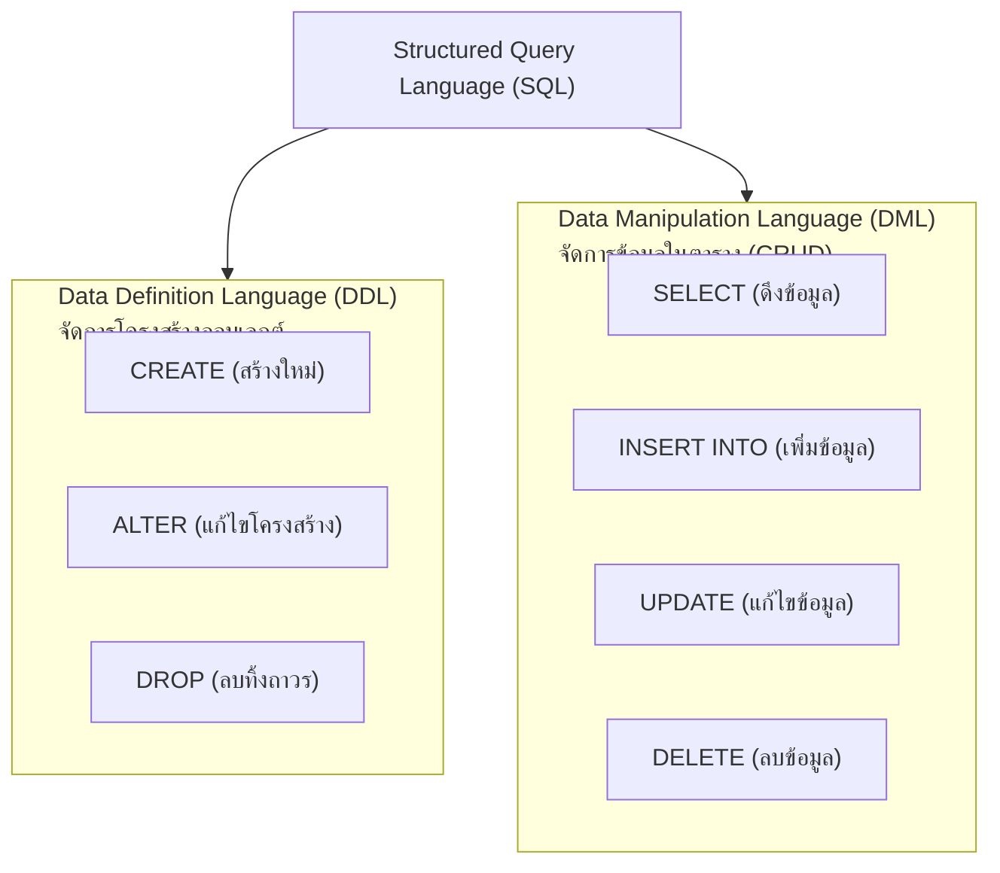

# ภาพรวมภาษา SQL คำสั่งกลุ่ม DDL และ DML (SQL Overview: DDL & DML)

<span class="material-symbols-outlined">arrow_back</span> กลับไปที่ [[Week02-MOC|MOC สัปดาห์ 2]]

## <span class="material-symbols-outlined">key</span> Keyword

- **SQL (Structured Query Language)** — ภาษาเชิงประกาศ (Declarative Language) ที่เป็นมาตรฐานสากลในการเข้าถึงและจัดการฐานข้อมูลเชิงสัมพันธ์
- **Case-Insensitive** — ลักษณะของภาษา SQL ที่ไม่แยกแยะตัวพิมพ์เล็ก-ตัวพิมพ์ใหญ่ในคีย์เวิร์ดคำสั่ง (เช่น `SELECT` = `select` = `Select`)
- **DDL (Data Definition Language)** — กลุ่มคำสั่งสำหรับสร้าง แก้ไข และลบโครงสร้างออบเจกต์ในฐานข้อมูล เช่น ฐานข้อมูล ตาราง อินเด็กซ์
- **DML (Data Manipulation Language)** — กลุ่มคำสั่งสำหรับจัดการข้อมูลที่อยู่ภายในตาราง เช่น ค้นหา เพิ่ม ลบ ปรับปรุงข้อมูล

## <span class="material-symbols-outlined">menu_book</span> Theory (เข้าใจง่าย)

### 1. หมวดหมู่คำสั่งในภาษา SQL
ภาษา SQL แบ่งออกเป็น 4 หมวดหลัก โดยในสัปดาห์นี้เน้น 2 หมวดสำคัญ:

#### 1.1 คำสั่งกลุ่ม DDL (สร้าง/แก้โครงสร้าง)
ทำงานระดับ Metadata หรือ schema ของระบบ:
- `CREATE DATABASE` / `CREATE TABLE` — สร้างฐานข้อมูลหรือตารางใหม่
- `ALTER DATABASE` / `ALTER TABLE` — ปรับปรุงแก้ไขโครงสร้าง เช่น เพิ่มคอลัมน์ ลบคอลัมน์ เปลี่ยน Data Type
- `DROP TABLE` / `DROP DATABASE` — ลบตารางหรือฐานข้อมูลทิ้งอย่างถาวร
- `CREATE INDEX` / `DROP INDEX` — สร้างหรือลบดัชนีช่วยเร่งความเร็วในการค้นหา

```sql
-- ตัวอย่าง DDL: สร้างตาราง Persons
CREATE TABLE Persons (
    P_Id INT PRIMARY KEY AUTO_INCREMENT,
    LastName VARCHAR(50) NOT NULL,
    FirstName VARCHAR(50) NOT NULL,
    Address VARCHAR(255),
    City VARCHAR(100)
);
```

#### 1.2 คำสั่งกลุ่ม DML (จัดการข้อมูลภายในตาราง)
ทำงานกับข้อมูลจริง (Tuples):
- `SELECT` — ดึงข้อมูล (Retrieve/Query)
- `INSERT INTO` — เพิ่มระเบียนข้อมูลใหม่ (Create)
- `UPDATE` — แก้ไขข้อมูลที่มีอยู่เดิม (Update)
- `DELETE` — ลบแถวข้อมูลออกจากตาราง (Delete)

```sql
-- ตัวอย่าง DML: เพิ่มข้อมูลใหม่
INSERT INTO Persons (LastName, FirstName, Address, City)
VALUES ('Hansen', 'Ola', 'Timoteivn 10', 'Sandnes');
```

> [!important] ข้อแตกต่างที่ต้องจำ
> - `DROP TABLE Persons;` $\rightarrow$ ลบทั้งโครงสร้างตารางและข้อมูลข้างในทิ้งทั้งหมด (Table หายไปจากระบบ)
> - `DELETE FROM Persons;` $\rightarrow$ ลบเฉพาะข้อมูลทุกแถวออก แต่โครงสร้างตารางยังคงอยู่พร้อมใช้งานต่อ

## <span class="material-symbols-outlined">schema</span> Diagram



**ตัวอย่าง:** แผนผังจำแนกกลุ่มคำสั่ง SQL พื้นฐานระหว่าง DDL สำหรับควบคุมโครงสร้าง และ DML สำหรับการประมวลผลข้อมูล (อ้างอิง Chapter 3 สไลด์หน้า 2–5)

---
<span class="material-symbols-outlined">arrow_forward</span> ต่อไป: [[02_Basic-Data-Retrieval-SELECT-and-WHERE]]
