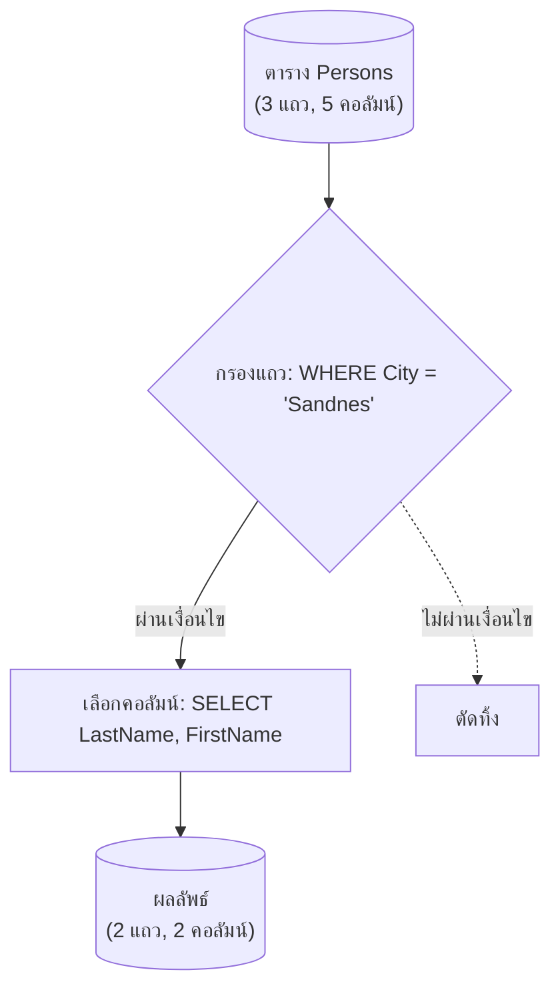

# การค้นคืนข้อมูลพื้นฐานด้วย SELECT และการกรองเงื่อนไข WHERE (Basic Data Retrieval)

<span class="material-symbols-outlined">arrow_back</span> กลับไปที่ [[Week02-MOC|MOC สัปดาห์ 2]] | ก่อนหน้า: [[01_SQL-Overview-DDL-and-DML]]

## <span class="material-symbols-outlined">key</span> Keyword

- **SELECT Statement** — คำสั่งพื้นฐานที่สุดของภาษา SQL สำหรับดึงข้อมูลจากตาราง (เทียบเท่า Projection $\pi$ ใน Relational Algebra)
- **Asterisk (`*`)** — เครื่องหมาย Wildcard ที่ใช้ใน SELECT เพื่อหมายถึง "เลือกทุกคอลัมน์ที่มีอยู่ในตาราง"
- **DISTINCT Clause** — ส่วนขยายคำสั่งเพื่อคัดกรองแถวผลลัพธ์ที่ซ้ำกัน ให้เหลือเฉพาะค่าที่ไม่ซ้ำกันเพียงค่าเดียว
- **WHERE Clause** — เงื่อนไขสำหรับจำกัดแถวผลลัพธ์ (เทียบเท่า Selection $\sigma$ ใน Relational Algebra)
- **Quotation Convention** — กฎการใส่เครื่องหมายอัญประกาศ: ข้อความและวันที่ต้องใส่ `'...'` ส่วนตัวเลขไม่ต้องใส่

## <span class="material-symbols-outlined">menu_book</span> Theory (เข้าใจง่าย)

### 1. โครงสร้างคำสั่ง SELECT พื้นฐาน

```sql
SELECT column1, column2, ...
FROM table_name;
```

หากต้องการดึงทุกคอลัมน์:
```sql
SELECT * FROM Persons;
```

### 2. การตัดข้อมูลที่ซ้ำกันด้วย `SELECT DISTINCT`
เมื่อดึงข้อมูลบางคอลัมน์ เช่น ชื่อเมือง (`City`) อาจมีคนอาศัยอยู่เมืองเดียวกันหลายคน ทำให้ผลลัพธ์มีชื่อเมืองซ้ำ การใช้ `DISTINCT` จะช่วยกำจัดความซ้ำซ้อน:

```sql
-- แสดงรายชื่อเมืองทั้งหมดที่ไม่ซ้ำกัน
SELECT DISTINCT City FROM Persons;
```

### 3. การกรองระเบียนด้วย `WHERE` Clause
`WHERE` ใช้ระบุเงื่อนไข หากแถวใดทำให้เงื่อนไขเป็นจริง (TRUE) แถวนั้นจะถูกนำมาแสดงในผลลัพธ์:

```sql
SELECT * FROM Persons
WHERE City = 'Sandnes';
```

### 4. กฎการระบุค่าข้อมูล (Literal Values)
- **ข้อความ (Text/String):** ต้องใช้เครื่องหมาย Single Quote เช่น `'Tove'`, `'Bangkok'`
- **ตัวเลข (Numeric/Integer/Decimal):** ห้ามใช้ Quote เช่น `Year = 1965`, `Salary >= 30000`
- **วันที่ (Date):** ส่วนใหญ่ใช้รูปแบบ `'YYYY-MM-DD'` ครอบด้วย Single Quote เช่น `'2025-09-16'`

> [!tip] เคล็ดลับประสิทธิภาพ
> หลีกเลี่ยงการใช้ `SELECT *` ในงาน Production จริง ให้เลือกเฉพาะคอลัมน์ที่จำเป็นเสมอ เพราะ `SELECT *` จะเพิ่มภาระ Network I/O และทำให้ DBMS ไม่สามารถดึงข้อมูลผ่าน Covering Index ได้

## <span class="material-symbols-outlined">schema</span> Diagram



**ตัวอย่าง:** ลำดับการประมวลผลคำสั่ง `SELECT LastName, FirstName FROM Persons WHERE City = 'Sandnes';` ระบบจะกรองแถวตามเงื่อนไข `WHERE` ก่อน แล้วจึงตัดเฉพาะคอลัมน์ที่ต้องการ (อ้างอิง Chapter 3 สไลด์หน้า 6–10)

---
<span class="material-symbols-outlined">arrow_forward</span> ต่อไป: [[03_Filtering-Operators-Sorting-and-Data-Modification]]
