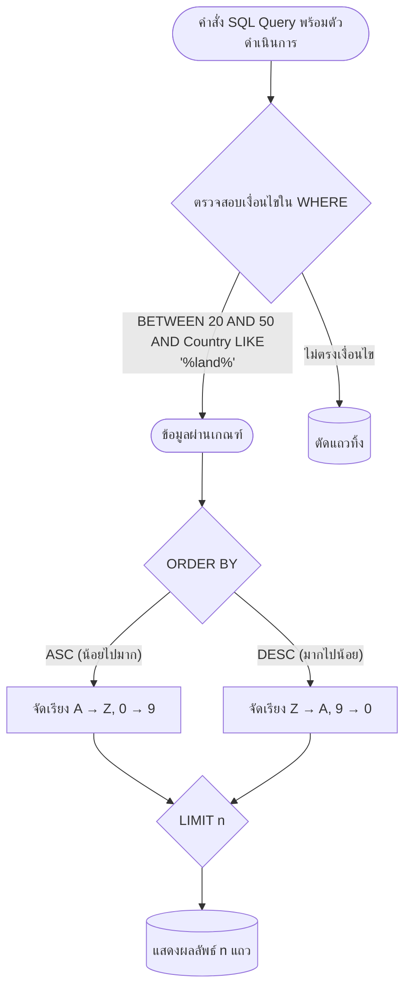

# ตัวดำเนินการกรองข้อมูล การจัดเรียง และการแก้ไขข้อมูล (Filtering Operators, Sorting & DML)

<span class="material-symbols-outlined">arrow_back</span> กลับไปที่ [[Week02-MOC|MOC สัปดาห์ 2]] | ก่อนหน้า: [[02_Basic-Data-Retrieval-SELECT-and-WHERE]]

## <span class="material-symbols-outlined">key</span> Keyword

- **Comparison Operators** — ตัวดำเนินการเปรียบเทียบ ได้แก่ `=`, `<>` (หรือไม่เท่ากับ `!=`), `>`, `<`, `>=`, `<=`
- **Logical Operators (`AND` / `OR` / `NOT`)** — ตัวดำเนินการทางตรรกะสำหรับเชื่อมหลายเงื่อนไข
- **BETWEEN ... AND ...** — ตัวดำเนินการเช็คช่วงข้อมูล โดยรวมค่าขอบทั้งสองข้าง (Inclusive Range)
- **LIKE Operator** — ตัวดำเนินการจับคู่รูปแบบข้อความ ทำงานร่วมกับ Wildcard `%` (แทนหลายตัวอักษร) และ `_` (แทน 1 ตัวอักษร)
- **IN Operator** — ตัวดำเนินการตรวจสอบค่าที่ตรงกับสมาชิกตัวใดตัวหนึ่งในชุดข้อมูลที่ระบุ
- **ORDER BY Clause** — ส่วนขยายสำหรับเรียงลำดับผลลัพธ์จากน้อยไปมาก (`ASC` - ค่าเริ่มต้น) หรือจากมากไปน้อย (`DESC`)

## <span class="material-symbols-outlined">menu_book</span> Theory (เข้าใจง่าย)

### 1. ตารางสรุปตัวดำเนินการเปรียบเทียบใน SQL

| ตัวดำเนินการ | ความหมาย | ตัวอย่างคำสั่ง |
| :--- | :--- | :--- |
| `=` | เท่ากับ | `WHERE City = 'Bangkok'` |
| `<>` หรือ `!=` | ไม่เท่ากับ | `WHERE Status <> 'Inactive'` |
| `>`, `<` | มากกว่า, น้อยกว่า | `WHERE UnitPrice > 100` |
| `>=`, `<=` | มากกว่าหรือเท่ากับ, น้อยกว่าหรือเท่ากับ | `WHERE Quantity >= 10` |
| `BETWEEN a AND b` | อยู่ในช่วง $a$ ถึง $b$ (รวมค่าขอบ) | `WHERE UnitPrice BETWEEN 20 AND 50` |
| `LIKE 'pattern'` | ค้นหารูปแบบข้อความ | `WHERE Country LIKE '%a%'` |
| `IN (v1, v2, ...)` | ตรงกับค่าใดค่าหนึ่งในลิสต์ | `WHERE City IN ('Paris', 'London', 'Berlin')` |

### 2. การค้นหารูปแบบข้อความด้วย `LIKE`
- `%` แทนตัวอักษรจำนวนเท่าใดก็ได้ (0 ตัวขึ้นไป)
  - `'s%'` $\rightarrow$ ขึ้นต้นด้วยตัวอักษร s
  - `'%s'` $\rightarrow$ ลงท้ายด้วยตัวอักษร s
  - `'%a%'` $\rightarrow$ มีตัวอักษร a อยู่ตรงไหนก็ได้ในคำ
- `_` (Underscore) แทนตัวอักษรเพียง 1 ตัว
  - `'_r%'` $\rightarrow$ ตัวอักษรที่สองเป็น r

### 3. การเรียงลำดับผลลัพธ์ด้วย `ORDER BY`

```sql
-- เรียงลำดับชื่อ Suppliers จาก Z ไป A (มากไปน้อย)
SELECT SupplierName, City, Country
FROM Suppliers
ORDER BY SupplierName DESC;

-- เรียงลำดับหลายคอลัมน์: เรียงประเทศก่อน (A-Z) แล้วเรียงราคาจากมากไปน้อย (DESC)
SELECT ProductName, Country, UnitPrice
FROM Products
ORDER BY Country ASC, UnitPrice DESC;
```

### 4. คำสั่งจัดการข้อมูลระเบียน (DML: Insert, Update, Delete)

#### 4.1 การเพิ่มข้อมูล (`INSERT INTO`)
```sql
INSERT INTO Persons (LastName, FirstName, Address, City)
VALUES ('Pettersen', 'Kari', 'Storgt 20', 'Stavanger');
```

#### 4.2 การแก้ไขข้อมูล (`UPDATE`)
```sql
UPDATE Persons
SET Address = 'Nissestien 67', City = 'Sandnes'
WHERE LastName = 'Tove' AND FirstName = 'Svendson';
```

#### 4.3 การลบข้อมูล (`DELETE`)
```sql
DELETE FROM Persons
WHERE LastName = 'Hansen' AND FirstName = 'Ola';
```

> [!important] กฎเตือนภัยระดับวิกฤต (Safety Warning)
> ก่อนรันคำสั่ง `UPDATE` หรือ `DELETE` ทุกครั้ง **ต้องตรวจสอบว่ามี `WHERE` Clause กำกับอยู่เสมอ** หากลืมใส่ `WHERE` ข้อมูลทุกแถวในตารางจะถูกแก้ไขหรือลบทิ้งทั้งหมดทันที!

## <span class="material-symbols-outlined">schema</span> Diagram



**ตัวอย่าง:** ผังลำดับการประมวลผลคำสั่งค้นหาข้อมูลใน SQL เริ่มจากการคัดกรองด้วยตัวดำเนินการต่างๆ นำข้อมูลที่ผ่านไปจัดเรียง และตัดแสดงผลตามจำนวน LIMIT ที่ต้องการ (อ้างอิง Chapter 3 สไลด์หน้า 11–35)

---
<span class="material-symbols-outlined">arrow_forward</span> กลับไปที่: [[Week02-MOC|MOC สัปดาห์ 2]]
