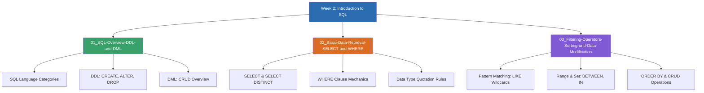

# Week 2 — Introduction to Structured Query Language (SQL) (MOC)

arrow_back สัปดาห์ก่อนหน้า: [[Week01-MOC|MOC สัปดาห์ 1]]

## check_circle เช็คลิสต์ก่อนเข้าเรียน

- [ ] แยกความแตกต่างระหว่างคำสั่งประเภท DDL (โครงสร้าง) และ DML (ข้อมูล) — ดู [[01_SQL-Overview-DDL-and-DML]]
- [ ] จำรูปแบบไวยากรณ์พื้นฐาน `SELECT ... FROM ... WHERE ...` — ดู [[02_Basic-Data-Retrieval-SELECT-and-WHERE]]
- [ ] ฝึกใช้ตัวดำเนินการเปรียบเทียบ `LIKE`, `IN`, `BETWEEN` และการจัดเรียง `ORDER BY` — ดู [[03_Filtering-Operators-Sorting-and-Data-Modification]]

## assignment ภาพรวมสัปดาห์ 2 (สรุปย่อ)

สัปดาห์ที่ 2 ก้าวเข้าสู่การปฏิบัติการด้วยภาษามาตรฐาน SQL (Structured Query Language) โดยเริ่มต้นจากการจำแนกกลุ่มคำสั่ง DDL (`CREATE`, `ALTER`, `DROP`) สำหรับนิยามออบเจกต์ในฐานข้อมูล และ DML (`SELECT`, `INSERT`, `UPDATE`, `DELETE`) สำหรับจัดการระเบียนข้อมูล จากนั้นเจาะลึกคำสั่งค้นคืนข้อมูลพื้นฐาน ไวยากรณ์การใช้ `SELECT DISTINCT`, การกรองแถวด้วย `WHERE Clause`, ตัวดำเนินการเปรียบเทียบและตรรกะ (`=`, `<>`, `LIKE`, `IN`, `BETWEEN`, `AND`, `OR`), การเรียงลำดับผลลัพธ์ด้วย `ORDER BY` (ASC/DESC) และการจำกัดจำนวนแถวผลลัพธ์ด้วย `LIMIT`

## map แผนที่หัวข้อสัปดาห์ 2

## collections_bookmark โน้ตรายหัวข้อ

| หัวข้อ | เนื้อหาหลัก | หน้าสไลด์ |
| --- | --- | --- |
| [[01_SQL-Overview-DDL-and-DML]] | ภาพรวมภาษา SQL, คุณลักษณะ Case-Insensitive, การจำแนกคำสั่ง DDL และ DML | Chapter 3 น. 1–5 |
| [[02_Basic-Data-Retrieval-SELECT-and-WHERE]] | การดึงข้อมูลด้วย `SELECT`, การตัดค่าซ้ำ `DISTINCT`, และการกรองเงื่อนไข `WHERE` | Chapter 3 น. 6–10 |
| [[03_Filtering-Operators-Sorting-and-Data-Modification]] | ตัวดำเนินการ `=`, `<>`, `BETWEEN`, `LIKE % _`, `IN`, `ORDER BY`, `INSERT`, `UPDATE`, `DELETE` | Chapter 3 น. 11–35 |

> [!tip] กฎเหล็กของโควทใน SQL
> - **ข้อความและวันที่ (String / Date):** ต้องครอบด้วยเครื่องหมาย Single Quote (`'...'`) เสมอ เช่น `WHERE City = 'Sandnes'` หรือ `WHERE BirthDate = '2000-01-01'`
> - **ตัวเลข (Numeric):** ห้ามใส่ Quote เช่น `WHERE Age > 20` (หากใส่ Single Quote DBMS อาจต้องแปลงชนิดข้อมูล ทำให้อินเด็กซ์ไม่ทำงาน)

arrow_forward สัปดาห์ถัดไป: [[Week03-MOC|MOC สัปดาห์ 3]]
