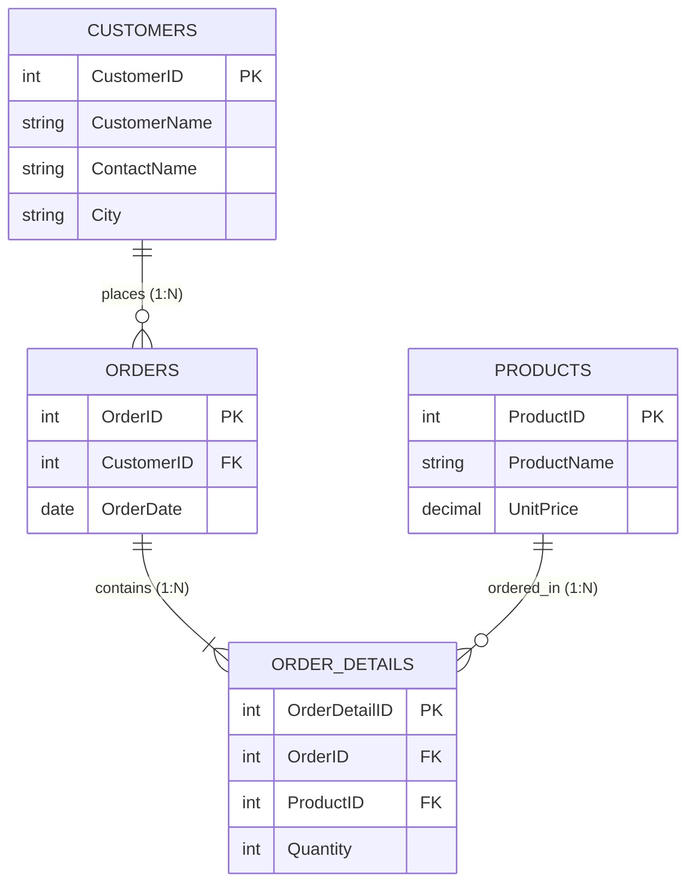

# พื้นฐานการเชื่อมตารางและ INNER JOIN (SQL Join Fundamentals & INNER JOIN)

<span class="material-symbols-outlined">arrow_back</span> กลับไปที่ [[Week03-MOC|MOC สัปดาห์ 3]]

## <span class="material-symbols-outlined">key</span> Keyword

- **SQL JOIN** — คำสั่งสำหรับนำข้อมูลจากสองตารางขึ้นไปมารวมกันในผลลัพธ์เดียว โดยอาศัยคอลัมน์ที่สัมพันธ์กัน (PK ↔ FK)
- **INNER JOIN** — การเชื่อมตารางที่คัดเลือกเฉพาะแถวที่มีค่าในคอลัมน์เชื่อมโยง "ตรงกัน" ทั้งสองตาราง (Strict Intersection)
- **ON Clause** — เงื่อนไขที่ใช้ระบุคู่คอลัมน์ที่เชื่อมโยงกัน เช่น `ON Persons.P_Id = Orders.P_Id`
- **Table Alias** — การตั้งชื่อย่อให้กับตารางใน `FROM` เพื่อให้เขียนคิวรีได้สั้น กระชับ และป้องกันความสับสนกรณีคอลัมน์ชื่อซ้ำ

## <span class="material-symbols-outlined">menu_book</span> Theory (เข้าใจง่าย)

### 1. ทำไมต้องใช้ JOIN?
ในการออกแบบฐานข้อมูลเชิงสัมพันธ์ ข้อมูลจะถูกแยกออกเป็นหลายตารางตามหลัก Normalization เพื่อลดความซ้ำซ้อน เช่น:
- ตาราง `Customers` เก็บข้อมูลลูกค้า
- ตาราง `Orders` เก็บรายการสั่งซื้อโดยเก็บเพียง `CustomerID`

เมื่อต้องการรายงานว่า "ลูกค้าแต่ละคนสั่งเลขออเดอร์อะไรไปบ้าง" เราต้องใช้ `JOIN` นำสองตารางนี้มาประกบกัน

### 2. ไวยากรณ์และตัวอย่าง INNER JOIN

```sql
SELECT table1.column1, table2.column2, ...
FROM table1
INNER JOIN table2
ON table1.common_column = table2.common_column;
```

#### ตัวอย่างการใช้งาน:
```sql
SELECT Persons.LastName, Persons.FirstName, Orders.OrderNo
FROM Persons
INNER JOIN Orders ON Persons.P_Id = Orders.P_Id
ORDER BY Persons.LastName;
```

**ผลลัพธ์:**
- ถ้าบุคคลใดใน `Persons` ยังไม่เคยมีออเดอร์เลยใน `Orders` แถวนั้นจะไม่ปรากฏในผลลัพธ์
- ถ้าออเดอร์ใดใน `Orders` มี `P_Id` ที่ไม่มีใน `Persons` แถวนั้นก็จะไม่ปรากฏในผลลัพธ์เช่นกัน

### 3. การใช้ Table Aliases (ชื่อแทนตาราง)
เมื่อคิวรีมีความยาวหรือเชื่อมโยงหลายตาราง การใช้ Alias จะช่วยให้โค้ดอ่านง่ายขึ้น:

```sql
SELECT p.LastName, p.FirstName, o.OrderNo
FROM Persons AS p
INNER JOIN Orders AS o ON p.P_Id = o.P_Id;
```

### 4. การเชื่อมโยง 3 ตารางขึ้นไป (Multi-Table Joins)
สมมุติว่ามีตาราง `Customers`, `Orders`, และ `Shippers`:

```sql
SELECT o.OrderID, c.CustomerName, s.ShipperName
FROM Orders AS o
INNER JOIN Customers AS c ON o.CustomerID = c.CustomerID
INNER JOIN Shippers AS s ON o.ShipperID = s.ShipperID;
```

> [!tip] ข้อสังเกต
> คำว่า `INNER` เป็นทางเลือก (Optional) การเขียน `FROM Persons JOIN Orders ON ...` มีความหมายเทียบเท่ากับ `INNER JOIN` ทุกประการ

## <span class="material-symbols-outlined">schema</span> Diagram



**ตัวอย่าง:** แผนผังความสัมพันธ์เอนทิตีที่แสดงจุดเชื่อมโยง Foreign Key สำหรับการทำ INNER JOIN ระหว่าง `Customers` $\rightarrow$ `Orders` $\rightarrow$ `Order Details` $\rightarrow$ `Products` (อ้างอิง SQL Join สไลด์หน้า 3–6, 12–15)

---
<span class="material-symbols-outlined">arrow_forward</span> ต่อไป: [[02_Outer-Joins-Left-Right-Full-and-Self-Join]]
