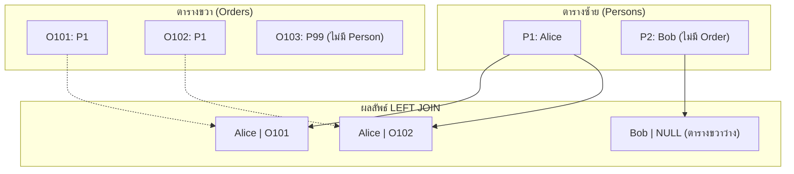

# กลุ่มคำสั่ง OUTER JOIN และเทคนิค Self Join (Outer Joins & Self Join Techniques)

<span class="material-symbols-outlined">arrow_back</span> กลับไปที่ [[Week03-MOC|MOC สัปดาห์ 3]] | ก่อนหน้า: [[01_SQL-Join-Fundamentals-and-Inner-Join]]

## <span class="material-symbols-outlined">key</span> Keyword

- **LEFT JOIN (LEFT OUTER JOIN)** — การเชื่อมตารางที่แสดงผล "ทุกแถวจากตารางซ้าย" แม้ว่าจะไม่มีคู่ที่ตรงกันในตารางขวา (ฝั่งขวาจะแสดงเป็นค่า `NULL`)
- **RIGHT JOIN (RIGHT OUTER JOIN)** — การเชื่อมตารางที่แสดงผล "ทุกแถวจากตารางขวา" แม้ว่าจะไม่มีคู่ที่ตรงกันในตารางซ้าย (ฝั่งซ้ายจะแสดงเป็นค่า `NULL`)
- **FULL OUTER JOIN** — การเชื่อมตารางที่แสดงผล "ทุกแถวจากทั้งสองตาราง" ไม่ว่าจะจับคู่กันได้หรือไม่
- **NULL Value Handling** — การจัดการค่าว่างที่เกิดจากการจับคู่ไม่เจอ มักใช้ร่วมกับ `IS NULL` เพื่อหาข้อมูลที่ตกหล่น
- **Self Join** — การเชื่อมตารางเดิมเข้ากับตัวเอง โดยมองเสมือนเป็นสองตารางแยกกัน มักใช้กับโครงสร้างลำดับชั้น (Hierarchical Data)

## <span class="material-symbols-outlined">menu_book</span> Theory (เข้าใจง่าย)

### 1. LEFT JOIN (การรักษาข้อมูลตารางซ้าย)
เมื่อต้องการแสดงรายชื่อลูกค้าทุกคน แม้ว่าลูกค้ารายนั้นจะยังไม่เคยสั่งซื้อสินค้าเลยก็ตาม:

```sql
SELECT p.LastName, p.FirstName, o.OrderNo
FROM Persons AS p
LEFT JOIN Orders AS o ON p.P_Id = o.P_Id
ORDER BY p.LastName;
```

**สิ่งที่เกิดขึ้น:**
- `Hansen Ola` มีออเดอร์ $\rightarrow$ แสดงชื่อพร้อม `OrderNo`
- `Svendson Tove` ไม่มีออเดอร์ $\rightarrow$ ยังคงแสดงชื่อ `Svendson Tove` แต่ในคอลัมน์ `OrderNo` จะมีค่าเป็น `NULL`

### 2. เทคนิคการหา "สิ่งที่ไม่มีคู่" ด้วย LEFT JOIN + IS NULL
โจทย์ยอดนิยมในการทำงานและการสอบ: "จงหารายชื่อลูกค้าที่ยังไม่เคยสั่งซื้อสินค้าแม้แต่ชิ้นเดียว":

```sql
SELECT c.CustomerID, c.CustomerName
FROM Customers AS c
LEFT JOIN Orders AS o ON c.CustomerID = o.CustomerID
WHERE o.OrderID IS NULL;
```

### 3. RIGHT JOIN (การรักษาข้อมูลตารางขวา)
ทำงานในทิศทางตรงกันข้ามกับ `LEFT JOIN`:

```sql
SELECT o.OrderID, e.LastName, e.FirstName
FROM Orders AS o
RIGHT JOIN Employees AS e ON o.EmployeeID = e.EmployeeID
ORDER BY o.OrderID;
```
จะแสดงพนักงานทุกคน แม้พนักงานคนนั้นจะยังไม่เคยออกบิล Order เลยก็ตาม

### 4. การจำลอง FULL OUTER JOIN ใน MySQL
MySQL ไม่รองรับคีย์เวิร์ด `FULL OUTER JOIN` โดยตรง เราจึงต้องใช้ `LEFT JOIN` รวมกับ `RIGHT JOIN` ผ่านตัวดำเนินการ `UNION`:

```sql
SELECT c.CustomerName, o.OrderID
FROM Customers c
LEFT JOIN Orders o ON c.CustomerID = o.CustomerID
UNION
SELECT c.CustomerName, o.OrderID
FROM Customers c
RIGHT JOIN Orders o ON c.CustomerID = o.CustomerID;
```

### 5. เทคนิค Self Join (เชื่อมตารางเข้ากับตัวเอง)
ใช้เมื่อตารางมี Foreign Key ชี้กลับมาที่ Primary Key ของตารางตัวเอง เช่น ตาราง `Employees` ที่มีคอลัมน์ `ReportsTo` (รหัสหัวหน้างาน):

```sql
SELECT 
    e.FirstName AS EmployeeName,
    m.FirstName AS ManagerName
FROM Employees AS e
LEFT JOIN Employees AS m ON e.ReportsTo = m.EmployeeID;
```

> [!tip] เคล็ดลับ
> ในทางปฏิบัติ การใช้ `LEFT JOIN` พบบ่อยที่สุด (มากกว่า 90%) โดยมักออกแบบให้ตารางหลักที่เป็นแกนของรายงานอยู่ทางซ้าย (`FROM TableA`) แล้วดึงรายละเอียดเสริมจากตารางทางขวา (`LEFT JOIN TableB`)

## <span class="material-symbols-outlined">schema</span> Diagram



**ตัวอย่าง:** แผนภาพเปรียบเทียบกลไกของ `LEFT JOIN` ที่ยังคงเก็บแถวของ `Bob` ไว้ แม้จะไม่พบข้อมูลในตาราง `Orders` ฝั่งขวา (อ้างอิง SQL Join สไลด์หน้า 7–11, 20–25)

---
<span class="material-symbols-outlined">arrow_forward</span> กลับไปที่: [[Week03-MOC|MOC สัปดาห์ 3]]
