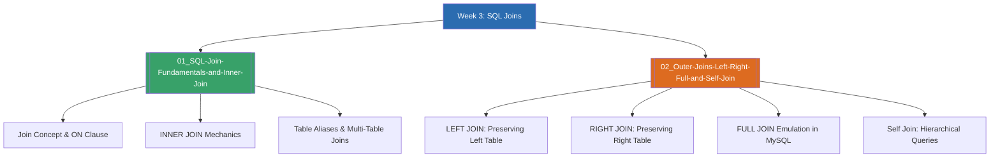

# Week 3 — SQL Joins and Multi-Table Relationships (MOC)

arrow_back สัปดาห์ก่อนหน้า: [[Week02-MOC|MOC สัปดาห์ 2]]

## check_circle เช็คลิสต์ก่อนเข้าเรียน

- [ ] ทำความเข้าใจแนวคิดการเชื่อมตารางผ่าน Primary Key และ Foreign Key — ดู [[01_SQL-Join-Fundamentals-and-Inner-Join]]
- [ ] ศึกษาข้อแตกต่างระหว่าง INNER JOIN, LEFT JOIN, RIGHT JOIN และ FULL JOIN — ดู [[02_Outer-Joins-Left-Right-Full-and-Self-Join]]
- [ ] ทดลองใช้ Table Alias เพื่อย่อชื่อตารางและแก้ปัญหาชื่อคอลัมน์ซ้ำกัน — ดู [[01_SQL-Join-Fundamentals-and-Inner-Join]]

## assignment ภาพรวมสัปดาห์ 3 (สรุปย่อ)

สัปดาห์ที่ 3 เน้นการดึงข้อมูลจากหลายตารางที่มีความสัมพันธ์กันด้วยคำสั่ง `JOIN` ในภาษา SQL ครอบคลุมการทำงานของ `INNER JOIN` ที่เลือกเฉพาะแถวที่มีค่าตรงกันทั้งสองฝั่ง, กลุ่มของ `OUTER JOIN` ได้แก่ `LEFT JOIN` (รักษาข้อมูลตารางซ้ายครบทุกแถว), `RIGHT JOIN` (รักษาตารางขวาครบ) และ `FULL OUTER JOIN` (รักษาข้อมูลทั้งสองฝั่ง หากไม่มีคู่ให้เป็นค่า NULL) ตลอดจนเทคนิค `Self Join` สำหรับตารางที่มีความสัมพันธ์แบบลำดับชั้นภายในตัวเอง (เช่น ตารางพนักงานกับหัวหน้างาน) และการเขียนเชื่อมโยง 3 ตารางขึ้นไป

## map แผนที่หัวข้อสัปดาห์ 3

## collections_bookmark โน้ตรายหัวข้อ

| หัวข้อ | เนื้อหาหลัก | หน้าสไลด์ |
| --- | --- | --- |
| [[01_SQL-Join-Fundamentals-and-Inner-Join]] | แนวคิดการเชื่อมตาราง, ไวยากรณ์ `INNER JOIN ... ON ...`, การใช้ Table Alias, การ Join 3 ตาราง | SQL Join น. 1–6, 12–15 |
| [[02_Outer-Joins-Left-Right-Full-and-Self-Join]] | `LEFT JOIN`, `RIGHT JOIN`, การจัดการค่า `NULL`, การทำ `FULL OUTER JOIN` ด้วย `UNION`, และ `Self Join` | SQL Join น. 7–11, 16–30 |

> [!tip] เคล็ดลับการจำ Venn Diagram ของ Join
> - **INNER JOIN:** ส่วนซ้อนทับ (Intersection) ของ 2 วงกลม
> - **LEFT JOIN:** วงกลมซ้ายทั้งวง (รวมส่วนที่ซ้อนทับกับวงขวา) หากวงขวาไม่มีข้อมูล ค่าจะเป็น `NULL`
> - **RIGHT JOIN:** วงกลมขวาทั้งวง (รวมส่วนที่ซ้อนทับกับวงซ้าย)
> - **หาข้อมูลที่ "ไม่มีการสั่งซื้อ":** ใช้ `LEFT JOIN` แล้วใส่เงื่อนไข `WHERE Orders.OrderID IS NULL`

arrow_forward สัปดาห์ถัดไป: [[Week04-MOC|MOC สัปดาห์ 4]]
