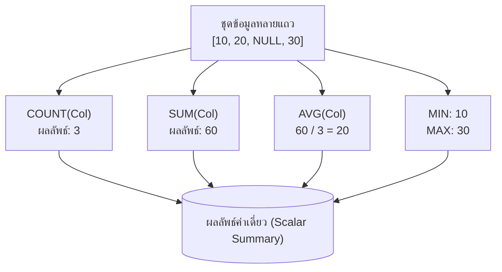

# ฟังก์ชันรวมกลุ่มทางสถิติใน SQL (SQL Aggregate Functions)

<span class="material-symbols-outlined">arrow_back</span> กลับไปที่ [[Week04-MOC|MOC สัปดาห์ 4]]

## <span class="material-symbols-outlined">key</span> Keyword

- **Aggregate Function (ฟังก์ชันรวมกลุ่ม)** — ฟังก์ชันทางคณิตศาสตร์ที่รับค่าข้อมูลหลายแถว (Multiple Rows) เข้ามาคำนวณ แล้วส่งคืนผลลัพธ์สรุปเพียงค่าเดียว (Single Summary Value)
- **`COUNT()`** — นับจำนวนแถวหรือจำนวนค่าที่ไม่เป็น NULL
- **`SUM()`** — คำนวณผลรวมของตัวเลขทั้งหมดในคอลัมน์
- **`AVG()`** — คำนวณค่าเฉลี่ยทางคณิตศาสตร์ของตัวเลขในคอลัมน์
- **`MIN()` / `MAX()`** — หาค่าน้อยที่สุด / มากที่สุดในคอลัมน์ (ใช้ได้ทั้งตัวเลข ข้อความ และวันที่)
- **NULL Elimination** — พฤติกรรมมาตรฐานของฟังก์ชัน Aggregate ส่วนใหญ่ ที่จะละเว้น (Ignore) ค่า `NULL` ในการคำนวณ ยกเว้น `COUNT(*)`

## <span class="material-symbols-outlined">menu_book</span> Theory (เข้าใจง่าย)

### 1. ฟังก์ชันรวมกลุ่มพื้นฐาน 5 ตัว

| ฟังก์ชัน | ความหมาย | ข้อมูลที่รองรับ | พฤติกรรมต่อ NULL |
| :--- | :--- | :--- | :--- |
| `COUNT(*)` | นับจำนวนแถวทั้งหมด | ทุกชนิด | นับทุกแถวรวมทั้ง NULL |
| `COUNT(column)` | นับจำนวนแถวที่มีค่าในคอลัมน์ | ทุกชนิด | **ข้ามแถวที่เป็น NULL** |
| `SUM(column)` | หาผลรวมทางคณิตศาสตร์ | Numeric | ข้าม NULL |
| `AVG(column)` | หาค่าเฉลี่ย ($\frac{\text{ผลรวม}}{\text{จำนวนที่ไม่เป็น NULL}}$) | Numeric | ข้าม NULL |
| `MIN(column)` | หาค่าน้อยที่สุด | ทุกชนิด (A-Z, ตัวเลข, วันที่) | ข้าม NULL |
| `MAX(column)` | หาค่ามากที่สุด | ทุกชนิด (Z-A, ตัวเลข, วันที่) | ข้าม NULL |

### 2. ตัวอย่างการใช้งานเดี่ยว ๆ (Global Aggregation)

```sql
-- คำนวณภาพรวมของตาราง Products ทั้งหมด
SELECT 
    COUNT(*) AS TotalProducts,
    AVG(UnitPrice) AS AveragePrice,
    MIN(UnitPrice) AS LowestPrice,
    MAX(UnitPrice) AS HighestPrice,
    SUM(UnitsInStock) AS TotalInventory
FROM Products;
```

### 3. ข้อแตกต่างสำคัญระหว่าง `COUNT(*)` และ `COUNT(column)`
สมมุติว่าตารางลูกค้า 5 คน แต่มี 2 คนที่ไม่ยอมกรอกเบอร์โทรศัพท์ (`Phone IS NULL`):
- `COUNT(*)` จะได้ผลลัพธ์เป็น **5** (นับจำนวนระเบียนลูกค้าทั้งหมด)
- `COUNT(Phone)` จะได้ผลลัพธ์เป็น **3** (นับเฉพาะคนที่มีเบอร์โทรศัพท์)

> [!important] ข้อควรระวังเรื่องค่า NULL กับ AVG()
> `AVG(column)` จะหารด้วยจำนวนแถวที่ไม่เป็น NULL เท่านั้น หากต้องการให้แถวที่เป็น NULL ถูกคิดเป็นค่า 0 ด้วย ต้องใช้ฟังก์ชัน `COALESCE`:
> `AVG(COALESCE(Bonus, 0))`

## <span class="material-symbols-outlined">schema</span> Diagram



**ตัวอย่าง:** แผนผังการทำงานของ Aggregate Functions ที่รับชุดข้อมูลหลายแถว ละเว้นค่า NULL และบีบอัดข้อมูลออกเป็นค่าสรุปทางสถิติค่าเดียว (อ้างอิง สรุปคำสั่ง SQL น. 2–3)

---
<span class="material-symbols-outlined">arrow_forward</span> ต่อไป: [[02_Grouping-Data-GROUP-BY-and-HAVING]]
