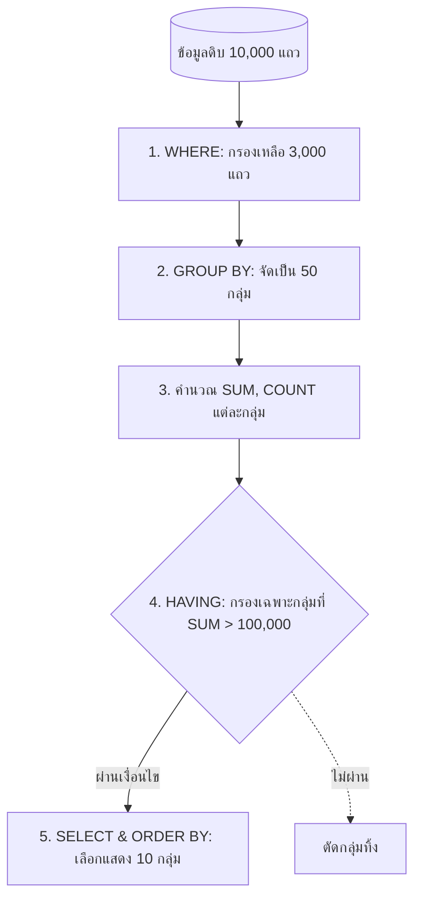

# การจัดกลุ่มข้อมูลด้วย GROUP BY และการกรองผลลัพธ์ด้วย HAVING (Grouping & HAVING)

<span class="material-symbols-outlined">arrow_back</span> กลับไปที่ [[Week04-MOC|MOC สัปดาห์ 4]] | ก่อนหน้า: [[01_SQL-Aggregate-Functions]]

## <span class="material-symbols-outlined">key</span> Keyword

- **GROUP BY Clause** — คำสั่งจัดกลุ่มแถวข้อมูลที่มีค่าในคอลัมน์ที่กำหนดเหมือนกันเข้าไว้ในกลุ่มเดียวกัน เพื่อให้ฟังก์ชัน Aggregate ทำการคำนวณแยกตามแต่ละกลุ่ม
- **HAVING Clause** — เงื่อนไขสำหรับกรองผลลัพธ์ระดับกลุ่ม (Group-Level Filter) ใช้ร่วมกับฟังก์ชัน Aggregate
- **Logical Query Processing Order** — ลำดับขั้นการประมวลผลจริงของ DBMS: `FROM` $\rightarrow$ `WHERE` $\rightarrow$ `GROUP BY` $\rightarrow$ `HAVING` $\rightarrow$ `SELECT` $\rightarrow$ `ORDER BY`

## <span class="material-symbols-outlined">menu_book</span> Theory (เข้าใจง่าย)

### 1. กฎเหล็กของ GROUP BY
เมื่อมีการใช้ `GROUP BY` ในคำสั่ง `SELECT` คอลัมน์ที่ปรากฏใน `SELECT` จะต้องเป็นหนึ่งในสองอย่างนี้เท่านั้น:
1. คอลัมน์ที่ถูกระบุไว้ใน `GROUP BY`
2. หรือคอลัมน์ที่ครอบด้วยฟังก์ชัน Aggregate (เช่น `SUM(...)`, `COUNT(...)`)

```sql
-- ถูกต้อง: แสดงชื่อประเทศ และจำนวนลูกค้าในประเทศนั้น
SELECT Country, COUNT(CustomerID) AS TotalCustomers
FROM Customers
GROUP BY Country;

-- ผิดหลักไวยากรณ์: CustomerName ไม่ได้อยู่ใน GROUP BY และไม่ได้ถูกครอบด้วย Aggregate
SELECT Country, CustomerName, COUNT(CustomerID)
FROM Customers
GROUP BY Country;
```

### 2. ความแตกต่างระหว่าง WHERE และ HAVING

| หัวข้อเปรียบเทียบ | WHERE Clause | HAVING Clause |
| :--- | :--- | :--- |
| **ระดับการทำงาน** | กรองระดับแต่ละแถว (Individual Rows) | กรองระดับกลุ่ม (Aggregated Groups) |
| **ช่วงเวลาประมวลผล** | ทำงาน **ก่อน** การจัดกลุ่ม (Before Grouping) | ทำงาน **หลัง** การคำนวณกลุ่ม (After Grouping) |
| **การใช้ Aggregate** | **ห้ามใช้** ฟังก์ชัน Aggregate เช่น `WHERE SUM(...) > 100` (Syntax Error) | **ใช้กับ Aggregate ได้** เช่น `HAVING COUNT(*) > 5` |
| **ประสิทธิภาพ** | ช่วยตัดข้อมูลทิ้งตั้งแต่ต้น ทำให้ระบบทำงานเร็ว | ทำงานกับผลสรุปสุดท้าย |

### 3. ตัวอย่างการใช้ WHERE, GROUP BY และ HAVING ร่วมกัน
"หาประเทศที่มีลูกค้ารวมมากกว่า 5 ราย โดยพิจารณาเฉพาะลูกค้าที่อยู่ในทวีปยุโรปเท่านั้น":

```sql
SELECT Country, COUNT(CustomerID) AS CustomerCount
FROM Customers
WHERE Region = 'Europe'          -- กรองแถวเฉพาะยุโรปก่อน
GROUP BY Country                 -- จัดกลุ่มตามชื่อประเทศ
HAVING COUNT(CustomerID) > 5     -- กรองเฉพาะกลุ่มประเทศที่มีคนมากกว่า 5 คน
ORDER BY CustomerCount DESC;     -- เรียงจากประเทศที่มีลูกค้ามากไปน้อย
```

### 4. ลำดับการทำงานจริงของเครื่องมือฐานข้อมูล (SQL Execution Order)
1. `FROM` & `JOIN` (นำตารางมาเชื่อมโยงกัน)
2. `WHERE` (กรองแถวดิบที่ไม่ต้องการทิ้ง)
3. `GROUP BY` (จัดแถวที่เหลือเป็นกลุ่มย่อย)
4. `HAVING` (กรองเฉพาะกลุ่มที่ผ่านเกณฑ์ Aggregate)
5. `SELECT` (เลือกคอลัมน์ที่จะแสดงและคำนวณสูตร)
6. `DISTINCT` (ตัดแถวผลลัพธ์ที่ซ้ำ)
7. `ORDER BY` (เรียงลำดับผลลัพธ์)
8. `LIMIT` (ตัดเอาเฉพาะ $N$ แถวแรก)

> [!tip] เคล็ดลับ
> เนื่องจาก `SELECT` ทำงานหลัง `WHERE` ทำให้เรา **ไม่สามารถ** นำ Column Alias ที่ตั้งใน `SELECT` (เช่น `AS Total`) ไปใช้ใน `WHERE` ได้ แต่ในบาง DBMS (เช่น MySQL) สามารถนำ Alias ไปใช้ใน `HAVING` และ `ORDER BY` ได้

## <span class="material-symbols-outlined">schema</span> Diagram



**ตัวอย่าง:** แผนผังวงจรการประมวลผลคำสั่งคิวรีแสดงตำแหน่งการทำงานของ `WHERE` ก่อนการจัดกลุ่ม และ `HAVING` หลังการคำนวณผลรวมกลุ่ม (อ้างอิง สรุปคำสั่ง SQL น. 3–4)

---
<span class="material-symbols-outlined">arrow_forward</span> ต่อไป: [[03_Combining-Joins-with-Aggregations-and-Business-Reports]]
