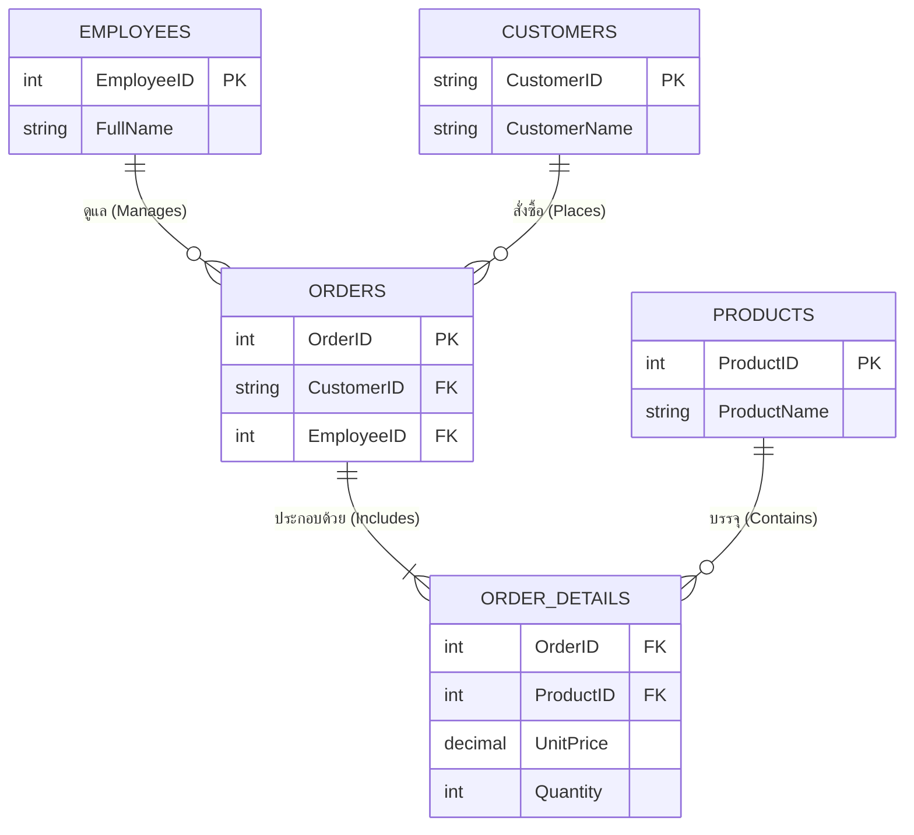

# การผสาน JOIN และ Aggregate Functions เพื่อวิเคราะห์ข้อมูลธุรกิจ (Joins & Analytics)

<span class="material-symbols-outlined">arrow_back</span> กลับไปที่ [[Week04-MOC|MOC สัปดาห์ 4]] | ก่อนหน้า: [[02_Grouping-Data-GROUP-BY-and-HAVING]]

## <span class="material-symbols-outlined">key</span> Keyword

- **Business Intelligence (BI) Queries** — คิวรีสำหรับออกรายงานเชิงสถิติและการตัดสินใจของผู้บริหาร
- **Calculated Metric (เมทริกซ์จากการคำนวณ)** — ค่าสถิติที่เกิดจากการนำหลายคอลัมน์มาคำนวณร่วมกัน เช่น ยอดเงินรวม `SUM(UnitPrice * Quantity)`
- **Aggregation with Join** — การเชื่อมตารางหลักกับตารางบันทึกการทำธุรกรรม แล้วจัดกลุ่มเพื่อสรุปยอดสถิติแยกตามมิติ (Dimension)

## <span class="material-symbols-outlined">menu_book</span> Theory (เข้าใจง่าย)

### เฉลยและวิเคราะห์โจทย์ฝึกปฏิบัติ 5 ข้อหลักประจำสัปดาห์ (JOIN_Aggregate)

#### ข้อ 1: หายอดขายรวม (Total Sales) ของสินค้าแต่ละตัว
- **ตารางที่ใช้:** `Products` (p) และ `Order Details` (od)
- **แนวคิด:** เชื่อมด้วย `ProductID` จัดกลุ่มตามสินค้า แล้วคูณราคาต่อหน่วยด้วยจำนวนชิ้น

```sql
SELECT 
    p.ProductID,
    p.ProductName,
    SUM(od.UnitPrice * od.Quantity) AS TotalSales
FROM Products AS p
INNER JOIN `Order Details` AS od ON p.ProductID = od.ProductID
GROUP BY p.ProductID, p.ProductName
ORDER BY TotalSales DESC;
```

#### ข้อ 2: หาจำนวนคำสั่งซื้อ (Number of Orders) ของลูกค้าแต่ละราย
- **ตารางที่ใช้:** `Customers` (c) และ `Orders` (o)
- **แนวคิด:** ใช้ `LEFT JOIN` เพื่อให้ลูกค้าที่ยังไม่เคยสั่งซื้อแสดงเป็น 0 และใช้ `COUNT(o.OrderID)`

```sql
SELECT 
    c.CustomerID,
    c.CustomerName,
    COUNT(o.OrderID) AS NumberOfOrders
FROM Customers AS c
LEFT JOIN Orders AS o ON c.CustomerID = o.CustomerID
GROUP BY c.CustomerID, c.CustomerName
ORDER BY NumberOfOrders DESC;
```

#### ข้อ 3: หายอดขายรวมที่พนักงานแต่ละคนดูแล
- **ตารางที่ใช้:** `Employees` (e), `Orders` (o), และ `Order Details` (od)
- **แนวคิด:** เชื่อม 3 ตารางแล้วรวมยอดเงินทั้งหมดของออเดอร์ที่พนักงานผู้นั้นเป็นคนเปิดบิล

```sql
SELECT 
    e.EmployeeID,
    CONCAT(e.FirstName, ' ', e.LastName) AS EmployeeName,
    SUM(od.UnitPrice * od.Quantity) AS TotalSalesHandled
FROM Employees AS e
INNER JOIN Orders AS o ON e.EmployeeID = o.EmployeeID
INNER JOIN `Order Details` AS od ON o.OrderID = od.OrderID
GROUP BY e.EmployeeID, EmployeeName
ORDER BY TotalSalesHandled DESC;
```

#### ข้อ 4: หาจำนวนสินค้า (Products) ที่ถูกสั่งซื้อในแต่ละ Order
- **ตารางที่ใช้:** `Orders` (o) และ `Order Details` (od)

```sql
SELECT 
    o.OrderID,
    o.OrderDate,
    COUNT(od.ProductID) AS DistinctItemCount,
    SUM(od.Quantity) AS TotalUnitsOrdered
FROM Orders AS o
INNER JOIN `Order Details` AS od ON o.OrderID = od.OrderID
GROUP BY o.OrderID, o.OrderDate
ORDER BY o.OrderID;
```

#### ข้อ 5: หายอดขายเฉลี่ย (Average Sales) ต่อคำสั่งซื้อของลูกค้าแต่ละราย
- **ตารางที่ใช้:** `Customers` (c), `Orders` (o), และ `Order Details` (od)

```sql
SELECT 
    c.CustomerID,
    c.CustomerName,
    AVG(OrderTotal.TotalAmount) AS AverageSalesPerOrder
FROM Customers AS c
INNER JOIN (
    SELECT o.CustomerID, o.OrderID, SUM(od.UnitPrice * od.Quantity) AS TotalAmount
    FROM Orders AS o
    INNER JOIN `Order Details` AS od ON o.OrderID = od.OrderID
    GROUP BY o.CustomerID, o.OrderID
) AS OrderTotal ON c.CustomerID = OrderTotal.CustomerID
GROUP BY c.CustomerID, c.CustomerName
ORDER BY AverageSalesPerOrder DESC;
```

> [!tip] เคล็ดลับ
> ในข้อ 2 หากใช้ `COUNT(*)` แทน `COUNT(o.OrderID)` ลูกค้าที่ไม่มีออเดอร์เลยจะได้ค่าเป็น **1** (เพราะแถวของลูกค้ายังคงอยู่จากการทำ LEFT JOIN) ดังนั้นการนับความถี่ในตารางลูกต้องระบุชื่อคอลัมน์ Primary Key ของตารางลูกเสมอ

## <span class="material-symbols-outlined">schema</span> Diagram



**ตัวอย่าง:** แผนผังความสัมพันธ์ 4 ตารางหลักที่ใช้เป็นโมเดลในการออกรายงานยอดขายและสถิติคำสั่งซื้อ (อ้างอิง แบบฝึกหัด JOIN_Aggregate)

---
<span class="material-symbols-outlined">arrow_forward</span> กลับไปที่: [[Week04-MOC|MOC สัปดาห์ 4]]
