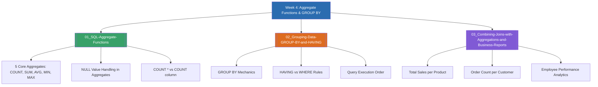

# Week 4 — SQL Aggregate Functions and GROUP BY Operations (MOC)

arrow_back สัปดาห์ก่อนหน้า: [[Week03-MOC|MOC สัปดาห์ 3]]

## check_circle เช็คลิสต์ก่อนเข้าเรียน

- [ ] จดจำฟังก์ชันรวมกลุ่มพื้นฐาน 5 ตัว (`COUNT`, `SUM`, `AVG`, `MIN`, `MAX`) — ดู [[01_SQL-Aggregate-Functions]]
- [ ] เข้าใจกฎการใช้ `GROUP BY` ร่วมกับคอลัมน์ใน `SELECT` — ดู [[02_Grouping-Data-GROUP-BY-and-HAVING]]
- [ ] แยกความแตกต่างระหว่างการกรองด้วย `WHERE` และการกรองด้วย `HAVING` — ดู [[02_Grouping-Data-GROUP-BY-and-HAVING]]
- [ ] ฝึกเขียนคิวรีเชื่อมตารางแล้วคำนวณสถิติยอดขายจริง — ดู [[03_Combining-Joins-with-Aggregations-and-Business-Reports]]

## assignment ภาพรวมสัปดาห์ 4 (สรุปย่อ)

สัปดาห์ที่ 4 เป็นการยกระดับการเขียนคิวรีเพื่อการวิเคราะห์ข้อมูลทางธุรกิจ (Data Analytics & Reporting) โดยมุ่งเน้นการประมวลผลข้อมูลระดับกลุ่มด้วย Aggregate Functions (`COUNT`, `SUM`, `AVG`, `MIN`, `MAX`) การจัดกลุ่มข้อมูลตามมิติต่าง ๆ ด้วย `GROUP BY` และการคัดกรองผลลัพธ์ของกลุ่มด้วย `HAVING Clause` พร้อมทั้งการผนวกการทำงานเข้ากับ `JOIN` เพื่อคำนวณยอดขายรวมของสินค้า ยอดขายรายพนักงาน และความถี่ในการสั่งซื้อของลูกค้าในระบบฐานข้อมูล Northwind / E-Commerce

## map แผนที่หัวข้อสัปดาห์ 4

## collections_bookmark โน้ตรายหัวข้อ

| หัวข้อ | เนื้อหาหลัก | หน้าสไลด์ / แหล่งอ้างอิง |
| --- | --- | --- |
| [[01_SQL-Aggregate-Functions]] | นิยามฟังก์ชัน `COUNT`, `SUM`, `AVG`, `MIN`, `MAX`, และพฤติกรรมต่อค่า `NULL` | สรุปคำสั่ง SQL น. 2–3 |
| [[02_Grouping-Data-GROUP-BY-and-HAVING]] | การจัดกลุ่มข้อมูล, กฎของคอลัมน์ใน `SELECT`, ความแตกต่างระหว่าง `WHERE` กับ `HAVING` | สรุปคำสั่ง SQL น. 3–4 |
| [[03_Combining-Joins-with-Aggregations-and-Business-Reports]] | การแก้โจทย์วิเคราะห์ธุรกิจ 5 ข้อ: ยอดขายรายสินค้า, จำนวนออเดอร์รายลูกค้า, ผลงานพนักงาน | แบบฝึกหัด JOIN_Aggregate |

> [!tip] ข้อแตกต่างสำคัญที่สุดในข้อสอบ
> - `WHERE` กรองข้อมูล **ก่อน** นำไปคำนวณกลุ่ม (ห้ามใส่ Aggregate Function ใน `WHERE` เด็ดขาด!)
> - `HAVING` กรองผลลัพธ์ **หลัง** จากที่คำนวณ Aggregate Function เสร็จเรียบร้อยแล้ว

arrow_forward สัปดาห์ถัดไป: [[Week05-MOC|MOC สัปดาห์ 5]]
