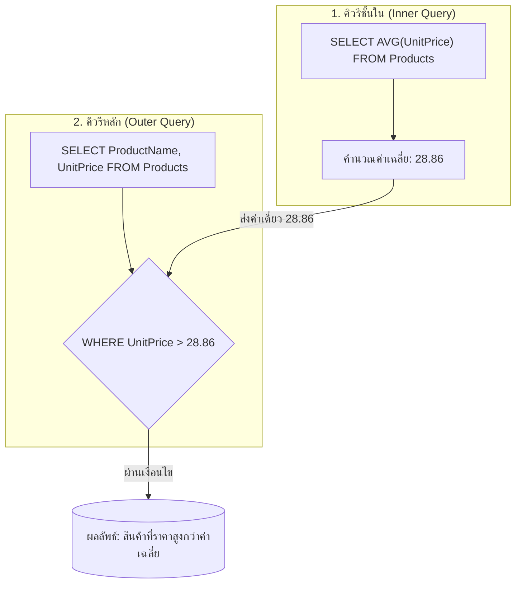

# พื้นฐานคำสั่ง SubQuery และการจำแนกประเภท (SubQuery Fundamentals & Types)

<span class="material-symbols-outlined">arrow_back</span> กลับไปที่ [[Week05-MOC|MOC สัปดาห์ 5]]

## <span class="material-symbols-outlined">key</span> Keyword

- **SubQuery (คิวรีย่อย / Nested Query)** — คำสั่ง `SELECT` ที่ฝังตัวอยู่ภายในคำสั่ง SQL อื่น เพื่อทำหน้าที่ดึงข้อมูลมาช่วยประมวลผลหรือเป็นเงื่อนไขให้กับคิวรีหลัก
- **Outer Query (คิวรีหลัก)** — คำสั่ง SQL ชั้นนอกสุดที่นำผลลัพธ์จาก SubQuery ไปประมวลผลต่อ
- **Inner Query (คิวรีชั้นใน)** — SubQuery ที่ทำงานอยู่ภายในวงเล็บ โดยปกติจะถูกประมวลผลก่อนคิวรีหลัก
- **Scalar Subquery** — คิวรีย่อยที่คืนผลลัพธ์เป็นค่าเดี่ยว (1 แถว 1 คอลัมน์) สามารถใช้ร่วมกับตัวดำเนินการเปรียบเทียบมาตรฐาน (`=`, `>`, `<`, `<>`) ได้โดยตรง
- **Multi-Row Subquery** — คิวรีย่อยที่คืนผลลัพธ์เป็นชุดข้อมูลหลายแถว (1 คอลัมน์ หลายแถว) ต้องใช้งานร่วมกับตัวดำเนินการเซต เช่น `IN`, `NOT IN`, `ANY`, `ALL`

## <span class="material-symbols-outlined">menu_book</span> Theory (เข้าใจง่าย)

### 1. ลำดับการทำงานของ SubQuery มาตรฐาน (Non-Correlated)
1. DBMS จะประมวลผล **Inner Query (คิวรีชั้นใน)** ก่อนเป็นลำดับแรก
2. ผลลัพธ์ที่ได้จากคิวรีชั้นในจะถูกส่งต่อไปแทนที่ในวงเล็บของ **Outer Query (คิวรีหลัก)**
3. คิวรีหลักจะนำค่าดังกล่าวไปประมวลผลเพื่อแสดงผลลัพธ์สุดท้าย

### 2. Scalar Subquery (คืนค่าเดี่ยว)
มักใช้ในการเปรียบเทียบกับค่าสถิติ เช่น "หาสินค้าที่มีราคาสูงกว่าราคาเฉลี่ยของสินค้าทั้งหมดในระบบ":

```sql
SELECT ProductID, ProductName, UnitPrice
FROM Products
WHERE UnitPrice > (
    -- SubQuery ชั้นใน: ส่งคืนค่าเฉลี่ยตัวเลขค่าเดียว เช่น 28.86
    SELECT AVG(UnitPrice)
    FROM Products
);
```

### 3. Multi-Row Subquery (คืนค่าหลายแถว)
เมื่อ SubQuery คืนค่าออกมาเป็นลิสต์ เราต้องใช้ `IN` หรือ `NOT IN`:

"หาลูกค้าที่อาศัยอยู่ในประเทศที่มีลูกค้าคนอื่นอาศัยอยู่มากกว่า 3 คนขึ้นไป":

```sql
SELECT CustomerName, Country
FROM Customers
WHERE Country IN (
    -- SubQuery ชั้นใน: ส่งคืนชุดชื่อประเทศ เช่น ('USA', 'Germany', 'Brazil')
    SELECT Country
    FROM Customers
    GROUP BY Country
    HAVING COUNT(*) > 3
);
```

> [!important] ข้อผิดพลาดที่พบบ่อย (Single-row subquery returns more than 1 row)
> หากเขียนว่า `WHERE UnitPrice = (SELECT UnitPrice FROM Products WHERE CategoryID = 1)` แต่ปรากฏว่าในหมวด 1 มีสินค้าหลายตัว ระบบจะฟ้อง Error ทันที เพราะเครื่องหมาย `=` ไม่สามารถเทียบกับชุดข้อมูลหลายค่าได้ ในกรณีนี้ต้องเปลี่ยนเครื่องหมาย `=` เป็น `IN`

## <span class="material-symbols-outlined">schema</span> Diagram



**ตัวอย่าง:** แผนผังลำดับขั้นตอนการประมวลผล Non-Correlated Subquery คิวรีชั้นในคำนวณค่าเฉลี่ยก่อน แล้วส่งค่าเดี่ยวไปให้คิวรีหลักใช้กรองข้อมูล (อ้างอิง SubQuery สไลด์หน้า 2–7)

---
<span class="material-symbols-outlined">arrow_forward</span> ต่อไป: [[02_Advanced-Subqueries-EXISTS-Correlated-and-Inline-Views]]
