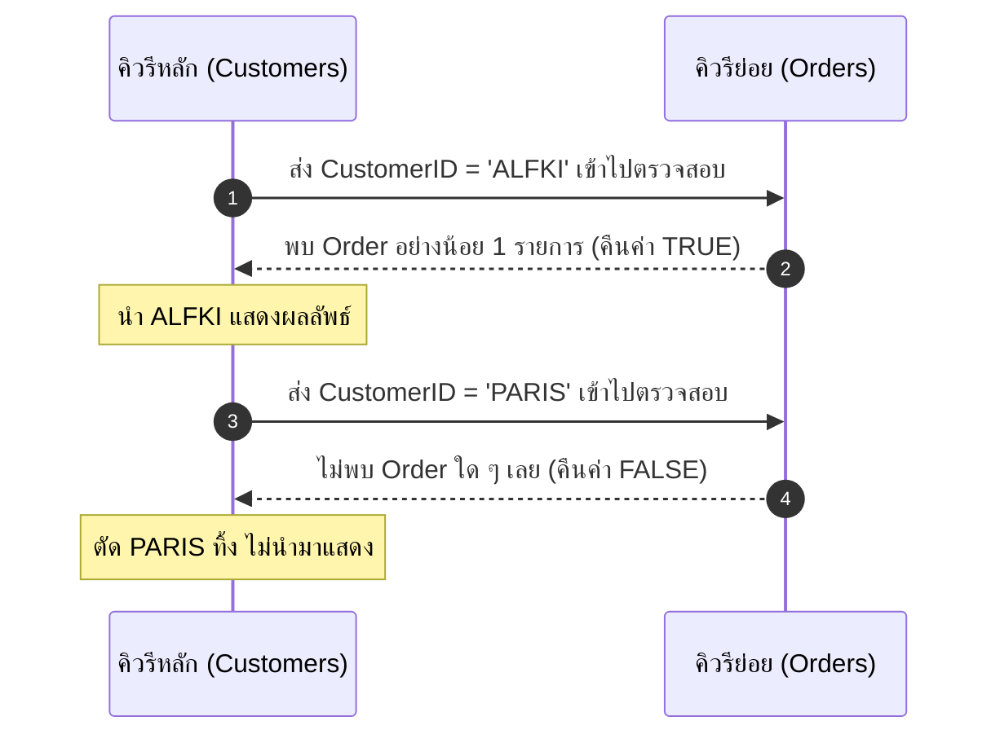

# เทคนิคขั้นสูง: EXISTS, Correlated Subquery และ Inline Views (Advanced Subqueries)

<span class="material-symbols-outlined">arrow_back</span> กลับไปที่ [[Week05-MOC|MOC สัปดาห์ 5]] | ก่อนหน้า: [[01_SubQuery-Fundamentals-and-Types]]

## <span class="material-symbols-outlined">key</span> Keyword

- **Inline View (Derived Table)** — การวาง SubQuery ไว้ในส่วนคำสั่ง `FROM` เพื่อทำหน้าที่เป็นตารางเสมือนชั่วคราว (จำเป็นต้องตั้ง Table Alias กำกับเสมอ)
- **EXISTS Operator** — ตัวดำเนินการบูลีนที่ตรวจสอบว่า SubQuery ส่งคืนแถวข้อมูลกลับมาอย่างน้อย 1 แถวหรือไม่ (คืนค่า TRUE ทันทีที่เจอแถวแรก)
- **NOT EXISTS Operator** — ตัวดำเนินการบูลีนที่ตรวจสอบว่า SubQuery ต้องไม่ส่งคืนแถวข้อมูลใด ๆ เลย (Empty Set)
- **Correlated Subquery** — คิวรีย่อยที่ทำงานโดยอ้างอิงค่าจากคอลัมน์ของคิวรีหลัก (Outer Query) ทำให้ต้องถูกประมวลผลซ้ำทีละแถวสำหรับทุก ๆ แถวของคิวรีหลัก

## <span class="material-symbols-outlined">menu_book</span> Theory (เข้าใจง่าย)

### 1. SubQuery ใน `FROM` (Inline View / Derived Table)
เมื่อเราต้องการสรุปข้อมูลรอบแรก แล้วนำผลสรุปนั้นมาจัดกลุ่มหรือคำนวณต่ออีกชั้นหนึ่ง:

```sql
-- หาค่าเฉลี่ยของยอดขายรวมต่อออเดอร์
SELECT AVG(OrderSummary.OrderTotal) AS AverageOrderValue
FROM (
    -- SubQuery ทำหน้าที่เสมือนเป็นตารางชั่วคราวชื่อ OrderSummary
    SELECT OrderID, SUM(UnitPrice * Quantity) AS OrderTotal
    FROM `Order Details`
    GROUP BY OrderID
) AS OrderSummary;
```

### 2. การใช้ `EXISTS` และ `NOT EXISTS`
`EXISTS` จะตรวจสอบเพียงแค่ว่า "มีข้อมูลตรงตามเงื่อนไขหรือไม่" โดยไม่ต้องดึงข้อมูลทั้งชุดขึ้นมา:

"หาลูกค้าที่เคยสั่งซื้อสินค้าอย่างน้อย 1 ครั้ง":
```sql
SELECT c.CustomerID, c.CustomerName
FROM Customers AS c
WHERE EXISTS (
    SELECT 1 
    FROM Orders AS o 
    WHERE o.CustomerID = c.CustomerID
);
```

"หาลูกค้าที่ไม่เคยสั่งซื้อสินค้าเลยแม้แต่ครั้งเดียว":
```sql
SELECT c.CustomerID, c.CustomerName
FROM Customers AS c
WHERE NOT EXISTS (
    SELECT 1 
    FROM Orders AS o 
    WHERE o.CustomerID = c.CustomerID
);
```

### 3. Correlated Subquery (คิวรีย่อยแบบอิงบริบท)
สังเกตว่าในตัวอย่าง `EXISTS` ด้านบน เงื่อนไข `WHERE o.CustomerID = c.CustomerID` ได้นำ `c.CustomerID` มาจากคิวรีหลักด้านนอก
- DBMS จะหยิบลูกค้าทีละคน (แถวที่ 1) $\rightarrow$ ส่ง `CustomerID` เข้าไปใน SubQuery $\rightarrow$ ตรวจสอบว่ามีออเดอร์ไหม
- จากนั้นหยิบลูกค้าคนที่ 2 $\rightarrow$ ส่งเข้าไปตรวจสอบซ้ำ
- ทำงานวนซ้ำจนครบทุกแถวของตาราง `Customers`

### 4. SubQuery ใน `HAVING`
ใช้เมื่อต้องการเปรียบเทียบผลรวมของกลุ่มกับผลรวมของกลุ่มเฉพาะตัวอื่น เช่น "หาสินค้าที่มียอดขายรวมสูงกว่ายอดขายของสินค้าชื่อ 'Chang'":

```sql
SELECT p.ProductName, SUM(od.Quantity * od.UnitPrice) AS TotalSales
FROM `Order Details` od 
INNER JOIN Products p ON od.ProductID = p.ProductID
GROUP BY p.ProductName
HAVING SUM(od.Quantity * od.UnitPrice) > (
    -- SubQuery ใน HAVING เพื่อหายอดขายของ 'Chang'
    SELECT SUM(od2.Quantity * od2.UnitPrice)
    FROM `Order Details` od2
    INNER JOIN Products p2 ON od2.ProductID = p2.ProductID
    WHERE p2.ProductName = 'Chang'
);
```

> [!tip] เคล็ดลับประสิทธิภาพ
> ใน `SELECT 1 FROM Orders WHERE ...` นิยมใส่เลข `1` แทนชื่อคอลัมน์ เพราะ `EXISTS` สนใจเพียงว่ามีแถวถูกส่งคืนหรือไม่ การใส่ `1` ช่วยประหยัดเวลาของฐานข้อมูลโดยไม่ต้องเสียเวลาไปถอดรหัสค่าของคอลัมน์จริง

## <span class="material-symbols-outlined">schema</span> Diagram



**ตัวอย่าง:** แผนภาพลำดับการทำงาน (Sequence Diagram) ของ Correlated Subquery ด้วย `EXISTS` แสดงการส่งค่าตัวแปรจากคิวรีหลักเข้าไปประเมินผลในคิวรีย่อยทีละแถว (อ้างอิง SubQuery สไลด์หน้า 8–19)

---
<span class="material-symbols-outlined">arrow_forward</span> ต่อไป: [[03_Comprehensive-SQL-Syntax-Cheatsheet]]
