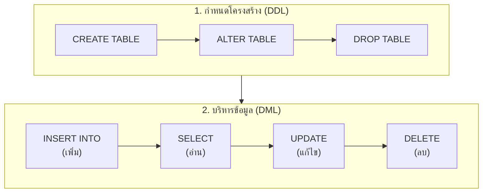

# สรุปคำสั่ง SQL ครบวงจรและคู่มือไวยากรณ์ (Comprehensive SQL Syntax Cheatsheet)

<span class="material-symbols-outlined">arrow_back</span> กลับไปที่ [[Week05-MOC|MOC สัปดาห์ 5]] | ก่อนหน้า: [[02_Advanced-Subqueries-EXISTS-Correlated-and-Inline-Views]]

## <span class="material-symbols-outlined">key</span> Keyword

- **Syntax Framework** — โครงสร้างลำดับคำสั่งที่ถูกต้องตามมาตรฐาน ANSI SQL
- **CRUD Operations** — 4 หน้าที่พื้นฐานของระบบฐานข้อมูล ได้แก่ Create (`INSERT`), Read (`SELECT`), Update (`UPDATE`), Delete (`DELETE`)
- **Query Clauses** — อนุประโยคในคำสั่ง SQL: `SELECT`, `FROM`, `WHERE`, `GROUP BY`, `HAVING`, `ORDER BY`, `LIMIT`

## <span class="material-symbols-outlined">menu_book</span> Theory (เข้าใจง่าย)

### 1. โครงสร้างคำสั่ง SELECT สมบูรณ์ (Full Query Anatomy)

```sql
SELECT [DISTINCT] column1, AGG_FUNC(column2) AS alias_name
FROM table_primary AS t1
[INNER | LEFT | RIGHT] JOIN table_secondary AS t2 ON t1.key = t2.key
WHERE filter_condition
GROUP BY column1
HAVING group_filter_condition
ORDER BY sort_column [ASC | DESC]
LIMIT row_count OFFSET offset_count;
```

### 2. ตารางสรุปคำสั่งและตัวอย่างการใช้งานจริง

| คำสั่ง / ส่วนประกอบ | หน้าที่ | ตัวอย่างโค้ด SQL |
| :--- | :--- | :--- |
| `SELECT` | กำหนดคอลัมน์ที่ต้องการแสดงผล | `SELECT FirstName, LastName` |
| `SELECT DISTINCT` | แสดงเฉพาะค่าที่ไม่ซ้ำกัน | `SELECT DISTINCT City FROM Customers` |
| `FROM` | ระบุตารางต้นทางของข้อมูล | `FROM Employees` |
| `WHERE` | กรองแถวตามเงื่อนไข (ห้ามใส่ Aggregate) | `WHERE Salary >= 30000 AND Dept = 'IT'` |
| `ORDER BY` | จัดเรียงผลลัพธ์ (น้อยไปมาก หรือ มากไปน้อย) | `ORDER BY UnitPrice DESC` |
| `INSERT INTO` | เพิ่มแถวข้อมูลใหม่เข้าตาราง | `INSERT INTO Persons (Name) VALUES ('John')` |
| `UPDATE ... SET` | แก้ไขค่าในคอลัมน์ (อย่าลืม WHERE) | `UPDATE Products SET Price = Price * 1.1 WHERE CatID = 1` |
| `DELETE FROM` | ลบแถวข้อมูลออกจากตาราง | `DELETE FROM Orders WHERE OrderID = 1001` |
| `GROUP BY` | รวมแถวที่มีค่าซ้ำกันเพื่อคำนวณ Aggregate | `GROUP BY CategoryID` |
| `HAVING` | กรองผลลัพธ์หลังจากการรวมกลุ่ม | `HAVING COUNT(*) > 10` |
| `INNER JOIN` | นำข้อมูลที่มีคู่ตรงกันทั้งสองฝั่งมารวมกัน | `FROM Orders o JOIN Customers c ON o.CID = c.CID` |
| `LEFT JOIN` | เอาตารางซ้ายทั้งหมด แม้ฝั่งขวาจะไม่มีคู่ | `FROM Customers c LEFT JOIN Orders o ON c.CID = o.CID` |
| `LIMIT` | จำกัดจำนวนแถวที่ต้องการแสดง | `LIMIT 10` |

### 3. ตัวดำเนินการที่ใช้บ่อยใน WHERE Clause
- `AND` / `OR` / `NOT` (ตัวดำเนินการตรรกะ)
- `BETWEEN low AND high` (ช่วงค่าตัวเลขหรือวันที่)
- `IN (val1, val2, ...)` (เทียบในเซตค่า)
- `LIKE 'pattern'` (จับคู่ข้อความ: `%` แทนกี่ตัวก็ได้, `_` แทน 1 ตัว)
- `IS NULL` / `IS NOT NULL` (เช็คค่าว่าง)

> [!tip] กฎทองคำเพื่อความปลอดภัย (SQL Best Practices)
> 1. ทดสอบเงื่อนไขด้วย `SELECT * FROM Table WHERE ...` ให้มั่นใจก่อนรันคำสั่ง `UPDATE` หรือ `DELETE` เสมอ
> 2. อย่าลืมใส่ Alias ให้กับทุก Derived Table ใน `FROM` เสมอ เช่น `FROM (SELECT ...) AS MyTable`
> 3. ใส่เครื่องหมาย Backticks (`` ` ``) ครอบชื่อตารางหรือคอลัมน์ที่มีเว้นวรรค เช่น `` `Order Details` ``

## <span class="material-symbols-outlined">schema</span> Diagram



**ตัวอย่าง:** แผนภาพสรุปวงจรคำสั่งภาษา SQL จากการสร้างโครงสร้างตาราง (DDL) ไปสู่การจัดการระเบียนข้อมูล (DML) (อ้างอิง สรุปคำสั่ง SQL พร้อมตัวอย่าง น. 1–4)

---
<span class="material-symbols-outlined">arrow_forward</span> กลับไปที่: [[Week05-MOC|MOC สัปดาห์ 5]]
