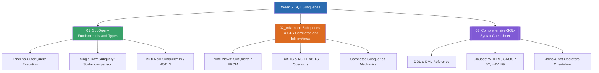

# Week 5 — SQL Subqueries and Advanced Query Formulations (MOC)

arrow_back สัปดาห์ก่อนหน้า: [[Week04-MOC|MOC สัปดาห์ 4]]

## check_circle เช็คลิสต์ก่อนเข้าเรียน

- [ ] เข้าใจนิยามและโครงสร้างของ SubQuery (Inner Query vs Outer Query) — ดู [[01_SubQuery-Fundamentals-and-Types]]
- [ ] แยกความแตกต่างระหว่าง Single-row Subquery และ Multi-row Subquery — ดู [[01_SubQuery-Fundamentals-and-Types]]
- [ ] เรียนรู้การใช้ตัวดำเนินการ `IN`, `EXISTS`, `NOT EXISTS` และ Correlated Subquery — ดู [[02_Advanced-Subqueries-EXISTS-Correlated-and-Inline-Views]]
- [ ] ทบทวนไวยากรณ์คำสั่ง SQL ทั้งหมดผ่าน Cheatsheet สรุปย่อ — ดู [[03_Comprehensive-SQL-Syntax-Cheatsheet]]

## assignment ภาพรวมสัปดาห์ 5 (สรุปย่อ)

สัปดาห์ที่ 5 มุ่งเน้นการเขียนคิวรีซ้อนคิวรี (SubQuery หรือ Nested Query) ซึ่งเป็นกลไกสำคัญในการแก้โจทย์ปัญหาที่มีความซับซ้อนเกินกว่าคำสั่งเดี่ยวจะทำได้ ครอบคลุมการจำแนกชนิดของ SubQuery ตามผลลัพธ์ (Scalar, Column, Table), ตำแหน่งการวางในคำสั่งหลัก (`SELECT`, `WHERE`, `FROM` ในฐานะ Derived Table/Inline View, และ `HAVING`), การใช้ตัวดำเนินการตรวจจับการมีอยู่ `EXISTS` และ `NOT EXISTS`, ความเข้าใจเกี่ยวกับ Correlated Subquery ที่เชื่อมโยงตัวแปรระหว่างคิวรีชั้นในและชั้นนอก รวมถึงสรุปภาพรวมคำสั่ง SQL ทั้งหมด

## map แผนที่หัวข้อสัปดาห์ 5

## collections_bookmark โน้ตรายหัวข้อ

| หัวข้อ | เนื้อหาหลัก | หน้าสไลด์ / แหล่งอ้างอิง |
| --- | --- | --- |
| [[01_SubQuery-Fundamentals-and-Types]] | นิยาม SubQuery, คิวรีชั้นในทำงานก่อน, Single-row vs Multi-row, ตัวอย่างราคาสูงกว่าค่าเฉลี่ย | SubQuery น. 1–7 |
| [[02_Advanced-Subqueries-EXISTS-Correlated-and-Inline-Views]] | SubQuery ใน `FROM`, `HAVING`, การใช้ `EXISTS / NOT EXISTS`, และ Correlated Subquery | SubQuery น. 8–19 |
| [[03_Comprehensive-SQL-Syntax-Cheatsheet]] | สรุปคำสั่ง SQL ครบวงจร: โครงสร้างคำสั่ง ตัวอย่างไวยากรณ์ และข้อควรระวัง | สรุปคำสั่ง SQL น. 1–4 |

> [!tip] เคล็ดลับประสิทธิภาพ (Join vs SubQuery)
> บ่อยครั้งคำสั่ง `IN (Subquery)` สามารถแปลงเป็น `INNER JOIN` หรือ `EXISTS` ได้ ซึ่งในฐานข้อมูลขนาดใหญ่ การใช้ `JOIN` หรือ `EXISTS` มักให้ประสิทธิภาพที่ดีกว่าเพราะ Optimizer สามารถใช้ Index ค้นหาแบบ Short-Circuit ได้ทันทีโดยไม่ต้องรัน Subquery จนครบชุด

arrow_forward สัปดาห์ถัดไป: [[Week06-MOC|MOC สัปดาห์ 6]]
