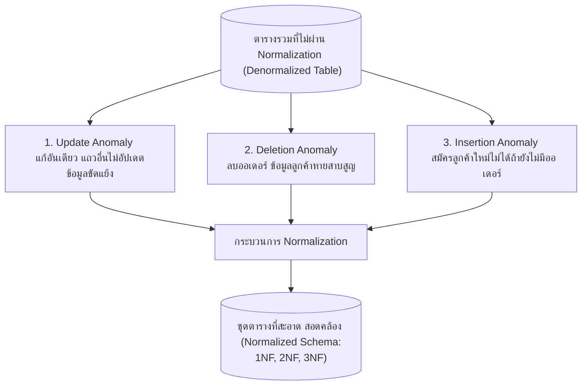

# แนวคิดการทำให้เป็นรูปปกติและความผิดปกติของข้อมูล (Normalization Concepts & Anomalies)

arrow_back กลับไปที่ [[Week06-MOC|MOC สัปดาห์ 6]]

## key Keyword

- **Normalization (การทำให้เป็นรูปปกติ)** — กระบวนการทางคณิตศาสตร์ในการจัดระเบียบโครงสร้างตาราง เพื่อกำจัดความซ้ำซ้อนของข้อมูล และป้องกันปัญหาความผิดปกติในการใช้งาน
- **Data Redundancy (ความซ้ำซ้อนของข้อมูล)** — การจัดเก็บข้อมูลข้อเท็จจริงเดียวกันซ้ำไว้ในหลาย ๆ แถวหรือหลายตาราง ส่งผลให้เปลืองพื้นที่จัดเก็บและเสี่ยงต่อข้อมูลขัดแย้งกัน
- **Insertion Anomaly (ความผิดปกติจากการเพิ่มข้อมูล)** — สภาวะที่ไม่สามารถเพิ่มข้อมูลบางอย่างลงตารางได้ เนื่องจากยังขาดข้อมูลของอีกสิ่งหนึ่งที่เป็นส่วนหนึ่งของ Primary Key
- **Deletion Anomaly (ความผิดปกติจากการลบข้อมูล)** — สภาวะที่การลบข้อมูลแถวหนึ่ง ส่งผลให้ข้อมูลสำคัญอื่นที่ไม่ได้ตั้งใจลบสูญหายไปด้วย
- **Update Anomaly (ความผิดปกติจากการแก้ไขข้อมูล)** — สภาวะที่เมื่อต้องการแก้ไขข้อมูลจุดหนึ่ง ผู้ใช้ต้องตามไปแก้ไขในหลาย ๆ แถว หากแก้ไขไม่ครบ ข้อมูลในระบบจะเกิดความไม่สอดคล้องกัน (Inconsistency)

## menu_book Theory (เข้าใจง่าย)

### 1. ปัญหาของตารางที่ไม่ได้ผ่านการ Normalize (Unnormalized Table)
พิจารณาตารางคำสั่งซื้อแบบรวมศูนย์ (จากไฟล์ `Database_Denormalized.docx`):

| OrderID | CustomerName | CustomerPhone | ProductNames | Prices | Salesperson |
| :--- | :--- | :--- | :--- | :--- | :--- |
| 1001 | Alice | 081-111-1111 | iPhone 15, AirPods Pro | 38000, 8500 | Mr. John |
| 1002 | Bob | 082-222-2222 | Galaxy S24 | 35000 | Ms. Jane |
| 1003 | Alice | 081-111-1111 | iPad Air | 23000 | Mr. John |

### 2. ความผิดปกติ 3 ประการ (The Three Anomalies)

#### 2.1 Update Anomaly (ความผิดปกติเมื่อแก้ไข)
หากลูกค้าชื่อ Alice เปลี่ยนเบอร์โทรศัพท์ใหม่ ระบบต้องตามไปแก้ `CustomerPhone` ในทุก ๆ ออเดอร์ที่ Alice เคยสั่ง (OrderID 1001 และ 1003) หากแอปพลิเคชันแก้เพียงแถวเดียว ข้อมูลของ Alice จะขัดแย้งกันทันที

#### 2.2 Deletion Anomaly (ความผิดปกติเมื่อลบ)
หากลูกค้าชื่อ Bob ขอยกเลิกคำสั่งซื้อ OrderID 1002 แล้วเราสั่ง `DELETE FROM Orders WHERE OrderID = 1002;` สิ่งที่จะเกิดขึ้นคือ:
- ประวัติการสั่งซื้อถูกลบ (ตามที่ต้องการ)
- แต่ **ข้อมูลส่วนตัวของ Bob (ชื่อ, เบอร์โทร)** รวมถึงข้อมูลว่ามีพนักงานชื่อ Ms. Jane อยู่ในระบบ จะถูกลบหายไปจากฐานข้อมูลอย่างถาวรด้วย!

#### 2.3 Insertion Anomaly (ความผิดปกติเมื่อเพิ่ม)
หากเรามีลูกค้าคนใหม่เดินเข้ามาสมัครสมาชิก แต่ยังไม่ได้ตัดสินใจสั่งซื้อสินค้า เราจะไม่สามารถบันทึกข้อมูลลูกค้าคนนี้ลงในตารางได้ เพราะคอลัมน์ `OrderID` ซึ่งทำหน้าที่เป็น Primary Key ยังไม่มีค่า (และ PK ห้ามเป็น NULL ตามกฎ Entity Integrity)

> [!tip] สรุปเป้าหมายของ Normalization
> Normalization ถูกคิดค้นขึ้นมาเพื่อตอบคำถามเดียว: **"แต่ละตารางควรเก็บข้อเท็จจริงเกี่ยวกับเรื่องอะไรเพียงเรื่องเดียว (One Theme per Table)"** ตารางลูกค้าเก็บเฉพาะลูกค้า ตารางสินค้าเก็บเฉพาะสินค้า และตารางคำสั่งซื้อเก็บเฉพาะการเชื่อมโยงการซื้อขาย

## schema Diagram

**ตัวอย่าง:** แผนภาพแสดงปัญหาความผิดปกติ 3 ประการที่เกิดขึ้นเมื่อเก็บข้อมูลหลายเรื่องรวมในตารางเดียว และการนำกระบวนการ Normalization มาแก้ไข (อ้างอิง Normalization สไลด์หน้า 1–3)

---
arrow_forward ต่อไป: [[02_Normal-Forms-1NF-2NF-3NF-and-BCNF]]
