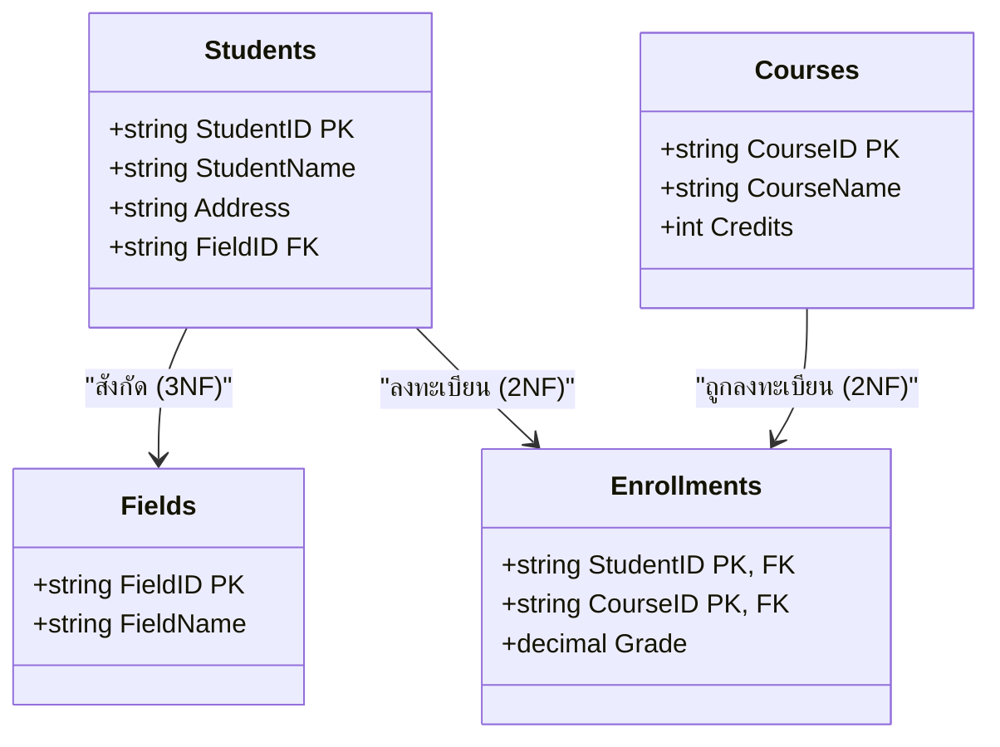

# ขั้นตอนการจัดระเบียบตารางสู่ 1NF, 2NF, 3NF และ BCNF (Normal Forms)

<span class="material-symbols-outlined">arrow_back</span> กลับไปที่ [[Week06-MOC|MOC สัปดาห์ 6]] | ก่อนหน้า: [[01_Normalization-Concepts-and-Anomalies]]

## <span class="material-symbols-outlined">key</span> Keyword

- **Atomic Value** — ค่าข้อมูลเดี่ยวที่ไม่สามารถแยกย่อยออกเป็นหลายค่าได้อีก (ห้ามเก็บค่าหลายตัวคั่นด้วยจุลภาคในเซลล์เดียว)
- **Repeating Group** — กลุ่มของข้อมูลที่เกิดขึ้นซ้ำ ๆ ในระเบียน เช่น `CourseID1`, `CourseID2`
- **Functional Dependency ($X \rightarrow Y$)** — การขึ้นต่อกันทางหน้าที่ หมายความว่า ถ้าทราบค่าของ $X$ เราจะสามารถระบุค่าของ $Y$ ได้อย่างแน่นอนเพียงค่าเดียว
- **Partial Dependency** — สภาวะที่ Attribute ที่ไม่ใช่คีย์ ขึ้นอยู่กับ "ส่วนใดส่วนหนึ่ง" ของ Composite Primary Key ไม่ได้ขึ้นกับคีย์หลักทั้งชุด
- **Transitive Dependency** — สภาวะที่ Attribute ที่ไม่ใช่คีย์ ขึ้นอยู่กับ Attribute อื่นที่ไม่ใช่คีย์ด้วยกันเอง ($X \rightarrow Y$ และ $Y \rightarrow Z$ โดยที่ $X$ คือ PK)
- **BCNF (Boyce-Codd Normal Form)** — ระดับปกติที่เข้มงวดกว่า 3NF โดยกำหนดว่า ตัวกำหนดค่า (Determinant $X$) ในทุก ๆ $X \rightarrow Y$ จะต้องเป็น Candidate Key เสมอ

## <span class="material-symbols-outlined">menu_book</span> Theory (เข้าใจง่าย)

### 1. ลำดับขั้นการทำ Normalization

```text
Unnormalized Table (UNF)
       │  [กำจัด Repeating Groups / ทำให้ค่าเป็น Atomic / กำหนด PK]
       ▼
1st Normal Form (1NF)
       │  [กำจัด Partial Dependency (ตัดคอลัมน์ที่ขึ้นกับคีย์แค่ครึ่งเดียว)]
       ▼
2nd Normal Form (2NF)
       │  [กำจัด Transitive Dependency (ตัดคอลัมน์ที่ขึ้นกับฟิลด์ธรรมดา)]
       ▼
3rd Normal Form (3NF)
       │  [ทุก Determinant ต้องเป็น Candidate Key]
       ▼
Boyce-Codd Normal Form (BCNF)
```

---

### 2. กฎและขั้นตอนของแต่ละระดับ

#### 2.1 First Normal Form (1NF)
- **กฎ:** 
  1. ข้อมูลทุกเซลล์ต้องเป็น **Atomic** (ค่าเดี่ยว)
  2. ไม่มีคอลัมน์ที่เป็นกลุ่มซ้ำ (No Repeating Columns เช่น `Course1`, `Course2`)
  3. ต้องมีการกำหนด Primary Key ที่ระบุแต่ละแถวได้อย่างไม่ซ้ำซ้อน
- **การแก้ไข:** แยกแถวออกมาให้แต่ละแถวมีสินค้า/วิชาเพียงชิ้นเดียว

#### 2.2 Second Normal Form (2NF)
- **กฎ:**
  1. ต้องเป็น **1NF** เรียบร้อยแล้ว
  2. ต้อง **ไม่มี Partial Dependency** (ทุกฟิลด์ที่ไม่ใช่คีย์ ต้องขึ้นกับ Primary Key ทั้งชุด)
  > [!note] ข้อสังเกต
  > หากตารางใดมี Primary Key เป็นคอลัมน์เดี่ยว (Single-column PK) ตารางนั้นจะผ่านเงื่อนไข 2NF โดยอัตโนมัติทันที เพราะไม่สามารถเกิด Partial Dependency ได้!
- **การแก้ไข:** แยกตารางออกเป็นตารางข้อมูลหลัก และตารางความสัมพันธ์ที่มี Composite Key

#### 2.3 Third Normal Form (3NF)
- **กฎ:**
  1. ต้องเป็น **2NF** เรียบร้อยแล้ว
  2. ต้อง **ไม่มี Transitive Dependency** (ไม่มีการขึ้นต่อกันแบบทอดต่อระหว่างฟิลด์ที่ไม่ใช่คีย์)
  - ตัวอย่าง: ในตารางนักศึกษา มี `{StudentID (PK), StudentName, MajorID, MajorName}`
  - พบว่า `StudentID` $\rightarrow$ `MajorID` และ `MajorID` $\rightarrow$ `MajorName`
  - ดังนั้น `MajorName` ขึ้นกับ `MajorID` (ไม่ใช่ PK) เกิด Transitive Dependency
- **การแก้ไข:** ตัด `{MajorID, MajorName}` ออกไปสร้างเป็นตาราง `Majors` ใหม่ แล้วคงเหลือไว้เพียง `MajorID` ในฐานะ Foreign Key ในตารางนักศึกษา

#### 2.4 Boyce-Codd Normal Form (BCNF)
3NF ส่วนใหญ่จะเป็น BCNF อยู่แล้ว เว้นแต่กรณีพิเศษที่ตารางมีหลาย Candidate Keys และคีย์เหล่านั้นมีคอลัมน์ซ้อนทับกัน (Overlapping Candidate Keys)
- **กฎ BCNF:** สำหรับทุก ๆ Functional Dependency $X \rightarrow Y$ ใด ๆ ค่า $X$ จะต้องเป็น **Super Key / Candidate Key** เท่านั้น

## <span class="material-symbols-outlined">schema</span> Diagram



**ตัวอย่าง:** แผนภาพโครงสร้างตารางสุดท้ายหลังผ่านกระบวนการ 3NF จากตัวอย่างในสไลด์เรียน ตารางเดิมถูกแยกออกเป็น 4 ตารางย่อยที่สะอาด ไม่มี Partial และ Transitive Dependency (อ้างอิง Normalization สไลด์หน้า 4–18)

---
<span class="material-symbols-outlined">arrow_forward</span> ต่อไป: [[03_Denormalization-and-Real-World-Tradeoffs]]
