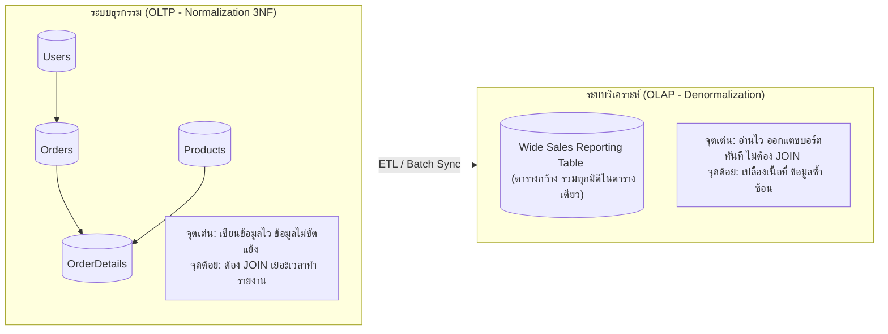

# การลดรูปกลับและข้อแลกเปลี่ยนในระบบงานจริง (Denormalization & Real-World Trade-offs)

arrow_back กลับไปที่ [[Week06-MOC|MOC สัปดาห์ 6]] | ก่อนหน้า: [[02_Normal-Forms-1NF-2NF-3NF-and-BCNF]]

## key Keyword

- **Denormalization (การลดรูปกลับ)** — กลยุทธ์การออกแบบฐานข้อมูลโดยจงใจยอมให้มีความซ้ำซ้อนของข้อมูลบางส่วน (Duplicate/Redundant Data) ในตาราง เพื่อเพิ่มความเร็วในการอ่านและลดการใช้คำสั่ง `JOIN`
- **OLTP (Online Transaction Processing)** — ระบบประมวลผลธุรกรรมแบบเรียลไทม์ (เน้นการเขียน เพิ่ม ลบ แก้ไขอย่างรวดเร็วและถูกต้องสูง) เหมาะกับ Normalized Schema (3NF)
- **OLAP (Online Analytical Processing)** — ระบบวิเคราะห์ข้อมูลขนาดใหญ่และคลังข้อมูล (เน้นการอ่านและออกรายงานซับซ้อน) เหมาะกับ Denormalized Schema (Star / Snowflake Schema)
- **Join Overhead** — ค่าใช้จ่ายด้านเวลาและหน่วยความจำของเครื่องแม่ข่ายฐานข้อมูล เมื่อต้องเชื่อมโยงตารางจำนวนมากเข้าด้วยกัน

## menu_book Theory (เข้าใจง่าย)

### 1. ทำไมระบบจึงไม่ควร Normalize ไปจนสุดทางเสมอไป?
แม้ว่า Normalization (3NF / BCNF) จะช่วยกำจัดความซ้ำซ้อนและป้องกัน Anomalies ได้สมบูรณ์แบบ แต่ในโลกความจริงมีผลข้างเคียงสำคัญ:
1. **ตารางแตกย่อยมากเกินไป:** เช่น จาก 1 ตารางกลายเป็น 10 ตาราง
2. **การคิวรีอ่านช้าลงอย่างมาก:** เมื่อต้องการดึงหน้ารายการสินค้าในแอปพลิเคชัน อาจต้อง `JOIN` ถึง 6–8 ตาราง ซึ่งทำให้ฐานข้อมูลต้องกวาด Index และใช้ CPU มหาศาล
3. **ความซับซ้อนของโค้ด:** การเขียนคำสั่ง SQL จะยาวและซับซ้อนขึ้นมาก

### 2. เปรียบเทียบระหว่าง Normalization และ Denormalization

| มิติการเปรียบเทียบ | Normalized Schema (3NF) | Denormalized Schema |
| :--- | :--- | :--- |
| **สถาปัตยกรรมเป้าหมาย** | OLTP (เว็บแอป, ระบบธนาคาร, POS) | OLAP / Data Warehouse / Reporting |
| **การเขียน (Write / Insert / Update)** | **เร็วมาก** (เขียนลงตารางเดียว ไม่ต้องแก้ซ้ำ) | ช้า (ต้องตามไปแก้หลายจุด) |
| **การอ่าน (Read / Query)** | ช้ากว่าหากต้อง `JOIN` หลายตาราง | **เร็วมาก** (อ่านจากตารางเดียวจบ) |
| **ความถูกต้องของข้อมูล** | สูงมาก (ไม่มี Anomalies) | ต้องควบคุมด้วยโค้ดหรือ Trigger |
| **พื้นที่จัดเก็บบนดิสก์** | ประหยัดเนื้อที่ (Minimal Storage) | เปลืองพื้นที่จัดเก็บมากขึ้น |

### 3. กรณีศึกษาที่นิยมทำ Denormalization ในระบบงานจริง
1. **การเก็บยอดคำนวณสะสม (Precomputed Totals):** เช่น ในตาราง `Orders` มีการเก็บคอลัมน์ `TotalAmount` ไว้ล่วงหน้า แทนที่จะต้องไปคำนวณ `SUM(UnitPrice * Quantity)` จากตารางลูกทุกครั้งที่มีคนเปิดดูประวัติออเดอร์
2. **การเก็บชื่อซ้ำเพื่อแสดงผลเร็ว:** ในตารางบันทึกการส่งของ เก็บทั้ง `CustomerID` และ `CustomerName` เพื่อให้สามารถพิมพ์ใบปะหน้าพัสดุได้ทันทีโดยไม่ต้องเชื่อมตารางลูกค้า

> [!tip] กฎเหล็กในการทำ Denormalization
> ให้ทำการ **Normalize สู่ 3NF ก่อนเสมอ** แล้วจึงค่อยทำการ Denormalize เฉพาะในจุดที่มีหลักฐานการวัดผล (Profiling / Slow Query Logs) พบว่าเกิดคอขวดด้านประสิทธิภาพการอ่านจริง ห้ามออกแบบแบบ Denormalize ตั้งแต่ต้นโดยไร้เหตุผล

## schema Diagram

**ตัวอย่าง:** สถาปัตยกรรมการแบ่งแยกระหว่างระบบ OLTP ที่ใช้ Normalized Schema เพื่อรองรับธุรกรรมประจำวัน และระบบ OLAP ที่ดึงข้อมูลผ่าน ETL มาจัดเก็บแบบ Denormalized เพื่อออกรายงาน (อ้างอิง Normalization สไลด์หน้า 19–20)

---
arrow_forward กลับไปที่: [[Week06-MOC|MOC สัปดาห์ 6]]
