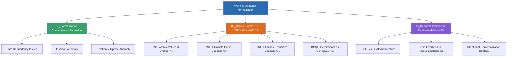

# Week 6 — Database Normalization and Schema Refinement (MOC)

arrow_back สัปดาห์ก่อนหน้า: [[Week05-MOC|MOC สัปดาห์ 5]]

## check_circle เช็คลิสต์ก่อนเข้าเรียน

- [ ] ทำความเข้าใจปัญหาความผิดปกติของข้อมูล 3 แบบ (Insertion, Deletion, Update Anomaly) — ดู [[01_Normalization-Concepts-and-Anomalies]]
- [ ] ศึกษาขั้นตอนการจัดระเบียบตารางสู่ 1NF (Atomic Value), 2NF (No Partial Dependency), และ 3NF (No Transitive Dependency) — ดู [[02_Normal-Forms-1NF-2NF-3NF-and-BCNF]]
- [ ] วิเคราะห์ข้อแลกเปลี่ยน (Trade-offs) ระหว่าง Normalization กับ Denormalization ในระบบงานจริง — ดู [[03_Denormalization-and-Real-World-Tradeoffs]]

## assignment ภาพรวมสัปดาห์ 6 (สรุปย่อ)

สัปดาห์ที่ 6 เป็นหัวใจสำคัญของการออกแบบฐานข้อมูลเชิงสัมพันธ์ นั่นคือกระบวนการ **Normalization (การทำให้เป็นรูปปกติ)** เพื่อกำจัดความซ้ำซ้อนของข้อมูล (Data Redundancy) และป้องกันความผิดปกติในการปรับปรุงข้อมูล (Anomalies) โดยเริ่มต้นจากการแปลงข้อมูลที่เก็บแบบตารางรวม (Denormalized Table) เข้าสู่ 1NF โดยบังคับให้ค่าในแต่ละเซลล์เป็นค่าเดี่ยว (Atomic Values), เข้าสู่ 2NF โดยการตัดการขึ้นต่อกันบางส่วน (Partial Dependency), และเข้าสู่ 3NF โดยการตัดการขึ้นต่อกันแบบทอดต่อ (Transitive Dependency) จนได้ชุดตารางที่มีโครงสร้างสัมพันธ์กันอย่างมีประสิทธิภาพ

## map แผนที่หัวข้อสัปดาห์ 6

## collections_bookmark โน้ตรายหัวข้อ

| หัวข้อ | เนื้อหาหลัก | หน้าสไลด์ / แหล่งอ้างอิง |
| --- | --- | --- |
| [[01_Normalization-Concepts-and-Anomalies]] | วัตถุประสงค์ของการ Normalize, ความซ้ำซ้อนของข้อมูล, และความผิดปกติทั้ง 3 แบบ | Normalization น. 1–3 |
| [[02_Normal-Forms-1NF-2NF-3NF-and-BCNF]] | กฎและขั้นตอนการแปลงทีละระดับ: 1NF $\rightarrow$ 2NF $\rightarrow$ 3NF พร้อมตัวอย่างแยกตาราง | Normalization น. 4–18 |
| [[03_Denormalization-and-Real-World-Tradeoffs]] | ข้อดี-ข้อเสีย, ผลกระทบต่อประสิทธิภาพการอ่าน/เขียน, และกรณีที่ควรทำ Denormalization | Normalization น. 19–20 |

> [!tip] กฎจำสั้นแบบสากลของ Bill Kent
> "Each non-key attribute must provide a fact about the key, the whole key, and nothing but the key, so help me Codd."
> - **the key** = 1NF (ต้องขึ้นกับคีย์หลัก)
> - **the whole key** = 2NF (ต้องขึ้นกับคีย์หลักทั้งตัว ไม่ใช่แค่บางส่วน)
> - **nothing but the key** = 3NF (ต้องขึ้นกับคีย์หลักเท่านั้น ไม่ใช่ไปขึ้นกับฟิลด์อื่นทอดต่อ)

arrow_forward สัปดาห์ถัดไป: [[Week07-MOC|MOC สัปดาห์ 7]]
