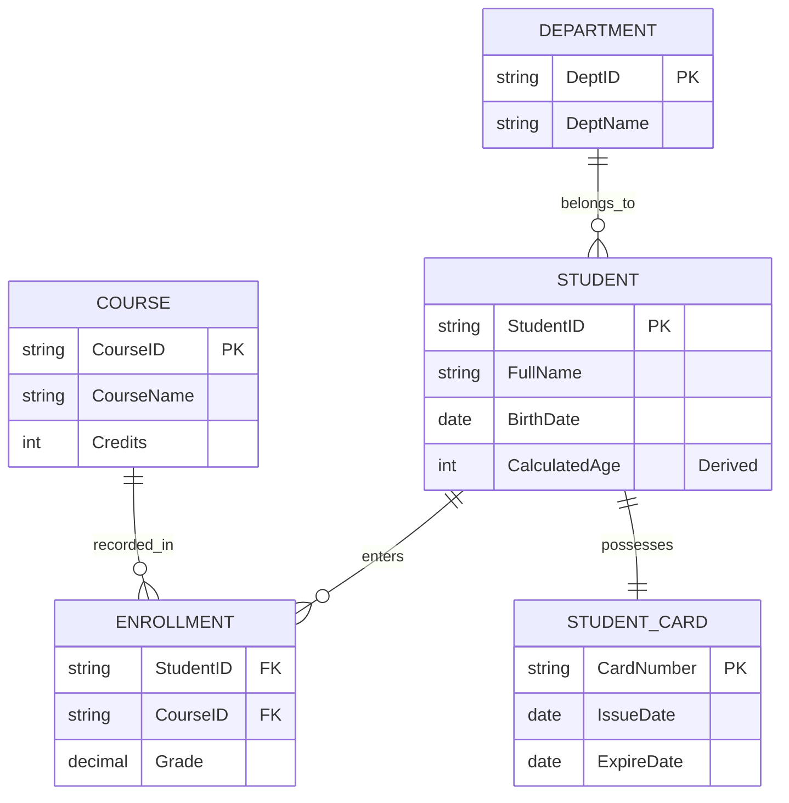

# วงจรการพัฒนาระบบฐานข้อมูลและการสร้างแบบจำลอง ER (DSDLC & ER Modeling)

<span class="material-symbols-outlined">arrow_back</span> กลับไปที่ [[Week07-MOC|MOC สัปดาห์ 7]]

## <span class="material-symbols-outlined">key</span> Keyword

- **DSDLC (Database Systems Development Life Cycle)** — กระบวนการขั้นตอนการพัฒนาระบบฐานข้อมูลตั้งแต่การศึกษาความต้องการจนถึงการดูแลรักษาระบบ
- **Conceptual Database Design** — การออกแบบโครงสร้างข้อมูลในระดับแนวคิด โดยไม่ขึ้นกับซอฟต์แวร์ DBMS ชนิดใด (สร้างผ่าน ER Diagram)
- **Logical Database Design** — การแปลงแบบจำลองแนวคิดให้อยู่ในรูปเค้าร่างเชิงสัมพันธ์ (Relational Schema) และการปรับบรรทัดฐาน (Normalization)
- **Physical Database Design** — การกำหนดโครงสร้างการจัดเก็บบนฮาร์ดดิสก์จริง เช่น การเลือก Storage Engine (InnoDB), การสร้าง Indexes, และการกำหนดขนาดพื้นที่
- **Strong Entity vs Weak Entity** — เอนทิตีที่มีคีย์หลักของตนเองอย่างสมบูรณ์ เทียบกับ เอนทิตีที่ต้องอาศัยการมีอยู่ของเอนทิตีอื่นและใช้ Partial Key (แทนด้วยสี่เหลี่ยมซ้อนสองชั้น)

## <span class="material-symbols-outlined">menu_book</span> Theory (เข้าใจง่าย)

### 1. สามระดับของการออกแบบฐานข้อมูล (Three Phases of Database Design)

```text
[ ผู้ใช้ / Business Rules ]
         │
         ▼
1. Conceptual Design  ──► ER Diagram (อิสระจาก DBMS และฮาร์ดแวร์)
         │
         ▼
2. Logical Design     ──► Relational Schema (อิงตามโมเดล เช่น เชิงสัมพันธ์/RDBMS)
         │
         ▼
3. Physical Design    ──► MySQL DDL, Indexes, Data Types, Partitioning (เจาะจงเครื่องและระบบ)
```

---

### 2. องค์ประกอบและสัญลักษณ์ในแบบจำลอง ER (Chen's Notation)

| องค์ประกอบ | สัญลักษณ์มาตรฐาน | ความหมายและตัวอย่าง |
| :--- | :--- | :--- |
| **Entity (เอนทิตีปกติ)** | สี่เหลี่ยมผืนผ้า (Rectangle) | สิ่งที่ต้องการจัดเก็บ เช่น `Student`, `Course` |
| **Weak Entity** | สี่เหลี่ยมซ้อน 2 ชั้น | เอนทิตีอ่อนแอ เช่น `Dependent` (ผู้ติดตามพนักงาน) |
| **Relationship** | สี่เหลี่ยมข้าวหลามตัด (Diamond) | ความสัมพันธ์ เช่น `Enrolls`, `Teaches` |
| **Identifying Relationship** | ข้าวหลามตัดซ้อน 2 ชั้น | ความสัมพันธ์ระหว่าง Weak Entity กับ Owner Entity |
| **Simple Attribute** | วงรี (Ellipse) | คุณลักษณะค่าเดี่ยว เช่น `Age`, `Salary` |
| **Key Attribute** | วงรี + ขีดเส้นใต้ชื่อ | คีย์หลัก เช่น <u>`StudentID`</u> |
| **Composite Attribute** | วงรีแตกกิ่ง | ฟิลด์ที่แยกย่อยได้ เช่น `Name` $\rightarrow$ `(First, Last)` |
| **Multivalued Attribute** | วงรีซ้อน 2 ชั้น | ฟิลด์ที่เก็บได้หลายค่า เช่น `PhoneNumbers` |
| **Derived Attribute** | วงรีเส้นประ (Dashed Ellipse) | ฟิลด์จากการคำนวณ เช่น `Age` (คำนวณจาก `DOB`) |

---

### 3. อัตราส่วนความสัมพันธ์ (Cardinality Ratios)
- **1:1 (One-to-One):** เช่น นักศึกษา 1 คน มีบัตรประจำตัวนักศึกษาได้ 1 ใบ
- **1:N (One-to-Many):** เช่น ภาควิชา 1 ภาควิชา ประกอบด้วยอาจารย์ได้หลายท่าน
- **M:N (Many-to-Many):** เช่น นักศึกษาหลายคน ลงทะเบียนเรียนได้หลายรายวิชา

> [!tip] เคล็ดลับ
> การสัมภาษณ์เก็บ Requirement ควรแปลงออกมาเป็นประโยค **Business Rules** ก่อนเสมอ เช่น:
> "หนังสือ 1 เล่ม มีผู้แต่งได้หลายคน และผู้แต่ง 1 คน สามารถแต่งหนังสือได้หลายเล่ม" $\rightarrow$ ระบุได้ทันทีว่าความสัมพันธ์เป็น **M:N**

## <span class="material-symbols-outlined">schema</span> Diagram



**ตัวอย่าง:** ผังความสัมพันธ์ ER แสดงเอนทิตีปกติ, ความสัมพันธ์ 1:1 (`Student` ↔ `Card`), ความสัมพันธ์ 1:N (`Dept` ↔ `Student`), และ M:N (`Student` ↔ `Course` ผ่าน `Enrollment`) (อ้างอิง DB Design using ERD สไลด์หน้า 1–35)

---
<span class="material-symbols-outlined">arrow_forward</span> ต่อไป: [[02_ER-Diagram-to-Relational-Schema-Mapping]]
