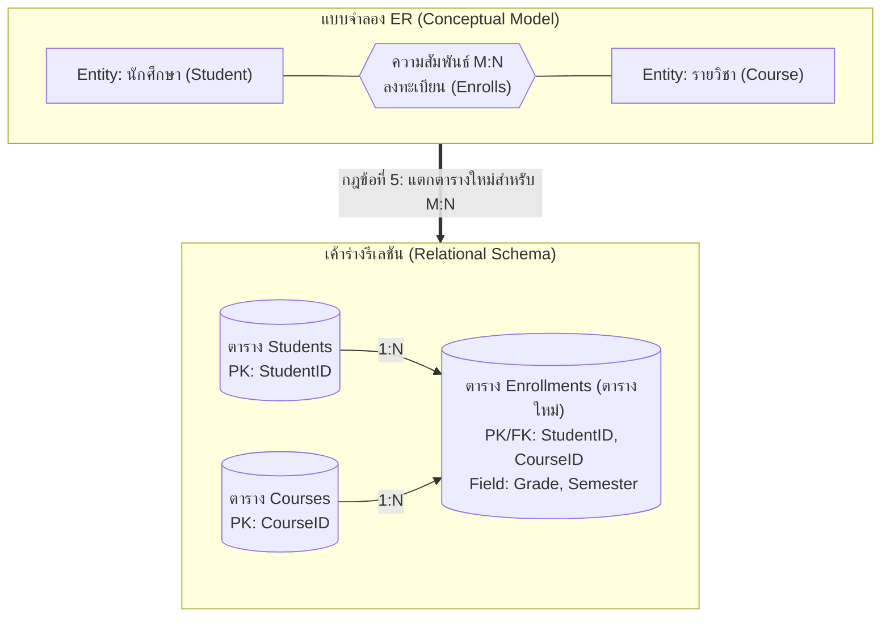

# กฎการแปลง ER Diagram เป็นเค้าร่างรีเลชัน (ER-to-Relational Mapping Rules)

arrow_back กลับไปที่ [[Week07-MOC|MOC สัปดาห์ 7]] | ก่อนหน้า: [[01_Database-Design-Lifecycle-and-ER-Modeling]]

## key Keyword

- **Mapping Algorithm** — ชุดกฎระเบียบมาตรฐานในการแปลงสัญลักษณ์ ER Model ให้กลายเป็นโครงสร้างตารางและ Foreign Key ใน RDBMS
- **Junction Table (Associative Entity / Bridge Table)** — ตารางตัวกลางที่สร้างขึ้นใหม่เพื่อแปลงความสัมพันธ์แบบกลุ่มต่อกลุ่ม (M:N) ให้กลายเป็น 1:N สองเส้น
- **Composite Primary Key** — คีย์หลักที่ประกอบด้วยคอลัมน์ตั้งแต่ 2 ตัวขึ้นไปรวมกันเพื่อระบุความไม่ซ้ำของแถว
- **Referential Action** — การกำหนดพฤติกรรมเมื่อข้อมูลตารางหลักถูกลบหรือแก้ไข (`ON DELETE CASCADE`, `RESTRICT`)

## menu_book Theory (เข้าใจง่าย)

### กฎการแปลง 7 ขั้นตอนมาตรฐาน (The 7-Step Mapping Algorithm)

#### กฎข้อที่ 1: การแปลง Strong Entity ทั่วไป
- สร้างตาราง 1 ตารางต่อ 1 Entity
- นำ Simple Attributes ทั้งหมดมาเป็นคอลัมน์
- กำหนด Key Attribute เป็น **Primary Key**

#### กฎข้อที่ 2: การแปลง Weak Entity
- สร้างตารางสำหรับ Weak Entity
- นำ Primary Key ของ Owner Entity มาเป็น **Foreign Key**
- กำหนด Primary Key ร่วมกันระหว่าง Foreign Key + Partial Key ของ Weak Entity ตัวเอง

#### กฎข้อที่ 3: การแปลงความสัมพันธ์ 1:1 (One-to-One)
มี 3 ทางเลือก โดยทางเลือกที่นิยมที่สุดคือ **Foreign Key Approach:**
- เลือกฝั่งที่มีการมีส่วนร่วมแบบสมบูรณ์ (Total Participation)
- นำ Primary Key ของฝั่งหนึ่งมาใส่เป็น Foreign Key ในอีกฝั่งหนึ่ง และตั้งเงื่อนไข `UNIQUE` กำกับไว้

#### กฎข้อที่ 4: การแปลงความสัมพันธ์ 1:N (One-to-Many)
- **นำ Primary Key ของฝั่ง 1 (One-side) ไปใส่เป็น Foreign Key ในฝั่ง N (Many-side) เสมอ**
- เหตุผล: ฝั่ง N สามารถเก็บค่า FK ชี้กลับไปหาฝั่ง 1 ได้โดยไม่เกิดความซ้ำซ้อนหรือค่า NULL

#### กฎข้อที่ 5: การแปลงความสัมพันธ์ M:N (Many-to-Many)
- **ห้ามใส่ Foreign Key ในตารางเดิมเด็ดขาด** (เพราะจะละเมิด 1NF หรือเกิดค่าซ้ำ)
- **ต้องสร้างตารางใหม่ (Junction Table)** ขึ้นมาคั่นกลาง
- นำ Primary Key จากทั้ง 2 ตารางมาเป็น Foreign Key ในตารางใหม่นี้
- กำหนด Primary Key ของตารางใหม่เป็นแบบ **Composite PK** (`PK1 + PK2`)
- หากมีความสัมพันธ์ที่มี Attribute ติดอยู่ (Relationship Attributes เช่น `OrderDate`, `Quantity`, `Score`) ให้ย้ายมาอยู่ในตารางใหม่นี้ด้วย

#### กฎข้อที่ 6: การแปลง Multivalued Attribute (แอตทริบิวต์หลายค่า)
- แตกเป็นตารางใหม่ ประกอบด้วย:
  1. ค่าของ Attribute นั้น
  2. Primary Key ของตารางแม่ (ทำหน้าที่เป็น Foreign Key)
- กำหนด Composite PK ระหว่าง `(ParentPK, AttributeValue)`

#### กฎข้อที่ 7: การแปลง Composite Attribute (แอตทริบิวต์แบบประสม)
- นำเฉพาะแอตทริบิวต์ย่อยที่แยกแล้วมาเป็นคอลัมน์ในตาราง (ไม่ต้องสร้างคอลัมน์ใหญ่ เช่น เก็บ `Street`, `District`, `Province` โดยไม่ต้องสร้างคอลัมน์ `Address`)

> [!important] สรุปหลักการวาง Foreign Key ที่ต้องจำขึ้นใจ
> - ความสัมพันธ์ **1:N** $\rightarrow$ เอา PK ของตารางฝั่ง **1** ไปวางเป็น FK ในตารางฝั่ง **N**
> - ความสัมพันธ์ **M:N** $\rightarrow$ **สร้างตารางใหม่เสมอ** โดยรวม PK ของทั้งสองฝั่งมาเป็น Composite PK

## schema Diagram

**ตัวอย่าง:** การแปลงความสัมพันธ์ Many-to-Many ระหว่างนักศึกษาและรายวิชา ให้กลายเป็น 2 ความสัมพันธ์แบบ One-to-Many ผ่านตารางตัวกลาง `Enrollments` (อ้างอิง DB Design using ERD สไลด์หน้า 36–100)

---
arrow_forward ต่อไป: [[03_SQL-Builtin-String-Functions-and-Date-Extraction]]
