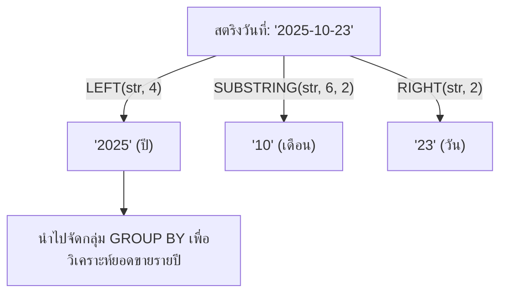

# ฟังก์ชันจัดการข้อความและการสกัดข้อมูลวันที่ใน SQL (SQL String Functions & Date Extraction)

<span class="material-symbols-outlined">arrow_back</span> กลับไปที่ [[Week07-MOC|MOC สัปดาห์ 7]] | ก่อนหน้า: [[02_ER-Diagram-to-Relational-Schema-Mapping]]

## <span class="material-symbols-outlined">key</span> Keyword

- **`LEFT(string, n)`** — ฟังก์ชันตัดข้อความโดยดึงตัวอักษรจากด้านซ้ายสุดจำนวน $n$ ตัวอักษร
- **`RIGHT(string, n)`** — ฟังก์ชันตัดข้อความโดยดึงตัวอักษรจากด้านขวาสุดจำนวน $n$ ตัวอักษร
- **`SUBSTRING(string, start, length)`** — ฟังก์ชันตัดข้อความเริ่มต้นจากตำแหน่งที่ `start` (นับเริ่มจาก 1 ใน SQL) และดึงออกมายาว `length` ตัวอักษร
- **Date String Extraction** — เทคนิคการสกัดข้อมูลปีหรือเดือนออกจากคอลัมน์วันที่ที่บันทึกเป็นข้อความหรือฟอร์แมตมาตรฐาน
- **Annual Customer Retention** — การวิเคราะห์หาลูกค้าประจำที่สั่งซื้อสินค้าอย่างต่อเนื่องในทุกปีปฏิทิน

## <span class="material-symbols-outlined">menu_book</span> Theory (เข้าใจง่าย)

### 1. การทำงานของ 3 ฟังก์ชันหลัก

#### 1.1 `LEFT(string, n)`
```sql
SELECT LEFT('2025-10-23', 4);
-- ผลลัพธ์: '2025'
```
*ประโยชน์:* เหมาะกับการดึง "ปี ค.ศ." ออกมาจากวันที่ฟอร์แมต ISO `'YYYY-MM-DD'`

#### 1.2 `RIGHT(string, n)`
```sql
SELECT RIGHT('23/10/2025', 4);
-- ผลลัพธ์: '2025'
```
*ประโยชน์:* เหมาะกับการดึง "ปี ค.ศ." ออกมาจากวันที่ฟอร์แมตไทย/ยุโรป `'DD/MM/YYYY'`

#### 1.3 `SUBSTRING(string, start, length)`
```sql
SELECT SUBSTRING('2025-10-23', 6, 2);
-- ผลลัพธ์: '10'
```
*ประโยชน์:* ตัดเอาตำแหน่งที่ 6 ไป 2 ตัวอักษร ซึ่งตรงกับ "เดือน" ในฟอร์แมต `'YYYY-MM-DD'`

---

### 2. ตัวอย่างโจทย์ทางธุรกิจจริงในสไลด์เรียน

#### ตัวอย่างที่ 1: อยากทราบว่าลูกค้าแต่ละคนเคยสั่งซื้อสินค้าในปีใดบ้าง
```sql
SELECT CustomerID, LEFT(OrderDate, 4) AS OrderYear
FROM Orders;
```

#### ตัวอย่างที่ 2: อยากทราบว่าลูกค้าแต่ละคนสั่งซื้อในปีใดบ้าง (แสดงเพียงปีละ 1 รายการ)
```sql
SELECT 
    CustomerID,
    LEFT(OrderDate, 4) AS OrderYear,
    MIN(OrderID) AS ExampleOrder
FROM Orders
GROUP BY CustomerID, LEFT(OrderDate, 4)
ORDER BY CustomerID, OrderYear;
```

#### ตัวอย่างที่ 3: หาลูกค้าที่เคยสั่งซื้อสินค้า "ครบทุกปี" ที่ร้านเปิดให้บริการ
**แนวคิด:**
1. หาจำนวนปีทั้งหมดที่มีการเปิดบิลในระบบด้วย `COUNT(DISTINCT LEFT(OrderDate, 4))`
2. จัดกลุ่มตามลูกค้า แล้วนับจำนวนปีที่ลูกค้ารายนั้นสั่งซื้อ
3. กรองด้วย `HAVING` ว่าจำนวนปีของลูกค้า ต้องเท่ากับจำนวนปีทั้งหมดในระบบ

```sql
SELECT CustomerID
FROM Orders
GROUP BY CustomerID
HAVING COUNT(DISTINCT LEFT(OrderDate, 4)) = (
    -- SubQuery: หาจำนวนปีทั้งหมดที่มีคำสั่งซื้อในประวัติของร้าน
    SELECT COUNT(DISTINCT LEFT(OrderDate, 4))
    FROM Orders
);
```

> [!tip] ข้อควรจำ
> ใน SQL ตำแหน่งดัชนีของสตริง **เริ่มต้นนับที่ 1 เสมอ (1-based Indexing)** แตกต่างจากภาษาโปรแกรมส่วนใหญ่ (เช่น Python, Java, C) ที่เริ่มต้นนับที่ 0

## <span class="material-symbols-outlined">schema</span> Diagram



**ตัวอย่าง:** แผนภาพแสดงการสกัดส่วนประกอบของวันที่ (ปี, เดือน, วัน) ผ่านฟังก์ชัน `LEFT`, `SUBSTRING`, และ `RIGHT` (อ้างอิง SQL String Functions สไลด์หน้า 1–16)

---
<span class="material-symbols-outlined">arrow_forward</span> กลับไปที่: [[Week07-MOC|MOC สัปดาห์ 7]]
