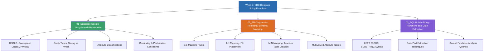

# Week 7 — ER Diagram Design, Relational Mapping & String Functions (MOC)

arrow_back สัปดาห์ก่อนหน้า: [[Week06-MOC|MOC สัปดาห์ 6]]

## check_circle เช็คลิสต์ก่อนเข้าเรียน

- [ ] ศึกษา 3 ลำดับขั้นของการออกแบบฐานข้อมูล: Conceptual $\rightarrow$ Logical $\rightarrow$ Physical Design — ดู [[01_Database-Design-Lifecycle-and-ER-Modeling]]
- [ ] จดจำกฎการแปลง ER Diagram เป็น Relational Schema โดยเฉพาะความสัมพันธ์แบบ M:N และ Multivalued Attributes — ดู [[02_ER-Diagram-to-Relational-Schema-Mapping]]
- [ ] ฝึกใช้ฟังก์ชันตัดต่อข้อความ `LEFT`, `RIGHT`, และ `SUBSTRING` เพื่อสกัดปี/เดือนจากฟิลด์วันที่ — ดู [[03_SQL-Builtin-String-Functions-and-Date-Extraction]]

## assignment ภาพรวมสัปดาห์ 7 (สรุปย่อ)

สัปดาห์ที่ 7 รวบรวมองค์ความรู้ด้านการออกแบบสถาปัตยกรรมฐานข้อมูลตั้งแต่ต้นน้ำจนถึงปลายน้ำ เริ่มต้นจากวงจรการพัฒนาระบบฐานข้อมูล (DSDLC) การสร้างแบบจำลองแนวคิดด้วย ER Model (ระบุ Strong/Weak Entity, ชนิดของ Attribute, Cardinality 1:1, 1:N, M:N) จากนั้นเข้าสู่ขั้นตอน Logical Design ด้วยกฎมาตรฐานการแปลง ER Diagram สู่เค้าร่างรีเลชัน (Relational Schema Mapping) และปิดท้ายด้วยการประยุกต์ใช้ฟังก์ชันจัดการข้อความใน SQL (`LEFT`, `RIGHT`, `SUBSTRING`) สำหรับการตัดข้อมูลวันที่เพื่อวิเคราะห์พฤติกรรมการซื้อรายปีของลูกค้า

## map แผนที่หัวข้อสัปดาห์ 7

## collections_bookmark โน้ตรายหัวข้อ

| หัวข้อ | เนื้อหาหลัก | หน้าสไลด์ / แหล่งอ้างอิง |
| --- | --- | --- |
| [[01_Database-Design-Lifecycle-and-ER-Modeling]] | DSDLC, การวิเคราะห์ความต้องการ, สัญลักษณ์ ER Model, ประเภท Entity และ Attribute | DB Design using ERD น. 1–35 |
| [[02_ER-Diagram-to-Relational-Schema-Mapping]] | กฎ 7 ข้อในการแปลง ER Diagram สู่ Relational Schema (1:1, 1:N, M:N, Composite, Multivalued) | DB Design using ERD น. 36–100 |
| [[03_SQL-Builtin-String-Functions-and-Date-Extraction]] | ฟังก์ชัน `LEFT`, `RIGHT`, `SUBSTRING`, และโจทย์วิเคราะห์ลูกค้าที่สั่งซื้อสินค้าครบทุกปี | SQL String Functions น. 1–16 |

> [!tip] เคล็ดลับการสอบแปลง ERD สู่ตาราง
> จำแม่น ๆ: **"M:N ต้องแตกตารางใหม่เสมอ (Junction Table)"** โดยตารางใหม่จะมี Composite Primary Key ที่ประกอบด้วย Foreign Key จากทั้งสองฝั่ง และหากมี Relationship Attribute (เช่น `Quantity`, `Date`) ให้ย้ายมาอยู่ในตารางใหม่นี้ด้วย

arrow_forward สัปดาห์ถัดไป: [[Week08-MOC|MOC สัปดาห์ 8]]
