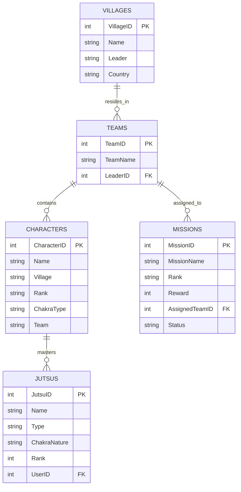

# กรณีศึกษาเค้าร่างฐานข้อมูลนินจาและการออกแบบระบบ (Case Study: Naruto Relational Database)

arrow_back กลับไปที่ [[Week08-MOC|MOC สัปดาห์ 8]]

## key Keyword

- **Case Study Schema (เค้าร่างกรณีศึกษา)** — ฐานข้อมูลตัวอย่างที่จำลองระบบจริงในโลกของนินจา เพื่อให้เห็นการเชื่อมโยงข้อมูลระหว่างหมู่บ้าน ทีม ตัวละคร คาถา และภารกิจ
- **One-to-Many Recursive Relationship** — ความสัมพันธ์แบบหนึ่งต่อกลุ่มที่สามารถเชื่อมโยงกลับมาในระดับทีมและผู้นำ
- **Foreign Key Dependency Chain** — ห่วงโซ่การอ้างอิงของตาราง เช่น `villages` $\rightarrow$ `teams` $\rightarrow$ `characters` $\rightarrow$ `jutsus` / `missions`

## menu_book Theory (เข้าใจง่าย)

### 1. โครงสร้างของ 5 ตารางหลักในฐานข้อมูล `naruto`

#### 1.1 ตาราง `villages` (หมู่บ้านนินจา)
- `VillageID` (INT, PK) — รหัสหมู่บ้าน
- `Name` (VARCHAR) — ชื่อหมู่บ้าน เช่น Konoha, Suna, Kiri, Kumo, Iwa
- `Leader` (VARCHAR) — ผู้นำหมู่บ้าน (Hokage, Kazekage)
- `Country` (VARCHAR) — แคว้นที่ตั้ง เช่น Land of Fire, Land of Wind

#### 1.2 ตาราง `teams` (ทีมปฏิบัติการ)
- `TeamID` (INT, PK) — รหัสทีม
- `TeamName` (VARCHAR) — ชื่อทีม เช่น Team 7, Team 10, Team Guy
- `LeaderID` (INT, FK) — รหัสตัวละครที่เป็นหัวหน้าทีม (อ้างอิง `characters.CharacterID`)

#### 1.3 ตาราง `characters` (ข้อมูลตัวละคร/นินจา)
- `CharacterID` (INT, PK) — รหัสนินจา
- `Name` (VARCHAR) — ชื่อ-นามสกุลนินจา
- `Village` (VARCHAR) — สังกัดหมู่บ้าน
- `Rank` (VARCHAR) — ระดับชั้นนินจา เช่น Genin, Chunin, Jonin, Hokage
- `ChakraType` (VARCHAR) — ธาตุจักระ เช่น Wind, Fire, Lightning, Earth, Water
- `Team` (VARCHAR) — ชื่อทีม

#### 1.4 ตาราง `jutsus` (วิชาคาถานินจา)
- `JutsuID` (INT, PK) — รหัสวิชาคาถา
- `Name` (VARCHAR) — ชื่อวิชา เช่น Rasengan, Chidori, Shadow Clone
- `Type` (VARCHAR) — ชนิดของคาถา (Ninjutsu, Taijutsu, Genjutsu)
- `ChakraNature` (VARCHAR) — ธาตุที่ใช้
- `Rank` (INT) — ระดับความยากของวิชา (1 ถึง 5 หรือ D ถึง S)
- `UserID` (INT, FK) — รหัสตัวละครผู้ใช้วิชานี้ (อ้างอิง `characters.CharacterID`)

#### 1.5 ตาราง `missions` (ภารกิจนินจา)
- `MissionID` (INT, PK) — รหัสภารกิจ
- `MissionName` (VARCHAR) — ชื่อภารกิจ
- `Rank` (VARCHAR) — ระดับภารกิจ (D, C, B, A, S)
- `Reward` (INT) — ค่าตอบแทนภารกิจ
- `AssignedTeamID` (INT, FK) — รหัสทีมที่ได้รับมอบหมาย (อ้างอิง `teams.TeamID`)
- `Status` (VARCHAR) — สถานะภารกิจ (Completed, Failed, In Progress)

### 2. การประยุกต์ใช้ในโครงงานวิชา (Student Registration Desktop App)
หลักการจัดโครงสร้างแบบนี้ถูกนำไปต่อยอดในการพัฒนาโปรแกรมลงทะเบียนนักศึกษา (`Register-System` ในโฟลเดอร์ `03_Projects/`):
- ตารางนักศึกษา (`students`) เชื่อมโยงกับตารางรายวิชา (`courses`) และตารางลงทะเบียน (`enrollment`)
- พัฒนาส่วนติดต่อผู้ใช้ด้วย Java Swing ผ่าน `MySQL Connector/J`
- มีการใช้ PreparedStatement ป้องกัน SQL Injection และจัดการ Transaction ให้สอดคล้องกัน

> [!tip] เคล็ดลับ
> การออกแบบตารางแบบมี Foreign Key กำกับความสัมพันธ์อย่างถูกต้อง จะช่วยให้การเขียนคำสั่ง `JOIN` ทำงานได้อย่างแม่นยำและช่วยให้ RDBMS สร้าง Execution Plan ที่ใช้อินเด็กซ์ได้อย่างเต็มประสิทธิภาพ

## schema Diagram

**ตัวอย่าง:** แผนภาพความสัมพันธ์เอนทิตี (ERD) ของฐานข้อมูลกรณีศึกษา `naruto` (อ้างอิง `naruto.sql` Data Dump)

---
arrow_forward ต่อไป: [[02_Complex-Multi-Table-Queries-and-Optimization]]
