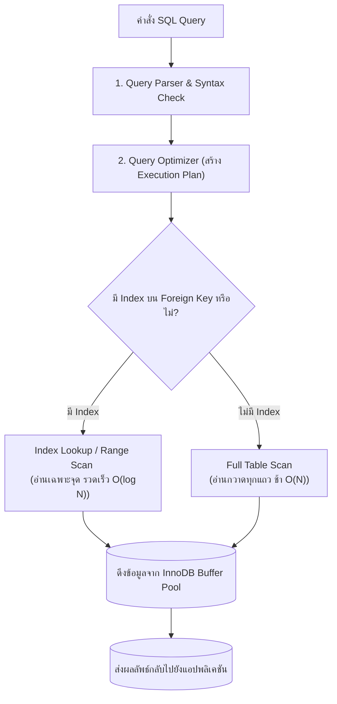

# คิวรีวิเคราะห์ข้อมูลข้ามหลายตารางและการเพิ่มประสิทธิภาพ (Complex Queries & Optimization)

<span class="material-symbols-outlined">arrow_back</span> กลับไปที่ [[Week08-MOC|MOC สัปดาห์ 8]] | ก่อนหน้า: [[01_Relational-Schema-Case-Study-Naruto-Database]]

## <span class="material-symbols-outlined">key</span> Keyword

- **Multi-Table Aggregation** — การเชื่อมโยงข้อมูลตั้งแต่ 3 ตารางขึ้นไป พร้อมคำนวณค่าสรุปทางสถิติแยกตามมิติ
- **EXPLAIN Plan** — คำสั่งวิเคราะห์เบื้องหลังของ MySQL เพื่อตรวจสอบว่าคำสั่ง Query ดึงข้อมูลด้วย Index หรือใช้วิธี Full Table Scan
- **Index Optimization** — การสร้างดัชนีบนคอลัมน์ที่ถูกใช้งานบ่อยใน `JOIN ... ON ...` และ `WHERE` เพื่อเร่งความเร็วในการประมวลผล

## <span class="material-symbols-outlined">menu_book</span> Theory (เข้าใจง่าย)

### 1. ตัวอย่างคิวรีวิเคราะห์ระดับสูงบนฐานข้อมูล `naruto`

#### โจทย์ที่ 1: หานินจาที่ใช้วิชาคาถาระดับสูง (Rank $\ge$ 3) พร้อมชื่อวิชาและสังกัดหมู่บ้าน
```sql
SELECT 
    c.Name AS NinjaName,
    c.Village,
    c.Rank AS NinjaRank,
    j.Name AS JutsuName,
    j.Type AS JutsuType,
    j.Rank AS JutsuDifficulty
FROM characters AS c
INNER JOIN jutsus AS j ON c.CharacterID = j.UserID
WHERE j.Rank >= 3
ORDER BY j.Rank DESC, c.Name ASC;
```

#### โจทย์ที่ 2: สรุปจำนวนวิชาคาถาทั้งหมดแยกตามประเภทธาตุจักระ (ChakraNature)
```sql
SELECT 
    j.ChakraNature,
    COUNT(j.JutsuID) AS TotalJutsus,
    AVG(j.Rank) AS AverageDifficulty
FROM jutsus AS j
GROUP BY j.ChakraNature
HAVING COUNT(j.JutsuID) >= 2
ORDER BY TotalJutsus DESC;
```

#### โจทย์ที่ 3: หาทีมที่ทำภารกิจสำเร็จ (Completed) และได้รับเงินรางวัลรวมสูงสุด
```sql
SELECT 
    t.TeamName,
    COUNT(m.MissionID) AS CompletedMissionsCount,
    SUM(m.Reward) AS TotalRewardEarned
FROM teams AS t
INNER JOIN missions AS m ON t.TeamID = m.AssignedTeamID
WHERE m.Status = 'Completed'
GROUP BY t.TeamID, t.TeamName
ORDER BY TotalRewardEarned DESC;
```

#### โจทย์ที่ 4: หานินจาที่ยังไม่มีการบันทึกวิชาคาถาประจำตัวในระบบ (LEFT JOIN + IS NULL)
```sql
SELECT 
    c.CharacterID,
    c.Name AS NinjaName,
    c.Village,
    c.Rank
FROM characters AS c
LEFT JOIN jutsus AS j ON c.CharacterID = j.UserID
WHERE j.JutsuID IS NULL;
```

---

### 2. เทคนิคการตรวจสอบและเพิ่มประสิทธิภาพคิวรี (Query Optimization)
1. **ใช้คำสั่ง `EXPLAIN` เพื่อดูรูปแบบการสแกนข้อมูล:**
   ```sql
   EXPLAIN SELECT * FROM characters WHERE Village = 'Konoha';
   ```
   - หากคอลัมน์ `type` แสดงเป็น `ALL` หมายถึงฐานข้อมูลต้องอ่านทุกแถวทั้งตาราง (Full Table Scan)
   - หากคอลัมน์ `type` แสดงเป็น `ref` หรือ `const` แสดงว่ามีการใช้งาน Index ช่วยค้นหา
2. **การสร้าง Index บน Foreign Key คอลัมน์:**
   ```sql
   CREATE INDEX idx_jutsus_userid ON jutsus(UserID);
   CREATE INDEX idx_missions_teamid ON missions(AssignedTeamID);
   ```
   การมี Index บน Foreign Key จะช่วยลดเวลาในการประมวลผลคำสั่ง `JOIN` ได้หลายเท่าตัวเมื่อตารางมีข้อมูลนับแสนแถว

> [!tip] เคล็ดลับ
> หลีกเลี่ยงการครอบฟังก์ชันลงบนคอลัมน์ในฝั่งซ้ายของเงื่อนไข `WHERE` เช่น `WHERE LEFT(Name, 1) = 'N'` จะทำให้ Index ไม่ทำงาน ทางที่ดีควรใช้ `WHERE Name LIKE 'N%'` แทน ซึ่งช่วยให้ฐานข้อมูลสามารถวิ่งบน B-Tree Index ได้โดยตรง

## <span class="material-symbols-outlined">schema</span> Diagram



**ตัวอย่าง:** แผนผังการทำงานของ MySQL Query Optimizer แสดงความแตกต่างระหว่างการค้นหาผ่านดัชนี (Index Lookup) กับการกวาดอ่านทั้งตาราง (Full Table Scan) (อ้างอิง Case Study Optimization)

---
<span class="material-symbols-outlined">arrow_forward</span> กลับไปที่: [[Week08-MOC|MOC สัปดาห์ 8]]
