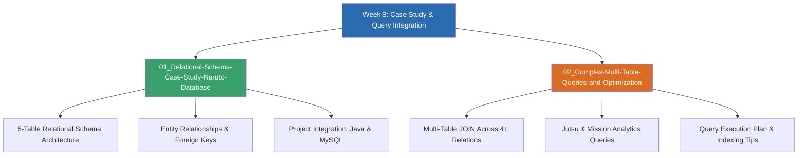

# Week 8 — Database Case Study, Complex Queries & Midterm Integration (MOC)

arrow_back สัปดาห์ก่อนหน้า: [[Week07-MOC|MOC สัปดาห์ 7]]

## check_circle เช็คลิสต์ก่อนเข้าเรียน

- [ ] วิเคราะห์โครงสร้างความสัมพันธ์ 5 ตารางของฐานข้อมูลกรณีศึกษา (`naruto.sql`) — ดู [[01_Relational-Schema-Case-Study-Naruto-Database]]
- [ ] ฝึกเขียนคิวรีรวมมิตร (Join + Aggregate + SubQuery + String Function) — ดู [[02_Complex-Multi-Table-Queries-and-Optimization]]
- [ ] เตรียมพร้อมสำหรับการนำเสนอโครงงานระบบฐานข้อมูลประจำวิชา (Student Registration Desktop App) — ดู [[01_Relational-Schema-Case-Study-Naruto-Database]]

## assignment ภาพรวมสัปดาห์ 8 (สรุปย่อ)

สัปดาห์ที่ 8 เป็นสัปดาห์แห่งการบูรณาการทักษะทั้งหมดที่ได้เรียนรู้มาตั้งแต่ Week 1 ถึง Week 7 โดยใช้ฐานข้อมูลกรณีศึกษา `naruto` (ประกอบด้วย 5 ตารางหลัก: `villages`, `teams`, `characters`, `jutsus`, `missions`) เพื่อฝึกฝนการเขียนคิวรีระดับสูง ทั้งการเชื่อมโยงข้อมูลหลายมิติ การจัดอันดับภารกิจ การคำนวณสถิติคาถานินจาตามประเภทจักระ พร้อมทั้งเป็นหมุดหมายสำคัญในการเตรียมโครงงานประจำรายวิชา (Student Registration App ด้วย Java + MySQL) ก่อนจะก้าวเข้าสู่หัวข้อ NoSQL และ Big Data ในสัปดาห์ถัดไป

## map แผนที่หัวข้อสัปดาห์ 8

## collections_bookmark โน้ตรายหัวข้อ

| หัวข้อ | เนื้อหาหลัก | แหล่งอ้างอิง |
| --- | --- | --- |
| [[01_Relational-Schema-Case-Study-Naruto-Database]] | สถาปัตยกรรมเค้าร่างฐานข้อมูล `naruto.sql`, โครงสร้างตาราง, และผังความสัมพันธ์ ER | `naruto.sql` Data Dump |
| [[02_Complex-Multi-Table-Queries-and-Optimization]] | รวมโจทย์คิวรีประยุกต์ขั้นสูง: สถิติทักษะนินจา, การกระจายตัวของภารกิจ, และแนวคิดการจูน Index | Case Study Practice |

> [!tip] เคล็ดลับการทำข้อสอบประมวลผลบูรณาการ
> เมื่อเจอโจทย์คิวรีที่ถามข้อมูลข้ามหลายตาราง ให้เริ่มจาก:
> 1. เขียนชื่อตารางที่มีคอลัมน์ผลลัพธ์ที่ต้องการออกมาก่อน
> 2. ลากเส้นเชื่อม Primary Key ↔ Foreign Key ให้ครบทุกคู่ใน `FROM ... JOIN ... ON ...`
> 3. จากนั้นจึงค่อยใส่ `WHERE`, `GROUP BY`, และ `HAVING` ตามลำดับ

arrow_forward สัปดาห์ถัดไป: [[Week09-MOC|MOC สัปดาห์ 9]]
