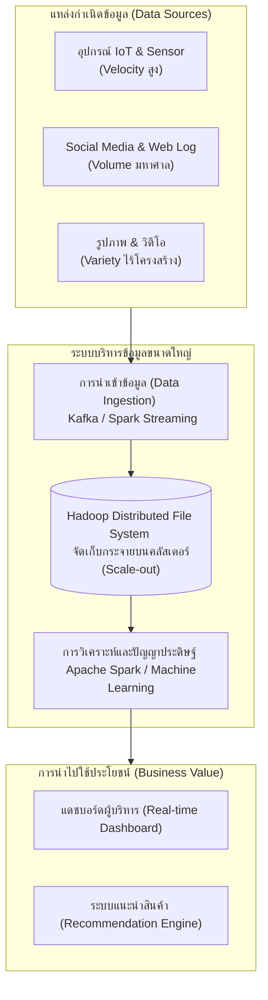

# รากฐานข้อมูลขนาดใหญ่และคุณลักษณะ 5Vs (Big Data Foundations & 5Vs)

arrow_back กลับไปที่ [[Week09-MOC|MOC สัปดาห์ 9]]

## key Keyword

- **Big Data (ข้อมูลขนาดใหญ่)** — ข้อมูลที่มีขนาดมหึมา หลากหลายประเภท และเกิดขึ้นด้วยความเร็วสูง จนซอฟต์แวร์ประมวลผลฐานข้อมูลแบบดั้งเดิม (Traditional RDBMS) ไม่สามารถจัดเก็บ ประมวลผล หรือวิเคราะห์ได้อย่างมีประสิทธิภาพ
- **The 5Vs of Big Data** — คุณลักษณะสำคัญ 5 ด้าน: Volume (ปริมาณ), Velocity (ความเร็ว), Variety (ความหลากหลาย), Veracity (ความน่าเชื่อถือ), และ Value (คุณค่าทางธุรกิจ)
- **Structured Data** — ข้อมูลที่มีโครงสร้างแน่นอน จัดเก็บในรูปตาราง 2 มิติ มี Schema ชัดเจน เช่น ข้อมูลใน MySQL, SQL Server
- **Semi-Structured Data** — ข้อมูลกึ่งโครงสร้างที่ไม่มีตารางตายตัว แต่มีแท็ก (Tags) หรือตัวคั่นกำกับ เช่น JSON, XML, YAML
- **Unstructured Data** — ข้อมูลไร้โครงสร้าง คิดเป็นสัดส่วนมากกว่า 80% ของข้อมูลในโลก เช่น วิดีโอ เสียง รูปภาพ โพสต์บนโซเชียลมีเดีย
- **HDFS (Hadoop Distributed File System)** — ระบบไฟล์แบบกระจายศูนย์ที่แบ่งไฟล์ขนาดใหญ่เป็นบล็อกย่อย แล้วกระจายไปจัดเก็บบนเครื่องคอมพิวเตอร์ทั่วไป (Commodity Hardware) หลาย ๆ เครื่อง

## menu_book Theory (เข้าใจง่าย)

### 1. คุณลักษณะสำคัญ 5 ประการของ Big Data (The 5Vs)

1. **Volume (ปริมาณมหาศาล):** ข้อมูลมีขนาดใหญ่เกินกว่าระดับ Gigabyte/Terabyte พุ่งทะยานสู่ระดับ Petabyte ($10^{15}$ Bytes) ถึง Exabyte
2. **Velocity (ความเร็วสูงในการเกิดและประมวลผล):** ข้อมูลไหลเข้าสู่ระบบแบบเรียลไทม์ เช่น ข้อมูลเซนเซอร์ IoT, การกด Like/Share บน Facebook, สัญญาณ GPS รถบรรทุก
3. **Variety (ความหลากหลายของประเภทข้อมูล):** ประกอบด้วย Structured, Semi-Structured และ Unstructured ผสมผสานกัน
4. **Veracity (ความถูกต้องและน่าเชื่อถือ):** ข้อมูลขนาดใหญ่มีความไม่สมบูรณ์ ขยะข้อมูล (Noise) หรือความคลาดเคลื่อนสูง ต้องผ่านการทำ Data Cleaning
5. **Value (คุณค่าที่ได้รับ):** ข้อมูลจะมีประโยชน์ก็ต่อเมื่อสามารถนำมาวิเคราะห์ (Analytics) สร้างโมเดล Machine Learning เพื่อขับเคลื่อนกลยุทธ์ธุรกิจได้จริง

---

### 2. เปรียบเทียบประเภทของข้อมูล (Data Types)

| ประเภทข้อมูล | นิยาม | ตัวอย่าง | เทคโนโลยีที่เหมาะสม |
| :--- | :--- | :--- | :--- |
| **Structured Data** | โครงสร้างตารางแถว/คอลัมน์ตายตัว | ตารางลูกค้า, ประวัติการทำธุรกรรมธนาคาร | Relational DBMS (MySQL, PostgreSQL) |
| **Semi-Structured Data** | ข้อมูลมี Metadata / Key-Value ระบุในตัว | ไฟล์ JSON, XML, REST API Response | NoSQL Document Store (MongoDB) |
| **Unstructured Data** | ข้อความอิสระ สื่อมัลติมีเดีย | รูปถ่าย, วิดีโอ TikTok, เสียงคอลเซ็นเตอร์ | Data Lake, Object Storage (S3, GCS) |

---

### 3. ทำไม Traditional RDBMS จึงไม่ตอบโจทย์ Big Data?
- **Scaling Bottleneck:** RDBMS เน้นการขยายแบบแนวตั้ง (Scale-up) คือการซื้อเซิร์ฟเวอร์ราคาหลายสิบล้าน ซึ่งมีเพดานฮาร์ดแวร์จำกัด
- **Rigid Schema:** RDBMS บังคับ Schema ที่ตายตัว เมื่อต้องการเพิ่มคอลัมน์ใหม่ในตารางที่มีข้อมูล 1,000 ล้านแถว ระบบต้องล็อกตาราง (Table Lock) ทำให้บริการหยุดชะงัก
- **High Storage Cost:** การเก็บไฟล์ log ที่ไม่ได้ใช้บ่อย (Cold Data) ไว้บน RDBMS มีค่าใช้จ่ายต่อกิกะไบต์สูงเกินความจำเป็น

> [!tip] เคล็ดลับ
> สถาปัตยกรรมข้อมูลสมัยใหม่จึงแบ่งหน้าที่อย่างชัดเจน: ใช้ **RDBMS** สำหรับข้อมูลธุรกรรมการเงินที่ต้องการความถูกต้อง 100% (ACID) และโยนข้อมูลดิบ, Log, และ Unstructured data ทั้งหมดลงใน **Data Lake / HDFS** เพื่อทำการประมวลผลแบบกระจาย (Distributed Processing)

## schema Diagram

**ตัวอย่าง:** สถาปัตยกรรมการไหลของข้อมูล Big Data จากแหล่งกำเนิด ผ่านระบบจัดเก็บแบบกระจาย HDFS จนถึงการวิเคราะห์สร้างมูลค่าให้องค์กร (อ้างอิง 1313305_Intro_Big_Data และ 1313305_Big_Data_Technology)

---
arrow_forward ต่อไป: [[02_NoSQL-Database-Types-and-CAP-Theorem]]
