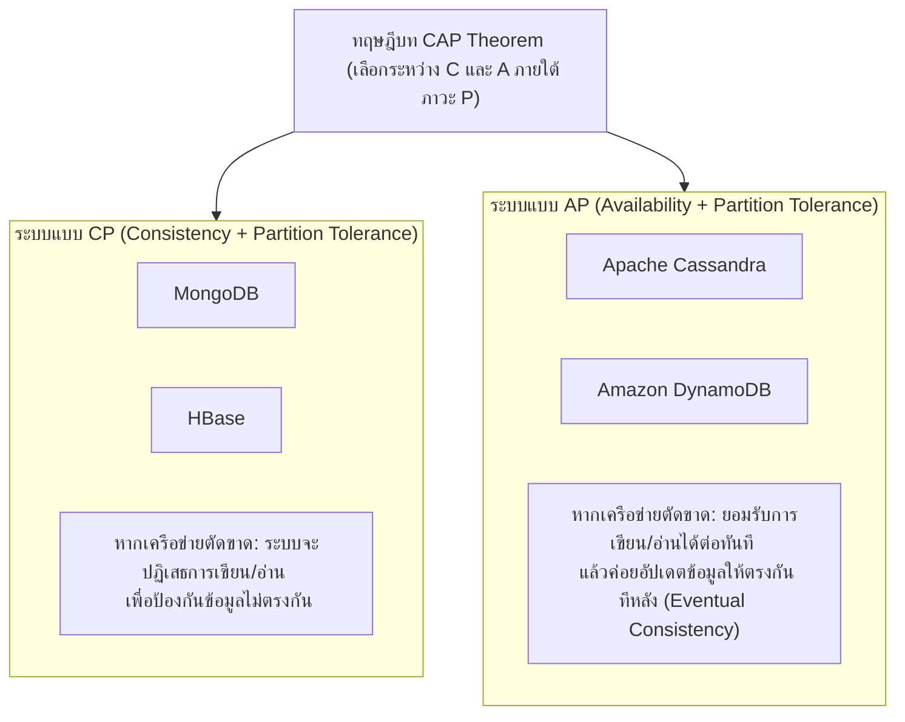

# ฐานข้อมูลแบบ NoSQL 4 ตระกูลหลักและทฤษฎีบท CAP (NoSQL & CAP Theorem)

arrow_back กลับไปที่ [[Week09-MOC|MOC สัปดาห์ 9]] | ก่อนหน้า: [[01_Big-Data-Foundations-and-5Vs-Characteristics]]

## key Keyword

- **NoSQL ("Not Only SQL")** — กลุ่มของระบบจัดการฐานข้อมูลที่ไม่ใช้โครงสร้างตารางเชิงสัมพันธ์แบบดั้งเดิม เน้นความยืดหยุ่นของ Schema และรองรับการขยายตัวแนวนอน
- **Vertical Scaling (Scale-up)** — การเพิ่มประสิทธิภาพโดยการอัปเกรดทรัพยากรบนเซิร์ฟเวอร์เครื่องเดิม (เพิ่ม CPU, RAM, Disk) มีขีดจำกัดสูงสุดและราคาสูงมาก
- **Horizontal Scaling (Scale-out)** — การขยายระบบโดยการเพิ่มเครื่องเซิร์ฟเวอร์ทั่วไปจำนวนมากเข้ามาต่อเป็นคลัสเตอร์ (Cluster) เป็นหัวใจหลักของระบบ NoSQL
- **CAP Theorem** — ทฤษฎีบทที่พิสูจน์ว่า ระบบฐานข้อมูลแบบกระจายศูนย์สามารถรับประกันคุณสมบัติได้เพียง 2 ใน 3 ข้อในเวลาเดียวกัน ได้แก่: Consistency, Availability, Partition Tolerance
- **BASE Model** — ปรัชญาการออกแบบของ NoSQL: Basically Available, Soft state, Eventual consistency (ผ่อนปรนความเข้มงวดของ ACID เพื่อแลกกับความพร้อมใช้งานและความเร็ว)

## menu_book Theory (เข้าใจง่าย)

### 1. เปรียบเทียบความแตกต่างระหว่าง SQL และ NoSQL

| คุณสมบัติ | SQL Database (Relational) | NoSQL Database (Non-Relational) |
| :--- | :--- | :--- |
| **โครงสร้างข้อมูล** | ตาราง 2 มิติ (Rows & Columns) | เอกสาร (JSON), Key-Value, กราฟ, คอลัมน์ |
| **Schema** | ตายตัว (Fixed Schema ต้อง DDL ก่อน) | ยืดหยุ่น ไดนามิก (Dynamic / Schema-less) |
| **การขยายระบบ (Scaling)** | Vertical Scaling (Scale-up เพิ่มสเปกเครื่อง) | Horizontal Scaling (Scale-out เพิ่มจำนวนเครื่อง) |
| **แบบจำลองธุรกรรม** | ACID (เน้นความถูกต้อง แม่นยำ 100%) | BASE (เน้น Availability และความเร็วสูง) |
| **ตัวอย่างระบบ** | MySQL, PostgreSQL, Oracle, SQL Server | MongoDB, Redis, Cassandra, Neo4j |

---

### 2. NoSQL 4 ตระกูลหลัก (The 4 NoSQL Data Models)

1. **Document Store (จัดเก็บแบบเอกสาร):**
   - เก็บข้อมูลในรูป JSON หรือ BSON (Binary JSON)
   - ข้อมูลแต่ละชิ้นสามารถมีโครงสร้างฟิลด์และอาร์เรย์ที่แตกต่างกันได้
   - *ตัวอย่างเด่น:* **MongoDB**, CouchDB
2. **Key-Value Store (จัดเก็บแบบกุญแจ-ค่า):**
   - รูปแบบที่เรียบง่ายและเร็วที่สุด จัดเก็บคู่ `Key` $\rightarrow$ `Value`
   - มักทำงานบน Memory (RAM) ทั้งหมด เหมาะกับงาน Caching และ Session Management
   - *ตัวอย่างเด่น:* **Redis**, DynamoDB, Memcached
3. **Column-Family / Wide-Column Store (จัดเก็บตามแนวคอลัมน์):**
   - จัดเก็บข้อมูลตามคอลัมน์แทนที่จะเก็บตามแถว เหมาะสำหรับการเขียนข้อมูลปริมาณมหาศาลและการค้นหาเฉพาะบางฟิลด์
   - *ตัวอย่างเด่น:* **Apache Cassandra**, Apache HBase, Google Bigtable
4. **Graph Database (จัดเก็บแบบโครงข่ายกราฟ):**
   - เก็บข้อมูลในรูปของโหนด (Nodes) และเส้นเชื่อม (Edges / Relationships) พร้อมคุณสมบัติ (Properties)
   - ค้นหาความสัมพันธ์ที่ซับซ้อนหลายทอดได้อย่างรวดเร็ว เหมาะกับ Social Network, ระบบตรวจจับการฉ้อโกง
   - *ตัวอย่างเด่น:* **Neo4j**, Amazon Neptune

---

### 3. ทฤษฎีบท CAP Theorem (Brewer's Theorem)
ในระบบฐานข้อมูลแบบกระจายศูนย์ ประกอบด้วยคุณสมบัติ 3 ด้าน:
- **C - Consistency (ความสอดคล้องกัน):** ผู้ใช้ทุกคนอ่านข้อมูลจากทุกโหนดแล้วได้ค่าเดียวกันเสมอ
- **A - Availability (ความพร้อมใช้งาน):** ทุกคำร้องขอ (Request) ต้องได้รับการตอบกลับว่าสำเร็จเสมอ (ไม่ล่ม)
- **P - Partition Tolerance (การทนทานต่อการตัดขาดของเครือข่าย):** ระบบยังทำงานต่อไปได้แม้สายแลนขาดหรือโหนดขาดการเชื่อมต่อจากกัน

> [!important] ความเป็นจริงของระบบกระจายศูนย์ (P Is Mandatory)
> ในโลกความเป็นจริง ความผิดพลาดของเครือข่ายย่อมเกิดขึ้นได้เสมอ ดังนั้นระบบจึงต้องมีคุณสมบัติ **P** อย่างหลีกเลี่ยงไม่ได้ สถาปัตยกรรมจึงต้องเลือกระหว่าง:
> - **CP Database:** ยอมให้บางโหนดหยุดรับคำขอ (ลด Availability) เพื่อให้ข้อมูลที่ตอบออกไปถูกต้องตรงกันเสมอ เช่น MongoDB, HBase
> - **AP Database:** ยอมตอบข้อมูลที่อาจยังไม่อัปเดตชั่วขณะ (Eventual Consistency) เพื่อให้ระบบไม่ล่มเด็ดขาด เช่น Cassandra, CouchDB

## schema Diagram

**ตัวอย่าง:** แผนผังจำแนกระบบ NoSQL ตามทฤษฎี CAP Theorem ระหว่างกลุ่มที่มุ่งเน้นความถูกต้องของข้อมูล (CP) กับกลุ่มที่มุ่งเน้นความพร้อมใช้งานต่อเนื่อง (AP) (อ้างอิง NoSQL สไลด์หน้า 1–20)

---
arrow_forward ต่อไป: [[03_MongoDB-Architecture-and-Document-Model]]
