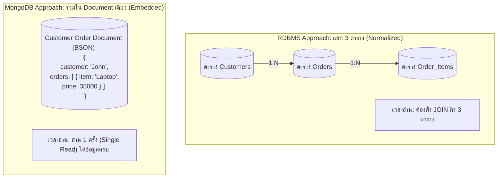

# สถาปัตยกรรม MongoDB และการออกแบบโมเดลเอกสาร (MongoDB Architecture & Document Model)

<span class="material-symbols-outlined">arrow_back</span> กลับไปที่ [[Week09-MOC|MOC สัปดาห์ 9]] | ก่อนหน้า: [[02_NoSQL-Database-Types-and-CAP-Theorem]]

## <span class="material-symbols-outlined">key</span> Keyword

- **MongoDB** — ฐานข้อมูล NoSQL ประเภท Document-oriented Database ที่ได้รับความนิยมสูงสุด จัดเก็บข้อมูลในรูปแบบเอกสาร BSON
- **Collection (คอลเลกชัน)** — กลุ่มของเอกสารที่มีความเกี่ยวข้องกัน (เทียบเท่ากับ Table ในโลก RDBMS)
- **Document (เอกสาร)** — ข้อมูล 1 ระเบียนในรูปโครงสร้าง JSON/BSON (เทียบเท่ากับ Row/Tuple ในโลก RDBMS)
- **Field (ฟิลด์)** — คู่ของ Key-Value ภายในเอกสาร (เทียบเท่ากับ Column ในโลก RDBMS)
- **BSON (Binary JSON)** — รูปแบบการจัดเก็บข้อมูลแบบไบนารีที่ขยายขีดความสามารถของ JSON โดยเพิ่มชนิดข้อมูล เช่น Date, ObjectId, 64-bit Integer
- **Embedded Document vs Reference** — กลยุทธ์การออกแบบข้อมูล: ฝังข้อมูลที่เกี่ยวข้องไว้ในเอกสารเดียวกัน (Embedding) เทียบกับ การเก็บ `_id` เพื่อชี้ไปยังเอกสารอื่น (Referencing)

## <span class="material-symbols-outlined">menu_book</span> Theory (เข้าใจง่าย)

### 1. การจับคู่คำศัพท์ระหว่าง SQL และ MongoDB

| แนวคิด / โครงสร้าง | โลกฐานข้อมูลเชิงสัมพันธ์ (SQL / RDBMS) | โลกฐานข้อมูลเอกสาร (MongoDB) |
| :--- | :--- | :--- |
| **ระดับบนสุด** | ฐานข้อมูล (Database) | ฐานข้อมูล (Database) |
| **กลุ่มของระเบียน** | ตาราง (Table) | คอลเลกชัน (Collection) |
| **ข้อมูล 1 รายการ** | แถว / ระเบียน (Row / Tuple) | เอกสาร (Document / BSON) |
| **คุณลักษณะข้อมูล** | คอลัมน์ (Column) | ฟิลด์ (Field) |
| **ตัวระบุเฉพาะ** | Primary Key | `_id` (สร้างเป็น ObjectId ให้อัตโนมัติ) |
| **การเชื่อมข้อมูล** | Foreign Key & `JOIN` | Embedded Sub-document หรือ `$lookup` |

---

### 2. โครงสร้างเอกสาร BSON ใน MongoDB

```json
{
  "_id": ObjectId("6530a1b2c3d4e5f678901234"),
  "username": "johndoe",
  "email": "john@example.com",
  "status": "active",
  "profile": {
    "age": 21,
    "major": "CAI"
  },
  "orders": [
    { "item": "laptop", "qty": 1, "price": 35000 },
    { "item": "mouse", "qty": 1, "price": 850 }
  ]
}
```
*จุดเด่น:* สามารถเก็บออบเจกต์ซ้อน (Nested Object) และอาร์เรย์ (Array of Objects) ได้อย่างเป็นธรรมชาติในเอกสารเดียว ไม่ต้องแยกเป็นตารางลูกเหมือนใน RDBMS

---

### 3. คำสั่งพื้นฐาน (CRUD Operations ใน MongoDB)

#### 3.1 การเพิ่มเอกสาร (Create)
```javascript
// เพิ่ม 1 เอกสาร
db.users.insertOne({
  name: "Alice",
  age: 20,
  skills: ["Python", "SQL", "MongoDB"]
});
```

#### 3.2 การค้นคืนเอกสาร (Read)
```javascript
// ค้นหาผู้ใช้ที่มีอายุมากกว่าหรือเท่ากับ 20 ปี
db.users.find({ age: { $gte: 20 } });

// ค้นหาและเลือกแสดงเฉพาะฟิลด์ name และ email
db.users.find({}, { name: 1, email: 1, _id: 0 });
```

#### 3.3 การแก้ไขเอกสาร (Update)
```javascript
// ปรับปรุงสถานะของ Alice
db.users.updateOne(
  { name: "Alice" },
  { $set: { status: "Active", age: 21 } }
);
```

#### 3.4 การลบเอกสาร (Delete)
```javascript
// ลบผู้ใช้ที่มีสถานะ Inactive
db.users.deleteMany({ status: "Inactive" });
```

---

### 4. Embedding vs Referencing
- **Embedded Document (แนะนำเป็นค่าเริ่มต้น):** นำข้อมูลที่ใช้งานร่วมกันเสมอมาฝังในเอกสารเดียวกัน ช่วยให้การอ่านเร็วมาก (Single Read) โดยไม่ต้องทำ `JOIN`
- **Referencing:** ใช้เมื่อข้อมูลมีขนาดใหญ่เกินขีดจำกัดของเอกสารใน MongoDB (จำกัดสูงสุด 16 MB ต่อ 1 Document) หรือเมื่อความสัมพันธ์เป็นแบบ Many-to-Many ที่มีขนาดไม่สิ้นสุด

> [!tip] เคล็ดลับ
> ใน MongoDB คติประจำใจคือ **"Data that is accessed together should be stored together"** (ข้อมูลที่ถูกอ่านพร้อมกัน ควรถูกเก็บไว้ด้วยกัน)

## <span class="material-symbols-outlined">schema</span> Diagram



**ตัวอย่าง:** แผนภาพเปรียบเทียบระหว่างสถาปัตยกรรมแยกตารางของ RDBMS กับการฝังข้อมูลแบบ Embedded Document ใน MongoDB (อ้างอิง Introduction-to-MongoDB สไลด์หน้า 1–43)

---
<span class="material-symbols-outlined">arrow_forward</span> กลับไปที่: [[Week09-MOC|MOC สัปดาห์ 9]]
