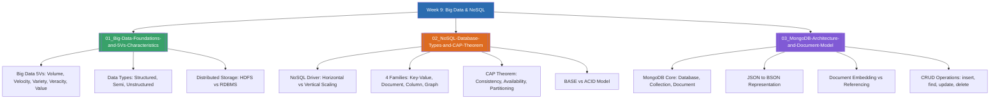

# Week 9 — Big Data Foundations, NoSQL Databases & MongoDB (MOC)

arrow_back สัปดาห์ก่อนหน้า: [[Week08-MOC|MOC สัปดาห์ 8]]

## check_circle เช็คลิสต์ก่อนเข้าเรียน

- [ ] ศึกษาคุณลักษณะ 5Vs ของข้อมูลขนาดใหญ่ และประเภทของข้อมูล (Structured, Semi-Structured, Unstructured) — ดู [[01_Big-Data-Foundations-and-5Vs-Characteristics]]
- [ ] ทำความเข้าใจทฤษฎีบท CAP Theorem และการจำแนก NoSQL ออกเป็น 4 ตระกูลหลัก — ดู [[02_NoSQL-Database-Types-and-CAP-Theorem]]
- [ ] เปรียบเทียบโครงสร้างเชิงสัมพันธ์ (RDBMS) กับโครงสร้างเอกสาร BSON ใน MongoDB — ดู [[03_MongoDB-Architecture-and-Document-Model]]

## assignment ภาพรวมสัปดาห์ 9 (สรุปย่อ)

สัปดาห์ที่ 9 เปิดประตูสู่โลกของข้อมูลยุคใหม่ (Modern Data Paradigm) เมื่อฐานข้อมูลเชิงสัมพันธ์แบบดั้งเดิม (RDBMS) เริ่มเผชิญขีดจำกัดด้านการขยายขนาด (Scale-up Limitation) และต้นทุนที่มหาศาลเมื่อต้องรองรับข้อมูลระดับเพตาไบต์ (Petabytes) จึงเกิดแนวคิด Big Data และเทคโนโลยีการจัดเก็บแบบกระจาย (Hadoop HDFS, Spark, Cloud Object Storage) พร้อมทั้งการถือกำเนิดของฐานข้อมูลแบบ NoSQL ("Not Only SQL") ที่มีจุดเด่นเรื่อง Schema ยืดหยุ่นและการขยายตัวแนวนอน (Scale-out) โดยเจาะลึก 4 รูปแบบ NoSQL ทฤษฎี CAP Theorem และการประยุกต์ใช้งาน MongoDB (Document Database) ผ่าน BSON และคำสั่ง CRUD พื้นฐาน

## map แผนที่หัวข้อสัปดาห์ 9

## collections_bookmark โน้ตรายหัวข้อ

| หัวข้อ | เนื้อหาหลัก | หน้าสไลด์ / แหล่งอ้างอิง |
| --- | --- | --- |
| [[01_Big-Data-Foundations-and-5Vs-Characteristics]] | นิยาม Big Data, คุณลักษณะ 5Vs, ที่มาของข้อมูล (IoT, Social Media), เทคโนโลยีจัดเก็บแบบกระจาย | Intro Big Data & Tech น. 1–23 |
| [[02_NoSQL-Database-Types-and-CAP-Theorem]] | ความแตกต่าง RDBMS vs NoSQL, การ Scale-out, 4 รูปแบบ NoSQL, CAP Theorem และ BASE | NoSQL น. 1–20 |
| [[03_MongoDB-Architecture-and-Document-Model]] | สถาปัตยกรรม MongoDB, การแปลงตารางสู่ Document BSON, การออกแบบ Embedding, คำสั่ง CRUD | Intro to MongoDB น. 1–43 |

> [!tip] เคล็ดลับการจำ CAP Theorem
> ในระบบแบบกระจาย (Distributed System) หากเกิดปัญหาเครือข่ายขาดการเชื่อมต่อ (**Partition Tolerance - P** ซึ่งหลีกเลี่ยงไม่ได้ในโลกจริง) ระบบสามารถเลือกได้เพียงอย่างใดอย่างหนึ่งระหว่าง:
> - **CP (Consistency):** หยุดการทำงานบางส่วนเพื่อรักษาความถูกต้องของข้อมูลให้ตรงกันทุกโหนด (เช่น MongoDB, HBase)
> - **AP (Availability):** อนุญาตให้ใช้งานต่อได้ทันทีแม้ข้อมูลแต่ละโหนดยังไม่เท่ากัน แล้วค่อยซิงค์ทีหลังผ่าน Eventual Consistency (เช่น Cassandra, DynamoDB, CouchDB)

arrow_forward สัปดาห์ถัดไป: [[Week10-MOC|MOC สัปดาห์ 10]]
