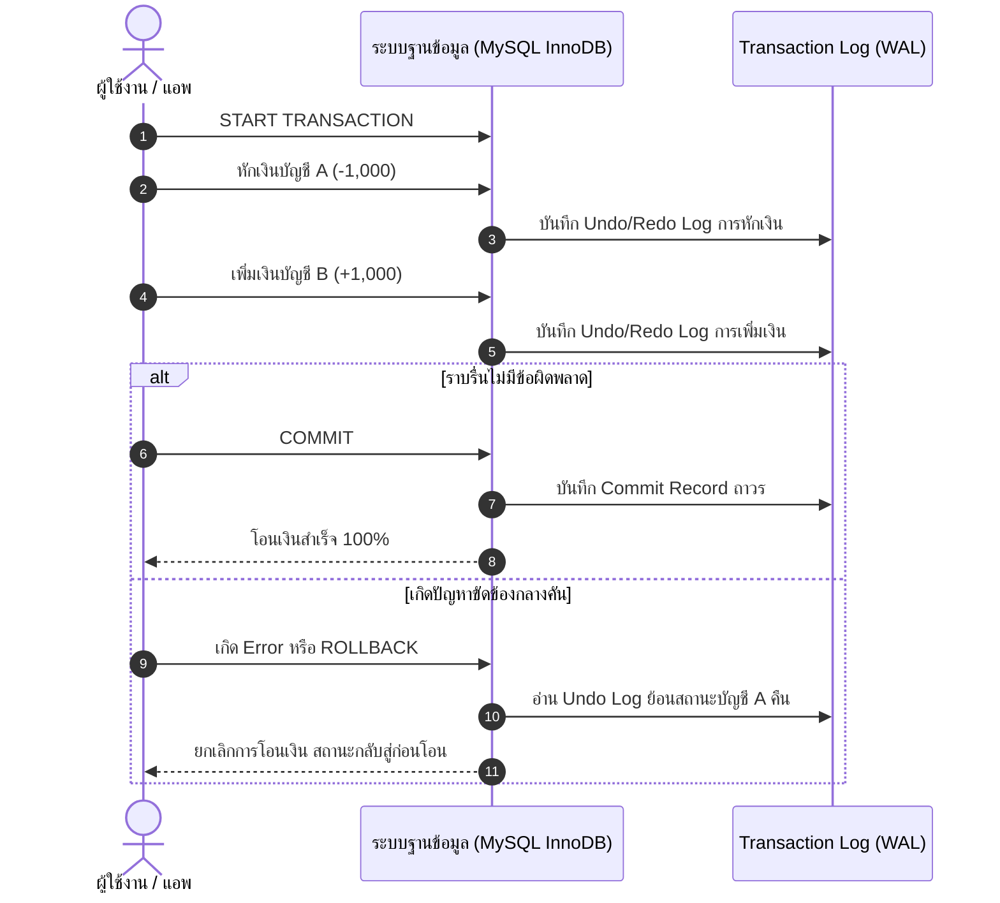

# ธุรกรรมในระบบฐานข้อมูลและคุณสมบัติ ACID (Database Transactions & ACID Properties)

<span class="material-symbols-outlined">arrow_back</span> กลับไปที่ [[Week10-MOC|MOC สัปดาห์ 10]]

## <span class="material-symbols-outlined">key</span> Keyword

- **Transaction (ทรานแซกชัน / ธุรกรรม)** — ชุดของคำสั่ง SQL ที่ทำงานร่วมกันเป็นหน่วยเดียว (Single Logical Unit of Work) โดยมีหลักการคือ "สำเร็จทั้งหมด หรือไม่สำเร็จเลย" (All-or-Nothing)
- **Atomicity (ความแบ่งแยกไม่ได้)** — ทุกคำสั่งในทรานแซกชันต้องสำเร็จครบถ้วน หากมีคำสั่งใดล้มเหลวแม้แต่คำสั่งเดียว ระบบต้องย้อนกลับ (Rollback) สู่จุดเริ่มต้นเสมือนไม่เคยมีอะไรเกิดขึ้น
- **Consistency (ความสอดคล้องถูกต้อง)** — การทำงานของทรานแซกชันต้องนำพาฐานข้อมูลจากสถานะที่ถูกต้องหนึ่ง ไปสู่อีกสถานะหนึ่งที่ถูกต้อง โดยไม่ละเมิดกฎเกณฑ์ (Integrity Constraints)
- **Isolation (ความเป็นอิสระจากกัน)** — ทรานแซกชันที่ทำงานพร้อมกันหลายตัว ต้องเสมือนทำงานแยกจากกันตามลำดับ โดยไม่ให้ผลลัพธ์ระหว่างทางมารบกวนกัน
- **Durability (ความคงทนถาวร)** — เมื่อทรานแซกชันได้รับการยืนยันผล (`COMMIT`) แล้ว ข้อมูลจะถูกบันทึกอย่างถาวร แม้ระบบจะไฟดับหรือเซิร์ฟเวอร์ล่มในวินาทีถัดมา
- **COMMIT** — คำสั่งยืนยันการเปลี่ยนแปลงข้อมูลในทรานแซกชันให้มีผลถาวรลงดิสก์
- **ROLLBACK** — คำสั่งยกเลิกการเปลี่ยนแปลงทั้งหมดในทรานแซกชัน และย้อนสถานะกลับไปยังจุดเริ่มต้น

## <span class="material-symbols-outlined">menu_book</span> Theory (เข้าใจง่าย)

### 1. ทำไมระบบต้องมี Transaction? (กรณีศึกษาการโอนเงิน)
สมมุติว่า นาย A ต้องการโอนเงิน 1,000 บาท ไปให้ นาย B:
1. `UPDATE Accounts SET Balance = Balance - 1000 WHERE AccountID = 'A';` (หักเงินนาย A)
2. *เกิดเหตุไฟดับ / เซิร์ฟเวอร์ล่มกลางคัน!*
3. `UPDATE Accounts SET Balance = Balance + 1000 WHERE AccountID = 'B';` (ยังไม่ทันได้ทำงาน)

**ผลลัพธ์หากไม่มี Transaction:** เงินของนาย A หายไป 1,000 บาท แต่นาย B ไม่ได้รับเงิน (เงินสูญหายอย่างไร้ร่องรอย)
**ผลลัพธ์เมื่อใช้ Transaction:** เมื่อเกิดข้อผิดพลาด ระบบจะสั่ง `ROLLBACK` คืนเงิน 1,000 บาทกลับเข้าบัญชีนาย A ทันที

---

### 2. ไวยากรณ์คำสั่งควบคุมธุรกรรมใน SQL

```sql
-- 1. เริ่มต้นธุรกรรม
START TRANSACTION;

-- 2. หักเงินบัญชีต้นทาง
UPDATE Accounts 
SET Balance = Balance - 1000 
WHERE AccountID = 'A' AND Balance >= 1000;

-- 3. เพิ่มเงินเข้าบัญชีปลายทาง
UPDATE Accounts 
SET Balance = Balance + 1000 
WHERE AccountID = 'B';

-- 4. ตรวจสอบว่าสำเร็จทั้งคู่หรือไม่ หากสำเร็จให้บันทึกถาวร
COMMIT;

-- หากเกิด Error ในขั้นตอนใดขั้นตอนหนึ่ง ให้สั่งยกเลิก
-- ROLLBACK;
```

---

### 3. เจาะลึก 4 เสาหลักของ ACID

1. **A - Atomicity:** จัดการผ่านกลไก **Undo Log** หากเกิดความล้มเหลว DBMS จะอ่าน Undo Log เพื่อแปลงค่าเดิมกลับคืนมา
2. **C - Consistency:** ควบคุมผ่านกฎของฐานข้อมูล เช่น NOT NULL, UNIQUE, CHECK, FOREIGN KEY หากทรานแซกชันทำให้ยอดเงินติดลบหรือ FK ผิด ระบบจะปฏิเสธการทำรายการ
3. **I - Isolation:** จัดการผ่านกลไก **Locks (Shared Lock, Exclusive Lock)** หรือ **MVCC (Multi-Version Concurrency Control)** เพื่อป้องกันไม่ให้ผู้ใช้อื่นมาอ่านข้อมูลระหว่างที่ยังไม่เสร็จ
4. **D - Durability:** จัดการผ่าน **Redo Log (Write-Ahead Logging - WAL)** ข้อมูลจะถูกเขียนลงดิสก์ล็อกก่อนที่แอปพลิเคชันจะได้รับคำยืนยัน `COMMIT`

> [!important] ข้อสังเกตในการใช้งาน MySQL
> คำสั่ง `START TRANSACTION` จะทำงานได้สมบูรณ์ก็ต่อเมื่อตารางนั้นใช้ Storage Engine ที่รองรับธุรกรรม เช่น **InnoDB** (ซึ่งเป็นค่าเริ่มต้นของ MySQL ตั้งแต่เวอร์ชัน 5.5 เป็นต้นมา) หากใช้เอนจินเก่าอย่าง **MyISAM** จะไม่รองรับ Transaction!

## <span class="material-symbols-outlined">schema</span> Diagram



**ตัวอย่าง:** แผนภาพลำดับการทำงาน (Sequence Diagram) ของธุรกรรมการโอนเงินธนาคาร แสดงเส้นทางการ `COMMIT` เมื่อสำเร็จ และการ `ROLLBACK` เมื่อเกิดข้อผิดพลาด (อ้างอิง Transaction Database สไลด์หน้า 1–8)

---
<span class="material-symbols-outlined">arrow_forward</span> ต่อไป: [[02_Transaction-Lifecycle-and-Concurrency-Control]]
