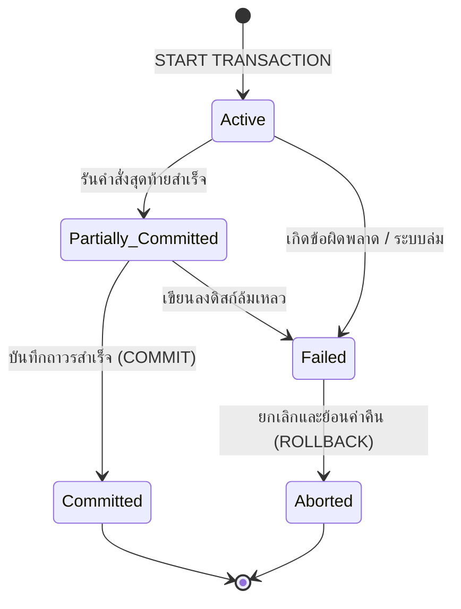

# วงจรชีวิตทรานแซกชันและการควบคุมภาวะพร้อมกัน (Transaction Lifecycle & Concurrency Control)

arrow_back กลับไปที่ [[Week10-MOC|MOC สัปดาห์ 10]] | ก่อนหน้า: [[01_Database-Transactions-and-ACID-Properties]]

## key Keyword

- **Transaction States** — สถานะทั้ง 5 ในวงจรชีวิตของทรานแซกชัน: Active, Partially Committed, Committed, Failed, Aborted
- **Dirty Read** — การที่ทรานแซกชันหนึ่งอ่านข้อมูลที่ถูกแก้ไขโดยอีกทรานแซกชันหนึ่ง แต่ทรานแซกชันนั้นดันสั่ง `ROLLBACK` ในเวลาต่อมา (ได้ข้อมูลปลอม/ข้อมูลขยะ)
- **Non-Repeatable Read** — การที่ทรานแซกชันหนึ่งอ่านข้อมูลแถวเดิม 2 ครั้ง แต่ได้ค่าไม่ตรงกัน เนื่องจากมีอีกทรานแซกชันหนึ่งเข้ามา `UPDATE` คั่นกลาง
- **Phantom Read** — การที่ทรานแซกชันหนึ่งรันคิวรีด้วยเงื่อนไขช่วงเดิม 2 ครั้ง แต่ได้จำนวนแถวเพิ่มขึ้นหรือลดลง เพราะมีอีกทรานแซกชันหนึ่ง `INSERT` แถวใหม่เข้ามา
- **Isolation Levels** — ระดับการแยกระหว่างทรานแซกชันตามมาตรฐาน ANSI SQL ทั้ง 4 ระดับ (Read Uncommitted, Read Committed, Repeatable Read, Serializable)

## menu_book Theory (เข้าใจง่าย)

### 1. วงจรชีวิตของทรานแซกชัน (Transaction States)

1. **Active (กำลังทำงาน):** สถานะเริ่มต้นเมื่อสั่งคำสั่ง SQL และกำลังดำเนินการอยู่
2. **Partially Committed (สำเร็จบางส่วน):** คำสั่งสุดท้ายทำงานเสร็จสิ้นแล้วในหน่วยความจำ แต่ยังไม่ได้เขียนบันทึกลงดิสก์ถาวร
3. **Failed (ล้มเหลว):** เกิดข้อผิดพลาด เช่น ละเมิดข้อจำกัด, ซอฟต์แวร์ล่ม, สัญญาณเน็ตหลุด
4. **Aborted (ถูกยกเลิก):** ระบบสั่ง `ROLLBACK` สำเร็จ และนำฐานข้อมูลกลับสู่สถานะก่อนเริ่มธุรกรรม
5. **Committed (ยืนยันผลสมบูรณ์):** ข้อมูลถูกบันทึกลงดิสก์อย่างถาวรแล้ว (จุดสิ้นสุดที่สมบูรณ์)

---

### 2. ปัญหาความขัดแย้งเมื่อทำงานพร้อมกัน (Concurrency Phenomena)

- **Dirty Read:** ทรานแซกชัน $T_1$ แก้ไขยอดเงินเป็น 5,000 $\rightarrow$ ทรานแซกชัน $T_2$ เข้ามาอ่านได้ 5,000 $\rightarrow$ ต่อมา $T_1$ เกิดข้อผิดพลาดจึง `ROLLBACK` กลับเป็น 1,000 $\rightarrow$ ค่า 5,000 ที่ $T_2$ อ่านไปจึงกลายเป็นค่าหลอกลวง
- **Non-Repeatable Read:** $T_1$ อ่านยอดเงินได้ 1,000 $\rightarrow$ $T_2$ แก้ไขเป็น 2,000 และ `COMMIT` $\rightarrow$ $T_1$ สั่งอ่านยอดเงินอีกครั้งได้ 2,000 (อ่านแถวเดิมได้ค่าเปลี่ยนไป)
- **Phantom Read:** $T_1$ นับจำนวนลูกค้าที่อายุ > 20 ได้ 10 คน $\rightarrow$ $T_2$ เพิ่มลูกค้าใหม่ที่อายุ 25 ปีเข้ามาแล้ว `COMMIT` $\rightarrow$ $T_1$ รันนับใหม่อีกครั้ง ได้ 11 คน (มีแถวผีโผล่ขึ้นมา)

---

### 3. ตารางระดับความปลอดภัยของ Isolation Levels

| Isolation Level | ป้องกัน Dirty Read | ป้องกัน Non-Repeatable Read | ป้องกัน Phantom Read | อัตราความเร็วในการทำงาน (Concurrency) |
| :--- | :---: | :---: | :---: | :--- |
| **Read Uncommitted** | $\times$ | $\times$ | $\times$ | เร็วที่สุด (ไม่มีการล็อก) |
| **Read Committed** | $\checkmark$ | $\times$ | $\times$ | ปานกลาง (ค่าเริ่มต้นของ Oracle, PostgreSQL) |
| **Repeatable Read** | $\checkmark$ | $\checkmark$ | $\times$ (หรือ $\checkmark$ ใน InnoDB) | สูงและปลอดภัย (**ค่าเริ่มต้นของ MySQL InnoDB**) |
| **Serializable** | $\checkmark$ | $\checkmark$ | $\checkmark$ | ปลอดภัยที่สุด แต่ช้าที่สุด (ล็อกทั้งช่วงข้อมูล) |

> [!tip] เคล็ดลับ
> ใน MySQL Storage Engine แบบ **InnoDB** สามารถป้องกันปัญหา **Phantom Read** ได้ตั้งแต่ระดับ `Repeatable Read` ผ่านกลไกที่เรียกว่า **Next-Key Locking** (การล็อกเรคคอร์ดร่วมกับการล็อกช่องว่างระหว่างเรคคอร์ด Gap Lock) โดยไม่ต้องปรับขึ้นไปถึงระดับ `Serializable`

## schema Diagram

**ตัวอย่าง:** แผนภาพสถานะ (UML State Machine Diagram) แสดง 5 สถานะของทรานแซกชันตามมาตรฐานทฤษฎีฐานข้อมูล (อ้างอิง Transaction Database สไลด์หน้า 9–20)

---
arrow_forward ต่อไป: [[03_NewSQL-Architecture-and-Modern-Distributed-Databases]]
