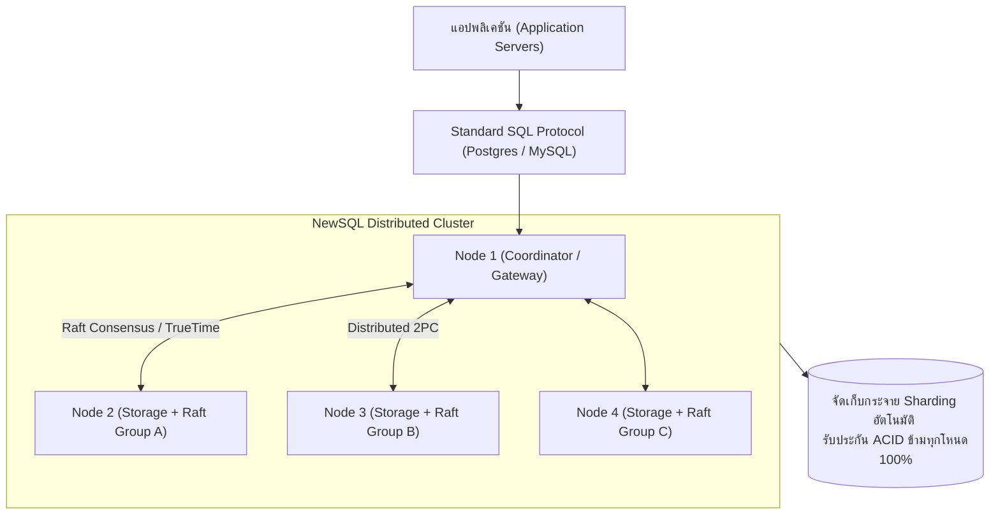

# สถาปัตยกรรม NewSQL และฐานข้อมูลแบบกระจายยุคใหม่ (NewSQL & Distributed Databases)

<span class="material-symbols-outlined">arrow_back</span> กลับไปที่ [[Week10-MOC|MOC สัปดาห์ 10]] | ก่อนหน้า: [[02_Transaction-Lifecycle-and-Concurrency-Control]]

## <span class="material-symbols-outlined">key</span> Keyword

- **NewSQL** — คำศัพท์ที่บัญญัติขึ้นในปี 2011 โดย Matthew Aslett เพื่ออธิบายระบบฐานข้อมูลรุ่นใหม่ที่คงไว้ซึ่งคุณสมบัติ ACID และภาษา SQL ของ RDBMS แต่สามารถขยายระบบแนวนอน (Scale-out) ได้เหมือน NoSQL
- **Distributed SQL (Distributed ACID)** — การรันคำสั่ง SQL และรักษาความเป็นธุรกรรม ACID ข้ามเครื่องเซิร์ฟเวอร์นับร้อยนับพันเครื่องที่กระจายอยู่ทั่วโลก
- **Consensus Protocol (Raft / Paxos)** — โพรโทคอลฉันทามติทางคณิตศาสตร์ที่ทำให้เครื่องคอมพิวเตอร์หลายเครื่องสามารถตกลงสถานะข้อมูลเดียวกันได้อย่างถูกต้อง แม้บางเครื่องจะล่มหรือเน็ตหลุด
- **Automated Sharding** — การแบ่งซอยและจัดสรรก้อนข้อมูลกระจายไปยังเซิร์ฟเวอร์ในคลัสเตอร์โดยอัตโนมัติ โดยที่ผู้พัฒนาโปรแกรมไม่ต้องเขียนโค้ดจัดการเอง
- **In-Memory Computing** — การนำข้อมูลทั้งหมดหรือส่วนใหญ่ขึ้นมาประมวลผลบนหน่วยความจำ RAM เพื่อลดคอขวด Disk I/O

## <span class="material-symbols-outlined">menu_book</span> Theory (เข้าใจง่าย)

### 1. วิวัฒนาการของระบบจัดการฐานข้อมูล (The Database Evolution)

```text
1. Traditional SQL (RDBMS) ──► จุดเด่น: ACID สูงมาก, Relational
                               จุดด้อย: ขยายระบบแนวนอน (Scale-out) ไม่ได้, Single Bottleneck
         │
         ▼
2. NoSQL Generation         ──► จุดเด่น: ขยายระบบง่าย (Scale-out), Schema ยืดหยุ่น
                               จุดด้อย: ไม่มี ACID, ข้อมูลไม่สอดคล้องชั่วขณะ (Eventual Consistency)
         │
         ▼
3. NewSQL Era               ──► รวมจุดเด่นทั้งสองยุค:
                               - ใช้ SQL เหมือนเดิม
                               - รับประกัน ACID 100%
                               - ขยายระบบแนวนอนได้ไม่จำกัด (Scale-out)
```

---

### 2. เสาหลัก 4 ด้านของสถาปัตยกรรม NewSQL (The 4 Architectural Pillars)

1. **In-Memory Processing:** สถาปัตยกรรมรุ่นใหม่ถูกออกแบบให้ทำงานบน RAM และแคชระดับ CPU โดยตรง ทำให้ประมวลผลคำสั่งธุรกรรมได้หลายแสนถึงหลายล้าน Transactions ต่อวินาที (TPS)
2. **Consensus Protocols (Raft & Paxos):** ใช้ขั้นตอนวิธีฉันทามติ เช่น Raft ใน CockroachDB/TiDB และ Paxos ใน Google Spanner เมื่อมีการเขียนข้อมูล ระบบจะกระจายไปยังโหนดต่าง ๆ และรอการตอบรับจากเสียงส่วนใหญ่ (Quorum) เพื่อรับประกันว่าข้อมูลจะไม่สูญหาย
3. **Distributed Transaction Management (2PC / TrueTime):** 
   - ระบบ NewSQL ใช้กลไก **Two-Phase Commit (2PC)** แบบปรับปรุงประสิทธิภาพ
   - Google Spanner มีการใช้นาฬิกาอะตอมและดาวเทียม GPS (**Google TrueTime API**) เพื่อกำหนดลำดับเวลาสัมบูรณ์ (Monotonic Timestamp) ข้ามศูนย์ข้อมูลทั่วโลก
4. **Transparent Auto-Sharding & Rebalancing:** เมื่อข้อมูลเพิ่มขึ้นหรือมีเซิร์ฟเวอร์ใหม่เพิ่มเข้ามาในคลัสเตอร์ ระบบจะแบ่งช่วงคีย์ (Range-based Partitioning) และโยกย้ายข้อมูลไปให้อัตโนมัติ โดยที่โปรแกรมเมอร์ยังคงยิงคำสั่ง SQL เดียวกัน

---

### 3. ตารางเปรียบเทียบเชิงลึก: SQL vs NoSQL vs NewSQL

| มิติการประเมิน | Traditional SQL (เช่น MySQL) | NoSQL (เช่น MongoDB) | NewSQL (เช่น Google Spanner, CockroachDB) |
| :--- | :--- | :--- | :--- |
| **Data Model** | Relational Tables | Documents, Key-Value | **Relational Tables** |
| **Query Language** | SQL | Proprietary API / JSON | **Full SQL Support** |
| **ACID Guarantee** | $\checkmark$ รองรับ (ในเครื่องเดียว) | $\times$ BASE / จำกัดเฉพาะ Document | **$\checkmark$ รองรับเต็มรูปแบบข้ามคลัสเตอร์** |
| **Scalability** | Vertical (Scale-up) | Horizontal (Scale-out) | **Horizontal (Scale-out ไม่จำกัด)** |
| **Consistency** | Strong Consistency | Eventual Consistency | **Strict Serializable Consistency** |
| **เหมาะกับงาน** | ระบบงานทั่วไป, อีคอมเมิร์ซ | ข้อมูลไร้โครงสร้าง, Big Data Log | **ระบบธนาคารระดับโลก, โครงข่ายคลาวด์ข้ามทวีป** |

---

### 4. ตัวอย่างระบบ NewSQL ที่ได้รับความนิยมในปัจจุบัน
- **Google Cloud Spanner:** ฐานข้อมูลระดับ NewSQL ตัวแรกของโลกที่รองรับ Globally Distributed ACID
- **CockroachDB:** โอเพ่นซอร์ส NewSQL ที่จำลองการทำงานเหมือน PostgreSQL แต่ทำงานเป็นคลัสเตอร์ด้วย Raft Consensus
- **TiDB (PingCAP):** ฐานข้อมูล NewSQL ที่เข้ากันได้กับ MySQL Protocol (MySQL-compatible) และรองรับการประมวลผลทั้งแบบธุรกรรม (HTAP)
- **VoltDB:** มุ่งเน้นความเร็วระดับ Real-time Streaming Analytics บน In-Memory Engine

> [!tip] เคล็ดลับ
> NewSQL ไม่ได้มาแทนที่ NoSQL ในทุกมิติ หากข้อมูลของคุณเป็นไฟล์วิดีโอ รูปภาพ หรือ Log มหาศาลที่ไม่มีความสัมพันธ์กัน การใช้ NoSQL หรือ Object Storage ยังคงคุ้มค่าและประหยัดกว่า แต่ถ้าเป็น **ข้อมูลธุรกรรมที่ต้องการความถูกต้องแม่นยำสูง (เช่น เงิน, สต็อก, สิทธิบัตร) แต่มีปริมาณมหาศาลเกินเครื่องเดียวรับไหว** NewSQL คือคำตอบที่ดีที่สุด

## <span class="material-symbols-outlined">schema</span> Diagram



**ตัวอย่าง:** แผนภาพสถาปัตยกรรมของ NewSQL Cluster แสดงการรับคำสั่งผ่านภาษา SQL มาตรฐาน กระจายการประมวลผลผ่าน Consensus Protocol (Raft) และการประสานธุรกรรมแบบกระจาย (อ้างอิง NewSQL สไลด์หน้า 1–20)

---
<span class="material-symbols-outlined">arrow_forward</span> กลับไปที่: [[Week10-MOC|MOC สัปดาห์ 10]]
