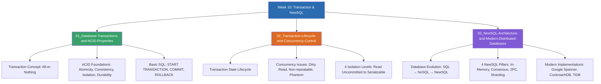

# Week 10 — Database Transactions, ACID & NewSQL Architecture (MOC)

arrow_back สัปดาห์ก่อนหน้า: [[Week09-MOC|MOC สัปดาห์ 9]]

## check_circle เช็คลิสต์ก่อนเข้าเรียน

- [ ] ทำความเข้าใจนิยามของ Transaction และหลักการ All-or-Nothing — ดู [[01_Database-Transactions-and-ACID-Properties]]
- [ ] ศึกษาคุณสมบัติ ACID ทั้ง 4 ด้าน และคำสั่ง `START TRANSACTION`, `COMMIT`, `ROLLBACK` — ดู [[01_Database-Transactions-and-ACID-Properties]]
- [ ] วิเคราะห์ปัญหาภาวะพร้อมกัน (Concurrency Anomalies) และระดับ Isolation Levels — ดู [[02_Transaction-Lifecycle-and-Concurrency-Control]]
- [ ] ศึกษาการถือกำเนิดของ NewSQL ที่รวมข้อดีของ SQL (ACID) และ NoSQL (Scale-out) เข้าด้วยกัน — ดู [[03_NewSQL-Architecture-and-Modern-Distributed-Databases]]

## assignment ภาพรวมสัปดาห์ 10 (สรุปย่อ)

สัปดาห์ที่ 10 เป็นการปิดท้ายหลักสูตรอย่างสมบูรณ์แบบด้วยสองหัวข้อระดับสูงของระบบฐานข้อมูล เริ่มต้นจากกลไกการรักษาความถูกต้องของข้อมูลผ่าน **Database Transaction** และคุณสมบัติ **ACID (Atomicity, Consistency, Isolation, Durability)** การควบคุมการทำงานพร้อมกัน (Concurrency Control) การป้องกัน Dirty Read และการใช้คำสั่ง `COMMIT` / `ROLLBACK` จากนั้นขยายภาพสู่สถาปัตยกรรมยุคใหม่ **NewSQL** ซึ่งผสานพลังของ SQL แบบดั้งเดิม (คงไว้ซึ่ง ACID และ relational schema) เข้ากับขีดความสามารถในการขยายระบบแนวนอน (Horizontal Scalability) ของ NoSQL ผ่านเทคโนโลยีอย่าง Raft/Paxos consensus, In-memory processing, และ Distributed Transaction Management (เช่น Google Spanner, CockroachDB, TiDB)

## map แผนที่หัวข้อสัปดาห์ 10

## collections_bookmark โน้ตรายหัวข้อ

| หัวข้อ | เนื้อหาหลัก | หน้าสไลด์ / แหล่งอ้างอิง |
| --- | --- | --- |
| [[01_Database-Transactions-and-ACID-Properties]] | นิยามทรานแซกชัน, ตัวอย่างโอนเงินธนาคาร, คุณสมบัติ ACID 4 ด้าน, คำสั่ง `COMMIT` และ `ROLLBACK` | Transaction Database น. 1–8 |
| [[02_Transaction-Lifecycle-and-Concurrency-Control]] | วงจรชีวิตของ Transaction (Active, Partially Committed, Failed, Aborted), Concurrency Problems, Isolation Levels | Transaction Database น. 9–20 |
| [[03_NewSQL-Architecture-and-Modern-Distributed-Databases]] | ประวัติและจุดกำเนิด NewSQL (Matthew Aslett 2011), เสาหลัก 4 ด้าน, เปรียบเทียบ SQL vs NoSQL vs NewSQL | NewSQL น. 1–20 |

> [!tip] บทสรุปวิวัฒนาการของระบบฐานข้อมูล (The Ultimate Takeaway)
> - **SQL (RDBMS):** ACID สมบูรณ์แบบ, เหมาะกับระบบขนาดเล็ก-กลาง (Scale-up)
> - **NoSQL:** ขยายตัวแนวนอนง่าย (Scale-out), ยืดหยุ่นสูง แต่สละความเป็น ACID
> - **NewSQL:** ใช้ SQL + รับประกัน ACID 100% + ขยายตัวแนวนอนกระจายทั่วโลกได้แบบ NoSQL (The Best of Both Worlds)

---
arrow_forward ย้อนกลับไปหน้าหลัก: [[README|หน้าแรกของรายวิชา 1322203]]
